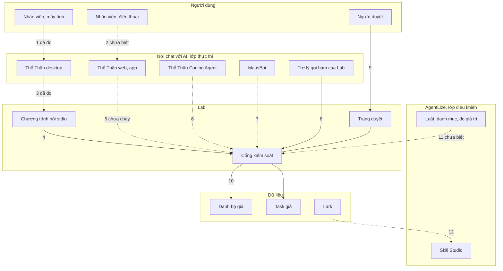

# Bản đồ hệ thống: Appota, AgentLize, Thổ Thần, MausBot và Lab

Ngày: 2026-11-19. Trạng thái: tổng hợp từ tài liệu và phép đo đã có, chưa có phép đo mới; chờ Kevin xác nhận vị trí của Lab.

Mọi người và dữ liệu trong ví dụ đều là giả lập.

## Đọc nhanh

- Appota muốn nhân viên nhờ AI làm việc trên dữ liệu công ty.
  AgentLize đặt luật và giữ danh mục công cụ, Thổ Thần là nơi nhân viên chat với AI, các phòng ban giữ dữ liệu.
- Lab của ta là cổng an toàn giữa AI và dữ liệu: biết ai đang hỏi, chặn việc vượt quyền, chờ người duyệt, không ghi hai lần.
  MausBot là một ứng dụng AI bên ngoài, có thể gọi cùng cổng nếu được cắm vào.
- Đã đo được: Thổ Thần trên máy tính gọi được công cụ của Lab, nhưng không cho biết ai đang hỏi và không hỏi lại trước khi ghi.
- Chưa biết, và quan trọng nhất: Thổ Thần có chuyển danh tính người dùng sang cổng không, và nhân viên thật dùng Thổ Thần trên điện thoại hay máy tính.
  Bản thử của Lab hiện chỉ chạy trên máy tính.
- Tuần này: gửi Kevin ba câu hỏi, tự làm các phép kiểm nhỏ, ghi các quyết định thiết kế, và dựng bản thử chỉ đọc chạy trong Thổ Thần.

## 1. Câu hỏi và nguồn

Câu hỏi: năm mảnh ghép (Appota, AgentLize, Thổ Thần, MausBot và Lab) nối với nhau thế nào để thành một hệ thống, phần nào đã chạy thật, phần nào là kế hoạch, và Lab đứng ở đâu.

Tài liệu này không có nguồn mới.
Nó ghép các nguồn đã có, và gắn mỗi mối nối với nguồn mạnh nhất đứng sau nó:

| Mức | Nghĩa | Nguồn trong repo |
| --- | --- | --- |
| Đã đo | Có log và ảnh, chạy lại được | [Kịch bản đo Thổ Thần](../research/tho-than-mcp-probe.md), ngày 2026-11-16; thử Thổ Thần web ngày 2026-11-17 ([khảo sát Thổ Thần, mục 2.1](../../rd/research/tho-than-platform.md#21-thổ-thần-gọi-công-cụ-của-lab-thế-nào-và-hệ-quả)) |
| Theo tài liệu công khai | Đọc từ mã nguồn hay tài liệu công bố, chưa chạy | [Khảo sát Thổ Thần](../../rd/research/tho-than-platform.md), [MausBot](mausbot.md) |
| Kế hoạch | Có trong bản nháp nội bộ hay trong spec của Lab, chưa thấy chạy | [Slide hệ sinh thái](../../docs/context/appota-ai-ecosystem.md), [PRD Skill Studio](../../docs/context/prd-agentlize-skill-studio.docx), [spec bản thử](mvp-spec.md) |
| Chưa biết | Không nguồn nào nói | - |

Slide hệ sinh thái là bản chép từ ảnh chụp và chưa được Kevin xác nhận.
PRD Skill Studio là bản nháp; chính nó ghi bảng phân quyền "cần xác nhận lại với team".

**Kết luận:** mỗi mối nối trên bản đồ mang đúng một trong bốn mức; không mối nối nào chỉ dựa vào slide hay PRD được trình bày như điều đã có.

## 2. Năm mảnh ghép

| Mảnh | Vai trò | Phần chạy thật mà Lab thấy được | Mức |
| --- | --- | --- | --- |
| Appota và các phòng ban | Sở hữu dữ liệu và hệ thống nghiệp vụ (nhân sự, Lark, CRM, ERP), quyết định chia dữ liệu nào cho AI. Lark giữ danh bạ, phòng ban và quản lý trực tiếp. | Lab không chạm dữ liệu thật; dùng danh bạ và danh sách task giả lập. | Kế hoạch |
| AgentLize | Lớp điều khiển (control plane): nơi đặt luật, giữ danh mục công cụ và Skill, duyệt tài sản AI và đo giá trị. Người dùng gặp nó qua Skill Studio, một tab trong Thổ Thần. AgentLize cũng là đơn vị chủ trì chương trình thực tập. | Chưa thấy phần mềm nào chạy. PRD Skill Studio ghi bản thử của họ chỉ có đăng nhập giả lập chạy trên máy. | Kế hoạch |
| Thổ Thần AI | Lớp thực thi (execution plane): nơi AI thật sự chạy, nhân viên chat, AI gọi mô hình và gọi công cụ. Gồm bản web, bản desktop và Thổ Thần Coding Agent trong VS Code. | Bản web là LobeHub 2.1.56 đổi nhãn. Bản desktop 2.1.56 gọi được công cụ của Lab qua stdio (Thổ Thần tự mở một chương trình trên máy người dùng và nói chuyện với nó). | Đã đo (desktop), theo tài liệu (web, Coding Agent) |
| MausBot | Ứng dụng agent mã nguồn mở của một công ty bên ngoài, không thuộc Appota. Đứng cùng lớp với Thổ Thần desktop, và tự mang một lớp điều khiển nhỏ trùng vai AgentLize. | Bản 0.1.165 cài trên máy Lab, chưa chạy phép kiểm nào. | Theo tài liệu |
| Lab (bản thử AI Platform) | Cổng kiểm soát (gateway): một cửa duy nhất mà mọi lệnh của AI phải đi qua. Cổng đổi khoá thành người, kiểm luật, che trường, giữ đề xuất chờ duyệt, chống ghi trùng và ghi vết. Hai cửa vào mỏng: chương trình nối MCP và trợ lý gọi hàm. | Chưa có code; mới có chương trình đo `archive/research/mcp-probe`. | Kế hoạch |

Kdata giữ máy chủ, khoá bí mật và mạng.
Bản thử chạy trên máy cá nhân với dữ liệu giả, nên chưa cần Kdata.

**Kết luận:** chỉ Thổ Thần desktop là phần mềm đang chạy mà Lab đã đo; AgentLize hiện là slide và PRD nháp, nên mọi mối nối với AgentLize là giả thuyết.

## 3. Bản đồ mối nối

| # | Mối nối | Mức | Điều đã biết | Còn thiếu |
| --- | --- | --- | --- | --- |
| 1 | Nhân viên chat trong Thổ Thần desktop | Đã đo | Lab dùng một tài khoản và một máy | Tài khoản thứ hai |
| 2 | Nhân viên dùng Thổ Thần trên điện thoại | Chưa biết | PRD Skill Studio viết "qua Thổ Thần AI trên điện thoại" và thiết kế cho điện thoại trước; mã bản web có dấu vết app điện thoại AppotaHub | Người dùng thật dùng thiết bị nào; trên điện thoại có cắm được công cụ không |
| 3 | Thổ Thần desktop gọi chương trình nối của Lab | Đã đo | Trong chat chỉ stdio chạy; khoá riêng tới được server; không có danh tính, không hỏi duyệt, cắt sau 60 giây, không tự gọi lại | Chế độ Allow List và Bypass Security chưa thử |
| 4 | Chương trình nối chuyển lời gọi sang cổng | Kế hoạch | HTTP kèm khoá riêng, theo spec | Thời gian thêm do mở tiến trình mới cho mỗi lần gọi |
| 5 | Thổ Thần web gọi cổng qua địa chỉ web (`/mcp`) | Chưa chạy | Bản web chỉ nhận địa chỉ web; nối tới `localhost` báo `fetch failed`, server không nhận gì | Có địa chỉ công khai thì gọi được không, lời gọi đi từ đâu, mang header gì |
| 6 | Thổ Thần Coding Agent gọi cổng | Theo tài liệu | Trang Marketplace ghi khai báo được MCP server | Chưa đo năm câu P1-P5 |
| 7 | MausBot gọi cổng | Theo tài liệu | Nhận server stdio và server qua địa chỉ web; bản nhóm có chế độ khoá "từng người" | Chưa chạy phép kiểm nào |
| 8 | Trợ lý gọi hàm của Lab gọi cổng | Kế hoạch | Cùng API `POST /v1/tools/<tên>` với chương trình nối | Chưa dựng |
| 9 | Người duyệt bấm trên trang của cổng | Kế hoạch | Link trong kết quả công cụ bấm được và mở trình duyệt (đã đo) | AI của Thổ Thần có giữ nguyên link khi tóm tắt không |
| 10 | Cổng đọc và ghi danh bạ giả, task giả | Kế hoạch | Theo spec | Chưa dựng |
| 11 | AgentLize trao luật cho cổng và nhận vết từ cổng | Chưa biết | Slide vẽ mũi tên "chính sách và phân quyền" đi xuống và "telemetry và kết quả" đi lên | Có API không; vết cần những trường nào |
| 12 | Lark cấp danh bạ, phòng ban và thẻ duyệt cho AgentLize | Kế hoạch | PRD Skill Studio: đồng bộ Lark theo sự kiện, duyệt Skill trên điện thoại qua thẻ Lark | Lab có cần đưa lời duyệt từng lệnh ghi lên thẻ Lark không |

**Kết luận:** phần đã đo là một đường hẹp: máy tính, stdio, khoá riêng.
Mọi đường dẫn tới điện thoại, tới Thổ Thần web và tới AgentLize đều chưa có bằng chứng.

## 4. Lab đứng ở đâu

Ví dụ chị Hoa gõ trong Thổ Thần "chuyển T-12 sang anh Minh, hạn thứ Sáu":

| Bước | Ai lo | Câu hỏi được trả lời |
| --- | --- | --- |
| 1 | Thổ Thần | Chị Hoa đã đăng nhập chưa |
| 2 | Cổng của Lab | Lệnh này (T-12, sang anh Minh, hạn thứ Sáu) có hợp luật không, có cần trưởng nhóm duyệt không, đã ghi lần nào chưa |
| 3 | Hệ thống task | Ghi đúng một lần |
| 4 | Cổng, rồi AgentLize | Ai yêu cầu, ai duyệt, đổi gì, tốn bao nhiêu |

Cổng trả lời "người này, lệnh này, với tham số này, vào lúc này, có được chạy không".
Cổng là điểm thực thi luật (policy enforcement point): nơi luật được áp vào từng lệnh ngay trước khi lệnh chạm dữ liệu.
Quyết định về quyền phải nằm ở cổng, vì ai có khoá cũng gọi thẳng được cổng mà không qua Thổ Thần, và các trợ lý khác không đi qua lớp kiểm nào của Thổ Thần.

Lời duyệt cũng có hai mức.
PRD Skill Studio duyệt một Skill trước khi cả phòng dùng, và duyệt lần xin quyền đầu tiên, trên thẻ Lark.
Lab duyệt từng lệnh ghi rủi ro, như chuyển 30 task, trên trang của cổng.

Danh tính là chỗ cổng phụ thuộc vào nơi chat.
Hôm nay cổng nhận người qua khoá riêng, vì Thổ Thần không chuyển danh tính mà cổng kiểm chứng được ([khảo sát Thổ Thần, mục 2.1](../../rd/research/tho-than-platform.md#21-thổ-thần-gọi-công-cụ-của-lab-thế-nào-và-hệ-quả)).
Về lâu dài, nơi chat nên gửi danh tính đã xác minh: token đăng nhập công ty theo chuẩn ủy quyền của MCP, hoặc token ngắn hạn do máy chủ Thổ Thần ký.
Vì vậy phần "đổi khoá thành người" trong cổng phải là một module thay được, không rải khắp code.

**Kết luận:** Lab là lớp kiểm từng lệnh ở phía hệ thống nghiệp vụ, dùng được với mọi nơi chat, đúng như [PRD của Lab, mục 2.3](../../rd/problem/prd-ai-platform.md#23-vị-trí-trong-hệ-sinh-thái-ai-của-appota) đã đặt.
ADR về danh tính phải ghi rõ khoá riêng là cách tạm.

## 5. Chỗ các nguồn nói khác nhau

1. **Danh tính.** PRD Skill Studio coi như Thổ Thần đã biết người dùng (đăng nhập bằng tài khoản Appota).
   Phép đo cho thấy server công cụ không nhận được gì về người dùng.
   Hai điều cùng đúng khi Thổ Thần chỉ dùng danh tính bên trong phiên đăng nhập và không chuyển nó sang server công cụ.
2. **Thiết bị.** PRD Skill Studio thiết kế cho điện thoại trước; bản thử của Lab chỉ chạy trên Thổ Thần desktop, vì trong chat chỉ stdio chạy.
   Điện thoại không tự mở được một chương trình trên máy.
   Nếu người dùng thật ở trên điện thoại hay web, đường thật của Lab là cổng có địa chỉ công khai (`/mcp`), và câu danh tính càng gấp.
3. **Quy mô.** Slide ghi "400+" nhân sự, PRD Skill Studio ghi "khoảng 1.000" ở năm công ty con.
   Con số không đổi thiết kế, nhưng không trích con số nào khi chưa hỏi.

**Kết luận:** chỗ lệch 1 và 2 quyết định Lab đang dựng đúng đường hay chỉ đúng trên máy tính; cả hai vào danh sách hỏi Kevin tuần này.

## 6. Điều chưa biết và cách kiểm

### 6.1. Chỉ người trong công ty trả lời được

Ba câu, xếp theo mức làm đổi thiết kế:

| Mã | Câu hỏi | Câu trả lời đổi gì ở Lab | Hỏi ai |
| --- | --- | --- | --- |
| U1 (thiết bị) | Nhân viên thật dùng Thổ Thần trên điện thoại, web hay desktop? | Điện thoại hay web: từ mốc 2 dời trọng tâm sang `/mcp` và địa chỉ công khai. Desktop: giữ stdio. | Kevin |
| U2 (danh tính) | Thổ Thần có kế hoạch chuyển danh tính người dùng sang server công cụ không, ví dụ bằng đăng nhập ủy quyền (OAuth)? | Có: module danh tính thêm cách đó, phần còn lại của cổng giữ nguyên. Không: khoá riêng là cách chính, cần cách cấp và thu hồi khoá tử tế. | Kevin, đội Thổ Thần |
| U3 (địa chỉ công khai) | Lab có được mở một địa chỉ HTTPS công khai tạm thời để thử Thổ Thần web không? | Có: chạy V2 ở mục 6.2. Không: đường web chỉ kiểm bằng phép thử tự động. | Kevin |

U1, U2 và U3 đã có trong [spec bản thử, mục 9](mvp-spec.md#9-phụ-thuộc-và-rủi-ro).
Ba câu nhỏ hơn hỏi sau: slide là đích hay hiện trạng, đo giá trị cần trường nào trong vết, Lab có cần đưa lời duyệt lên thẻ Lark không.

### 6.2. Lab tự kiểm được

| Mã | Phép kiểm | Cách làm | Thời gian | Trả lời phần nào |
| --- | --- | --- | --- | --- |
| V1 (mã LobeHub) | LobeHub 2.1.56 gửi gì sang server công cụ, có OAuth và bước duyệt công cụ không | Đọc mã phần gọi MCP của LobeHub đúng phiên bản 2.1.56: header, `_meta`, OAuth, các chế độ Auto Approve, Manual, Allow List | 2 giờ | Một phần U2: Thổ Thần ẩn tính năng có sẵn, hay LobeHub không có |
| V2 (Thổ Thần web) | Thổ Thần web gọi được cổng qua địa chỉ công khai không | Chạy probe sau một đường hầm HTTPS, cắm vào bản web, gọi `whoami` và `slow` | 1 giờ, sau khi Kevin cho phép | Mối nối 5, U1 |
| V3 (Coding Agent) | Thổ Thần Coding Agent có làm nơi gọi thứ hai được không | Cắm probe vào extension VS Code, chạy rút gọn P1-P5 | 1 giờ | Mối nối 6 |
| V4 (MausBot) | MausBot gọi được bộ công cụ và mang được khoá riêng không | Cắm probe vào MausBot, gọi `whoami` với hai khoá | 2 giờ | Mối nối 7 |
| V5 (chế độ duyệt) | Allow List và Bypass Security của Thổ Thần desktop có đổi gì với lệnh ghi không | Lặp phép đo P3 với hai chế độ chưa thử | 30 phút | Mối nối 3 |
| V6 (định dạng Skill) | Skill Store của Thổ Thần có nhận Skill theo chuẩn `SKILL.md` không | Nhập một Skill giả theo chuẩn Agent Skills | 30 phút | Lab và Skill Studio dùng chung được Skill không |
| V7 (điện thoại) | App điện thoại có chỗ cắm công cụ không | Mở app AppotaHub nếu cài được; nếu không, mở bản web trên trình duyệt điện thoại | 30 phút | Mối nối 2, U1 |

V3 đáng làm trước V4.
Nếu Coding Agent chạy được, "agent thứ hai dùng lại công cụ" được chứng minh trên một sản phẩm của chính Appota, có giá trị hơn với người review nội bộ.

### 6.3. Bản thử tự trả lời

- AI của Thổ Thần có giữ link duyệt khi tóm tắt kết quả không (mốc 1 và 2 của [spec, mục 5.2](mvp-spec.md#52-điểm-dừng)).
- Mở tiến trình mới cho mỗi lần gọi làm chậm thêm bao nhiêu (M1, thời gian).
- Sập giữa lúc chuyển 30 task thì chạy tiếp có đủ và không trùng không (Q1, mốc 3).

**Kết luận:** ba câu hỏi Kevin gửi một lần, ngay hôm nay.
Bảy phép kiểm tự làm tốn khoảng bảy giờ rưỡi; V1, V3, V5, V6 và V7 làm được ngay mà không chờ ai.

## 7. Hướng đi tuần này

Tuần 2 chạy từ 16/11 tới 22/11; hôm nay là thứ Ba 17/11.
Kế hoạch tuần 2 có năm việc; ba việc nghiên cứu đã xong, còn ADR và bản thử.

| Ngày | Việc | Xong khi |
| --- | --- | --- |
| Thứ Ba 17/11 | Gửi Kevin ba câu ở 6.1 cùng ba giới hạn của Thổ Thần; chạy V1, gồm cả lời gọi mô hình | Tin nhắn đã gửi; kết quả V1 ghi vào [khảo sát Thổ Thần](../../rd/research/tho-than-platform.md) |
| Thứ Tư 18/11 | Viết năm ADR ở [spec, mục 6](mvp-spec.md#6-kiến-trúc-tóm-tắt), mỗi ADR có mục "xem lại khi" gắn với U1-U3; chạy V5 và V6 | Có `docs/adr/adr-0001-<slug>.md` tới `adr-0005-<slug>.md` |
| Thứ Năm 19/11 và thứ Sáu 20/11 | Mốc 1: danh bạ giả, cổng đổi khoá thành người, `find_employee` chỉ trả trường đã khai, chương trình nối stdio, vết; chạy kịch bản D (tra cứu có lọc) trong Thổ Thần | Kịch bản D có ảnh và log; phép thử SR3 (phạm vi quyền) đạt bằng một lệnh |
| Thứ Bảy 21/11 | V3 và V7; còn thời gian thì V4; cập nhật tổng hợp phát hiện và viết báo cáo tuần | Báo cáo tuần 2 gửi vào nhóm Lark |

Mốc 2 (ghi một task) làm tiếp nếu mốc 1 xong sớm; nếu không, nó mở đầu tuần 3.

Khi Kevin trả lời, Lab đổi hướng theo bảng dưới:

| Kevin trả lời | Lab làm |
| --- | --- |
| Người dùng thật ở điện thoại hay web | Mốc 2 làm qua `/mcp`; xin địa chỉ công khai; chạy V2; đo thêm cách cổng đóng vai mô hình AI ([khảo sát Thổ Thần, mục 6.3](../../rd/research/tho-than-platform.md#63-lời-gọi-model-có-danh-tính-nhưng-trong-body)) |
| Thổ Thần sẽ chuyển danh tính | Module danh tính thêm cách thứ hai; khoá riêng giữ cho MausBot và trợ lý gọi hàm |
| Chưa trả lời | Không chờ: mốc 1 và mốc 2 có ích với mọi câu trả lời |

**Kết luận:** tuần này không việc nào phải chờ Kevin.
Câu hỏi đi sớm, quyết định ghi kèm điều kiện xem lại, và mốc 1 có ích dù câu trả lời ra sao.
