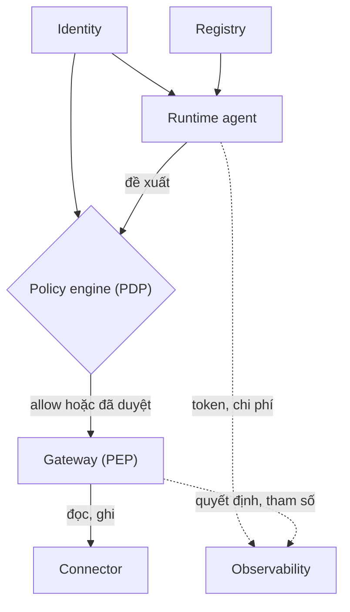

# Bước 0 - Vấn đề, mô hình hệ thống và yêu cầu

**Người:** Phạm Bách Hiệp. **Track:** 01 - AI Platform & MCP. **Mentor:** Kevin.  
**Vị trí:** bước 0, trước bước 01 Explore của khung bảy bước.  
**Trạng thái:** đã review ngày 11.11.2026. Phần 2 viết lại ngày 13.11.2026 theo cách cắt bảy thành phần, chờ review lại phần đã sửa; Phần 1 và Phần 3 giữ nguyên.

Khung R&D của chương trình có bảy bước, từ 01 Explore tới 07 Package.
Mục tiêu của file này không nằm trong bảy bước đó: nó chốt vấn đề, mô hình hệ thống và yêu cầu trước khi bước 01 bắt đầu.
Vì vậy file được đánh số bước 0 và không thay thế bước nào.

## 0. Tóm tắt

| Việc                                                                                                      | Phần    |
| --------------------------------------------------------------------------------------------------------- | ------- |
| Xác định vấn đề: một thay đổi nghiệp vụ phải trả lời được 5 câu hỏi, và hiện chưa câu nào trả lời được    | 1.1     |
| Xác định người dùng: 5 vai U1-U5 đi qua một thay đổi, tính cả agent thứ hai không phải người              | 1.2     |
| Chia nhỏ vấn đề: 5 nhóm con, 6 mã I1, A1, A2, S1, E1, R1, mỗi mã một ví dụ sai và một điều kiện đúng      | 1.3-1.8 |
| Dựng mô hình hệ thống: bảy thành phần, mỗi thành phần sở hữu đúng một quyết định, đọc như giả thuyết      | 2       |
| Xác định yêu cầu bắt buộc: 8 yêu cầu SR1-SR8, mỗi yêu cầu có tiêu chí kiểm, không gắn với framework nào   | 3.1     |
| Xác định tiêu chí đánh giá: 6 chỉ số M1-M6, tách khỏi điều kiện đúng/sai, ngưỡng chốt sau khi có baseline | 3.2     |
| Chưa làm: chưa khảo sát năm mô hình, chưa chọn baseline, chưa có ADR, chưa build, chưa có số đo nào       | -       |

Bước tiếp theo là 01 Explore: khảo sát 5 mô hình API/Function Calling, MCP, Workflow Engine, Agent Orchestration, Event-driven Integration.
Mỗi mô hình ghi nguồn gốc, phần nào của SR1-SR8 nó cung cấp sẵn, phần nào phải tự dựng, cùng chi phí, khả năng mở rộng, bảo mật, bảo trì.

# Phần 1 - Problem statement

## Mở đầu

Câu hỏi trung tâm, nguyên văn:

> "Làm sao để AI kết nối, sử dụng và phối hợp công cụ/hệ thống nghiệp vụ một cách an toàn, quan sát được và tái sử dụng được?"

Phần 1 không trả lời câu hỏi này bằng một giải pháp.
Nó chia câu hỏi thành các nhóm vấn đề, mỗi nhóm có một ví dụ tổng quát và một điều kiện đúng để kiểm sau này.

Các ví dụ dưới đây là ví dụ minh họa, không phải số liệu đo từ hệ thống thật.
Bối cảnh thanh toán được dùng vì dễ hình dung; khi vào lab, cùng các mã sẽ được ánh xạ sang danh bạ và công việc.

## 1.1. Phát biểu vấn đề

Khi agent muốn thay đổi dữ liệu nghiệp vụ, hệ thống không trả lời được năm câu hỏi:

1. Ai đang hỏi?
2. Người đó được làm gì, với dữ liệu nào, đến mức nào?
3. Thay đổi đã xảy ra chưa, và có xảy ra hai lần không?
4. Ai làm, lúc nào, vì sao, tốn bao nhiêu?
5. Agent khác có dùng lại được mà không kéo theo quyền của agent thứ nhất?

Agent có thể sinh một đề xuất, nhưng đề xuất đó chưa phải là một thay đổi.
Một thay đổi chỉ đáng tin khi có danh tính, có quyền, có khóa ghi và có bằng chứng.
Bốn thứ này là thuộc tính của một thay đổi.
Câu hỏi thứ năm (tái dùng) là thuộc tính của nền tảng, không phải của một thay đổi, nên nó không suy ra từ bốn thứ trên.
Trong phạm vi lab, bốn thứ này chưa tồn tại ở một chỗ, nên năm câu hỏi trên chưa trả lời được.

## 1.2. Người dùng

Năm nhóm dưới đây là năm vai mà một thay đổi đi qua, không phải năm người hỏi năm câu ở 1.1.
Có vai không hỏi câu nào trong năm câu đó (U2, U5), và có câu do nhiều vai cùng hỏi.
Bảng dưới đây là giả định thiết kế, chưa phải kết quả khảo sát hay phỏng vấn.

| Vai                                          | Là ai                                                                                                   | Cần gì từ hệ thống                                                                                                                                 | Điều tuyệt đối không được có                                                                   |
| -------------------------------------------- | ------------------------------------------------------------------------------------------------------- | -------------------------------------------------------------------------------------------------------------------------------------------------- | ---------------------------------------------------------------------------------------------- |
| U1 Người yêu cầu (requester)                 | Nhân viên nghiệp vụ: CSKH, nhân sự, vận hành. Không biết viết prompt dài, không quan tâm tool nào chạy. | Gõ yêu cầu bằng tiếng Việt tự nhiên; thấy đề xuất kèm đúng tham số trước khi gửi; biết mình bị từ chối vì thiếu quyền, không phải vì lỗi hệ thống. | Không thấy hay sửa dữ liệu ngoài phạm vi; không mượn được quyền của agent hay của đồng nghiệp. |
| U2 Người duyệt (approver)                    | Quản lý nhóm hoặc kế toán, có quyền nghiệp vụ thật. Duyệt trên trình duyệt trong lúc làm việc khác.     | Thấy ngay ai yêu cầu, thay đổi gì, trên bản ghi nào, số tiền bao nhiêu, vì sao; duyệt đúng một lần và có hạn.                                      | Không phải đọc log kỹ thuật; không duyệt một đề xuất đã bị đổi tham số sau khi hiển thị.       |
| U3 Kỹ sư tích hợp (builder)                  | Người viết connector và policy, hiện là chính tác giả lab.                                              | Một hợp đồng tool rõ ràng; sửa policy ở một chỗ; trace đủ để tái hiện lỗi.                                                                         | Không phải sửa từng agent khi đổi quyền; không phải viết lại connector cho agent thứ hai.      |
| U4 Người kiểm tra (auditor)                  | Mentor, người review, hoặc bộ phận tuân thủ sau này. Không chạy hệ thống, chỉ đọc bằng chứng.           | Một trace trả lời được ai, lúc nào, vì sao, kết quả, chi phí; bằng chứng chống ghi hai lần.                                                        | Không cần quyền ghi; không nhận log rời rạc ở ba nơi.                                          |
| U5 Agent thứ hai (tác nhân không phải người) | Bot khác dùng lại cùng connector, ví dụ agent marketing tra danh bạ.                                    | Dùng lại năng lực qua hợp đồng tool, không qua bản sao code.                                                                                       | Không thừa hưởng quyền của agent thứ nhất; không xuất hiện như một người dùng.                 |

U5 không phải người dùng nhưng là tác nhân gọi hệ thống, nên phải có dòng riêng.
Bỏ U5 khỏi bảng này là cách chắc chắn nhất để vấn đề R1 quay lại.

## 1.3. Bản đồ các nhóm

| Nhóm                                    | Câu hỏi trung tâm                                       | Mã    |
| --------------------------------------- | ------------------------------------------------------- | ----- |
| 1. Danh tính (Identity)                 | Ai đang hỏi?                                            | I1    |
| 2. Quyền hạn và phạm vi (Authorization) | Người đó được làm gì, với dữ liệu nào, đến mức nào?     | A1-A2 |
| 3. Ghi an toàn (Safe writes)            | Thay đổi đã xảy ra chưa, và có xảy ra hai lần không?    | S1    |
| 4. Bằng chứng (Evidence)                | Ai làm, lúc nào, vì sao, tốn bao nhiêu?                 | E1    |
| 5. Tái dùng (Reuse)                     | Agent thứ hai có dùng lại được mà không kéo theo quyền? | R1    |

## 1.4. Nhóm 1 - Danh tính (Identity)

**Câu hỏi:** Ai đang hỏi?

| Mã  | Vấn đề                                              | Ví dụ                                                                                                                                                                                                            |
| --- | --------------------------------------------------- | ---------------------------------------------------------------------------------------------------------------------------------------------------------------------------------------------------------------- |
| I1  | Người không có quyền vẫn mượn được quyền của agent. | Một thực tập sinh chưa được cấp quyền hoàn tiền nhờ agent "hoàn giúp anh đơn này". Agent có quyền, nên lệnh chạy. Log chỉ ghi tài khoản `svc-cskh`, không ghi nhân viên nào, cũng không phân biệt người với bot. |

**Điều kiện đúng:** phân biệt người và bot; quyền của bot không thay quyền người.

## 1.5. Nhóm 2 - Quyền hạn và phạm vi (Authorization)

**Câu hỏi:** Người đó được làm gì, với dữ liệu nào, đến mức nào, có cần duyệt không?

| Mã  | Vấn đề                                                                    | Ví dụ                                                                                                                                                                                                                                                                                                                                             |
| --- | ------------------------------------------------------------------------- | ------------------------------------------------------------------------------------------------------------------------------------------------------------------------------------------------------------------------------------------------------------------------------------------------------------------------------------------------- |
| A1  | Quyền là câu dặn trong prompt, không phải luật chạy được.                 | Prompt ghi "chỉ hoàn tiền cho đơn đã giao". Agent hoàn cho một đơn đang vận chuyển, vì không có dòng code nào kiểm trạng thái đơn; câu dặn chỉ nằm trong prompt. Lệnh chạy, và log chỉ ghi agent đã hoàn, không ghi luật nào đã bị bỏ qua.                                                                                                        |
| A2  | Một quyền gọi tool không nói được phạm vi, mức rủi ro và điều kiện duyệt. | Cùng một tool `refund` dùng cho cả hoàn 20 nghìn và hoàn 20 triệu. Hệ thống không nói mức nào tự động, mức nào cần kế toán duyệt. Với lệnh 20 triệu, agent chạy thẳng. Nếu có màn hình duyệt, người duyệt chỉ thấy "đề nghị hoàn tiền đơn DH-1001", không thấy số tiền, tên khách và lý do, nên bấm duyệt mà không biết mình đang duyệt 20 triệu. |

**Điều kiện đúng:** quyền là luật chạy được; quyền nói được phạm vi dữ liệu và mức rủi ro, không chỉ tên tool; hành vi rủi ro cao có điểm dừng bắt buộc, gắn với đúng tham số và thời hạn; khi không biết thì từ chối.

## 1.6. Nhóm 3 - Ghi an toàn (Safe writes)

**Câu hỏi:** Thay đổi đã xảy ra chưa, và có xảy ra hai lần không?

| Mã  | Vấn đề                                                                                                  | Ví dụ                                                                                                                                                                       |
| --- | ------------------------------------------------------------------------------------------------------- | --------------------------------------------------------------------------------------------------------------------------------------------------------------------------- |
| S1  | Không phân biệt "chưa gọi" với "gọi rồi nhưng chưa biết", và không có khóa để retry trả lại kết quả cũ. | Agent gọi API hoàn tiền, mạng đứt trước khi có phản hồi. Agent thử lại và sinh mã tham chiếu mới. Hệ thống nhận thành hai lệnh, khách được hoàn hai lần, mỗi lần 500 nghìn. |

**Điều kiện đúng:** phân biệt "chưa gọi" với "gọi rồi nhưng chưa biết"; mỗi lần gọi có khóa để lần thứ hai trả lại kết quả cũ, không tạo bản ghi mới.

## 1.7. Nhóm 4 - Bằng chứng (Evidence)

**Câu hỏi:** Ai làm, lúc nào, vì sao, tốn bao nhiêu?

| Mã  | Vấn đề                                                         | Ví dụ                                                                                                                                                                                                           |
| --- | -------------------------------------------------------------- | --------------------------------------------------------------------------------------------------------------------------------------------------------------------------------------------------------------- |
| E1  | Không nối được người yêu cầu, quyết định, thay đổi và chi phí. | Sếp hỏi "ai hoàn tiền đơn DH-1001 chiều qua, và lần đó tốn bao nhiêu". Log giao dịch chỉ có `svc-cskh`; chat log ở công cụ chat, tool log ở app, chi phí model không nằm ở đâu. Ba chỗ, ba mã, không ghép được. |

**Điều kiện đúng:** một trace nối người yêu cầu, quyết định và thay đổi; trace ghi chi phí, không chỉ ghi lỗi.

## 1.8. Nhóm 5 - Tái dùng (Reuse)

**Câu hỏi:** Agent thứ hai có dùng lại được mà không kéo theo quyền của agent thứ nhất?

| Mã  | Vấn đề                                 | Ví dụ                                                                                                                                                                                                                |
| --- | -------------------------------------- | -------------------------------------------------------------------------------------------------------------------------------------------------------------------------------------------------------------------- |
| R1  | Tái dùng tool kéo theo tái dùng quyền. | Agent CSKH có tool hoàn tiền. Agent marketing cài chung bộ tool để tra cứu. Giờ agent marketing cũng hoàn tiền được, dù không ai định cấp quyền đó. Nếu không dùng chung, mỗi agent mới lại phải viết lại connector. |

**Điều kiện đúng:** tái dùng năng lực tách khỏi tái dùng quyền; một connector dùng cho nhiều agent, mỗi agent có quyền riêng.

# Phần 2 - System design

## 2.1. Sơ đồ thành phần

Sơ đồ dưới đây là giả thuyết để hình dung, không phải kết luận.
Nó cắt theo đúng một câu hỏi: quyết định nào do ai sở hữu.
Mỗi thành phần sở hữu đúng một quyết định; bỏ thành phần nào thì quyết định đó không còn chỗ trả lời.
Giao diện người dùng và hệ thống nghiệp vụ nằm ngoài biên kiểm soát.

Gateway là cửa duy nhất cho mọi truy cập vào hệ thống nghiệp vụ, cả đọc và ghi; nếu agent đọc thẳng connector thì SR3 không có chỗ nào kiểm.
Connector không tự suy phạm vi trường từ danh tính: policy engine quyết định phạm vi, gateway truyền xuống thành danh sách trường cụ thể.

Sơ đồ này sẽ bị kiểm ở bước khảo sát năm mô hình: quyết định nào mô hình được chọn đã sở hữu sẵn thì gộp thành phần tương ứng vào mô hình đó, thay vì lab tự dựng.

Bước duyệt không phải một thành phần; nó nằm trên cạnh từ policy engine tới gateway, vì gateway chỉ chạy khi request được cho phép hoặc sau khi có người duyệt.

## 2.2. Bảy thành phần và ranh giới

| #   | Thành phần                               | Sở hữu quyết định gì                                     | Trách nhiệm                                                                                                                   | Không được làm gì                                                                          |
| --- | ---------------------------------------- | -------------------------------------------------------- | ----------------------------------------------------------------------------------------------------------------------------- | ------------------------------------------------------------------------------------------ |
| 1   | Runtime agent                            | Vòng lặp tool dừng ở đâu, và state của lần chờ nằm ở đâu | Hiểu yêu cầu, đề xuất tool và tham số, dừng vòng lặp khi policy yêu cầu duyệt, giữ state của lần chờ                          | Không ghi dữ liệu nghiệp vụ, không giữ quyền                                               |
| 2   | Connector                                | Hợp đồng tool: schema, kiểu, validate đầu vào            | Gọi hệ thống nghiệp vụ, validate tham số theo schema, áp đúng danh sách trường do gateway truyền xuống, chuẩn hóa lỗi         | Không tự suy phạm vi từ danh tính, không giữ quyền, không quyết định ai được gọi           |
| 3   | Gateway, tức điểm thực thi (PEP)         | Request có được đi tiếp không, và đi tới đích nào        | Cửa duy nhất cho mọi truy cập, cả đọc và ghi; hỏi policy engine; sinh và tra khóa idempotency; kiểm lại hash tham số đã duyệt | Không tự quyết định thay policy, không cho connector gọi tắt                               |
| 4   | Policy engine, tức điểm phán quyết (PDP) | Allow, deny hay cần duyệt, theo đúng tham số             | Đọc kho quyền, áp luật theo tham số, mặc định từ chối khi không xác định được, trả verdict kèm lý do                          | Không ghi dữ liệu nghiệp vụ, không gọi connector, không nhận câu dặn trong prompt làm luật |
| 5   | Identity                                 | Ai là chủ thể, ai là bên đang hành động                  | Cấp và xác thực danh tính hai lớp: subject là người yêu cầu, actor là agent; giữ nguyên người yêu cầu qua mọi hop             | Không cấp quyền nghiệp vụ, không gộp người và bot làm một chủ thể                          |
| 6   | Registry                                 | Đích nào được phép gọi, và tool nào tồn tại              | Định nghĩa tool, schema, đích đến được duyệt, rủi ro mặc định                                                                 | Không cấp quyền theo agent, không quyết định rủi ro cuối cùng                              |
| 7   | Observability                            | Bằng chứng của một quyết định gồm những trường nào       | Ghi ai yêu cầu, tool nào, tham số nào, quyết định nào, kết quả, chi phí, phiên bản luật                                       | Không sửa hay xóa quyết định, chỉ ghi thêm                                                 |

## 2.3. Nguồn cho cách cắt thành phần

Cách cắt bảy thành phần là quyết định thiết kế của báo cáo này.
Nó không được suy ra từ tên sản phẩm, chỉ từ việc mỗi nguồn dưới đây tách riêng đúng một quyết định.

| #   | Thành phần          | Nguồn                                | Câu kiểm chứng                                                                                                                                                                       | URL                                                                                                          |
| --- | ------------------- | ------------------------------------ | ------------------------------------------------------------------------------------------------------------------------------------------------------------------------------------ | ------------------------------------------------------------------------------------------------------------ |
| 1   | Runtime agent       | OpenAI Agents SDK, human in the loop | `needs_approval` làm một tool dừng lại giữa vòng lặp                                                                                                                                 | https://openai.github.io/openai-agents-python/human_in_the_loop/                                             |
| 2   | Connector           | MCP, tools 2026-07-28                | "Servers that declare the tools capability MUST respond to tools/list requests"                                                                                                      | https://modelcontextprotocol.io/specification/2026-07-28/server/tools                                        |
| 3   | Gateway (PEP)       | Amazon Bedrock AgentCore, gateway    | "discover and reach tools, other agents, and models through a single, secure endpoint"                                                                                               | https://docs.aws.amazon.com/bedrock-agentcore/latest/devguide/gateway.html                                   |
| 4   | Policy engine (PDP) | AgentCore, policy core concepts      | "For every tool invocation, the policy engine evaluates all applicable policies against the request to determine whether to allow or deny access."                                   | https://docs.aws.amazon.com/bedrock-agentcore/latest/devguide/policy-core-concepts.html                      |
| 5   | Identity            | Microsoft Entra, agent identities    | "The subject of the token is a user, while the actor is the agent identity."                                                                                                         | https://learn.microsoft.com/en-us/entra/agent-id/agent-identities                                            |
| 5   | Identity            | RFC 8693, mục 4.4                    | claim `may_act` giới hạn ai được làm actor                                                                                                                                           | https://www.rfc-editor.org/rfc/rfc8693.html                                                                  |
| 6   | Registry            | Google, Agent Gateway overview       | "Access rules that link an agent's identity to approved tools and endpoints in Agent Registry. By default, all connections are blocked unless an explicit IAM policy grants access." | https://docs.cloud.google.com/gemini-enterprise-agent-platform/govern/gateways/agent-gateway-overview.md.txt |
| 7   | Observability       | AgentCore, observability             | "AgentCore emits telemetry data in a standardized OpenTelemetry (OTEL)-compatible format"                                                                                            | https://docs.aws.amazon.com/bedrock-agentcore/latest/devguide/observability.html                             |
| 7   | Observability       | OTel GenAI, span `execute_tool`      | `gen_ai.tool.call.arguments` là `Opt-In`, nên tham số có thể không có trong trace chuẩn                                                                                              | https://raw.githubusercontent.com/open-telemetry/semantic-conventions-genai/main/docs/gen-ai/execute-tool.md |

Chín phép kiểm ở [`../research/checks/verify-report-2.sh`](../research/checks/verify-report-2.sh) khớp nguyên văn ngày 2026-11-13.

# Phần 3 - Yêu cầu và đánh giá

## 3.1. Yêu cầu bắt buộc

Mỗi nhóm vấn đề ở Phần 1 sinh ra từ một đến bốn yêu cầu.
Yêu cầu viết ở mức kiểm được, không gắn với MCP hay framework nào.
Cột "Tiêu chí kiểm" là bằng chứng tối thiểu để nói yêu cầu đã đạt.

SR1-SR8 là điều kiện cho tổ hợp được chọn, không phải điều kiện cho từng mô hình riêng lẻ.
Năm mô hình ở bước tiếp theo không cùng một tầng: function calling là năng lực của model, MCP là giao thức, workflow engine là tầng thực thi, agent orchestration là mẫu điều khiển, event-driven là mẫu kích hoạt.
Vì vậy mỗi mô hình được đánh giá theo ba tầng:

1. Mô hình cung cấp sẵn gì, không phải tự dựng.
2. Lớp tích hợp của mình phải tự dựng thêm gì để đạt SR1-SR8.
3. Tổ hợp nào thỏa toàn bộ SR1-SR8 với ít phần tự dựng nhất.

Áp SR1-SR8 trực tiếp lên từng mô hình rồi loại khi thiếu một tiêu chí là sai phạm trù.
Gần như chắc chắn không mô hình nào qua, và phép so sánh không chọn được gì.

| Mã  | Tên ngắn                   | Nhóm          | Yêu cầu bắt buộc                                                                                                                                                                                                                                                  | Tiêu chí kiểm                                                                                                                          |
| --- | -------------------------- | ------------- | ----------------------------------------------------------------------------------------------------------------------------------------------------------------------------------------------------------------------------------------------------------------- | -------------------------------------------------------------------------------------------------------------------------------------- |
| SR1 | Danh tính &amp; cửa ghi    | Identity      | Mọi thay đổi phải đi qua một đường thực thi duy nhất, mang danh tính người yêu cầu. Quyền của agent không được thay quyền của người.                                                                                                                              | Người không có quyền yêu cầu agent thực hiện hành vi bị từ chối; trace ghi đúng người yêu cầu, không chỉ tài khoản dịch vụ.            |
| SR2 | Luật chạy được             | Authorization | Quyền phải được kiểm ở tầng thực thi, không phải bằng câu dặn trong prompt.                                                                                                                                                                                       | Sửa hoặc xóa câu dặn quyền trong prompt không làm thay đổi quyết định của hệ thống.                                                    |
| SR3 | Phạm vi quyền              | Authorization | Quyền phải nói được phạm vi: đọc trường nào, thấy bản ghi nào, ghi việc gì.                                                                                                                                                                                       | Agent chỉ nhận được trường dữ liệu, bản ghi và hành động trong phạm vi quyền; ngoài phạm vi bị từ chối.                                |
| SR4 | Điểm dừng rủi ro           | Authorization | Hành vi rủi ro cao phải có điểm dừng bắt buộc, gắn với hash của đúng tham số và có thời hạn.                                                                                                                                                                      | Hành vi rủi ro cao dừng lại để duyệt; quyết định duyệt gắn với hash tham số, và sửa tham số sau khi duyệt thì quyết định mất hiệu lực. |
| SR5 | Fail-closed                | Authorization | Khi không xác định được quyền, hệ thống phải từ chối, không được cho qua.                                                                                                                                                                                         | Khi kho quyền không trả lời, lệnh bị chặn và không có thay đổi nào được ghi.                                                           |
| SR6 | Không tạo hiệu ứng thứ hai | Safe writes   | Hệ thống phải phân biệt "chưa gọi" với "gọi rồi nhưng chưa biết kết quả", và mỗi lần gọi phải có khóa để retry trả lại kết quả cũ, không tạo bản ghi mới. Đây là at-most-once effect, không phải exactly-once, và chỉ đúng khi hệ thống nghiệp vụ tôn trọng khóa. | Retry sau khi mất phản hồi không tạo bản ghi thứ hai; nếu lần đầu đã ghi, lần retry trả lại kết quả cũ.                                |
| SR7 | Trace xuyên suốt           | Evidence      | Hệ thống phải có một trace nối người yêu cầu, quyết định, thay đổi và chi phí.                                                                                                                                                                                    | Một truy vấn trace trả lời được ai, lúc nào, vì sao, kết quả và chi phí.                                                               |
| SR8 | Tái dùng tách quyền        | Reuse         | Tái dùng lớp tích hợp phải tách khỏi tái dùng quyền. Agent thứ hai dùng lại cùng lớp tích hợp nhưng có quyền riêng.                                                                                                                                               | Agent thứ hai dùng lại lớp tích hợp nhưng không thừa hưởng quyền của agent thứ nhất.                                                   |

Authorization có bốn mã vì có bốn câu hỏi độc lập: luật nằm ở đâu (SR2), luật bao phủ cái gì (SR3), khi nào phải dừng (SR4), và khi không biết thì làm gì (SR5).
Một mô hình có thể đúng phần này nhưng sai phần kia, nên mỗi phần cần một tiêu chí kiểm riêng.

Điểm cố ý: không có yêu cầu nào nói "dùng MCP" hay "dùng workflow engine".
Đó là quyết định ở phần đề xuất/ADR, sau khi khảo sát và so sánh.

## 3.2. Yếu tố đánh giá

3.1 là điều kiện đúng/sai.
3.2 là các yếu tố cần đo để so sánh và cải tiến, không phải điều kiện loại.
Các yếu tố đúng/sai như quyền, ghi, bằng chứng đã nằm trong 3.1.
Hai ô được đánh dấu Gate trong bảng dưới là điều kiện đúng/sai lấy từ 3.1, giữ ở đây để đọc cùng một chỗ, không phải chỉ số mới.
Ngưỡng cụ thể sẽ chốt sau khi có baseline.
Cột "Kỳ vọng" chỉ chứa gate lấy từ 3.1 hoặc để trống cho tới khi có baseline, không chứa dự đoán kết quả.

| Mã  | Yếu tố                                        | Câu hỏi                                                                                        | Cách đo                                                                                     | Kỳ vọng                                                       |
| --- | --------------------------------------------- | ---------------------------------------------------------------------------------------------- | ------------------------------------------------------------------------------------------- | ------------------------------------------------------------- |
| M1  | Thời gian (Latency)                           | Một yêu cầu từ lúc gửi đến lúc có kết quả mất bao lâu?                                         | Đo end-to-end p50/p95 qua 100 lần chạy; tách thời gian model, policy, gateway.              | Chưa chốt. Sẽ thành giả thuyết khi có baseline.               |
| M2  | Độ ổn định (Stability)                        | Chạy 100 lần thì bao nhiêu lần thành công, bao nhiêu lần lỗi, bao nhiêu lần phải retry?        | Chạy 100 lần gồm lỗi mạng và timeout; đếm success, error, retry, duplicate.                 | Gate: 0 duplicate, 0 lost. Success rate sẽ chốt sau baseline. |
| M3  | Chi phí (Cost)                                | Một thay đổi thành công tốn bao nhiêu tiền model và hạ tầng?                                   | Ghi token vào/ra, giá model, thời gian hạ tầng; chia cho số thay đổi thành công.            | Chưa chốt. Sẽ thành giả thuyết khi có baseline.               |
| M4  | Khả năng mở rộng (Scalability)                | Khi số agent hoặc số tool tăng 10 lần, throughput và latency thay đổi thế nào?                 | Chạy tải tăng dần; đo throughput, p95, lỗi khi số agent/tool tăng.                          | Chưa chốt.                                                    |
| M5  | Độ phức tạp vận hành (Operational complexity) | Hệ thống có bao nhiêu thành phần, bao nhiêu bước cấu hình, bao nhiêu chỗ có thể sai?           | Đếm số service, số file cấu hình, số bước deploy; ghi lại các điểm phải sửa khi đổi policy. | Chưa chốt.                                                    |
| M6  | Công sức tái dùng (Reuse effort)              | Thêm agent thứ hai mất bao nhiêu người-giờ, bao nhiêu dòng code, bao nhiêu connector phải sửa? | Đo thời gian và số dòng code để thêm agent thứ hai dùng lại connector.                      | Gate: 0 connector phải sửa. Công sức sẽ chốt sau baseline.    |
