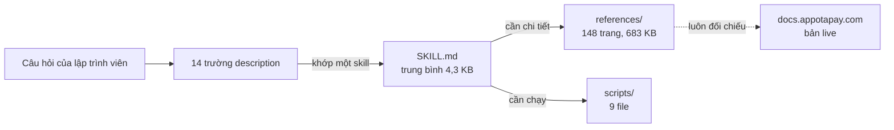

> **RESEARCH NOTE - KHÔNG PHẢI ADR.** Bản này do agent soạn.
> Coi mọi số liệu, trích dẫn và kết luận trong đây là giả thuyết phải kiểm lại. Không dùng làm nguồn học, không trích dẫn lại, không ra quyết định.

# Agent Skills của AppotaPay: tầng kiến thức, không phải tầng năng lực

Owner: Phạm Bách Hiệp. Mentor: Kevin.
Ngày: 2026-11-10.
Revision khảo sát: commit `cb8df1f`, đẩy lên 2026-11-09.
Trạng thái: research note, chưa phải ADR.
Phạm vi: đầu vào cho phần khảo sát mô hình và báo cáo chính thức. Không thay ADR, không thay khảo sát năm mô hình.
Các mã S1 đến S4, O1, R1 và F5 trong tài liệu này thuộc khung đánh giá cũ gồm sáu yêu cầu và sáu yếu tố, đã gỡ khỏi repository.
Giữ nguyên để đối chiếu lịch sử; báo cáo chính thức dùng SR1 đến SR8.

## 0. Tóm tắt

AppotaPay công bố một bộ Agent Skills theo chuẩn mở agentskills.io, và không công bố MCP server.
Bộ artifact đó trả lời được một câu mà spec MCP không trả lời: cái gì đáng tái sử dụng thì không phải lúc nào cũng là một tool.

Số đo tại revision ở trên:

- 14 thư mục skill trong `skills/`, cộng 1 suite ở gốc repo, tổng 15 entry trong index chuẩn agentskills.io.
- 148 trang tài liệu đóng gói sẵn, 683 KB, lớn gấp 11,3 lần toàn bộ `SKILL.md`.
- 60.611 byte cho cả 14 `SKILL.md`, trung bình 4.329 byte một skill.
- 9 script chạy được bằng Node, Python, PHP.
- 0 lần nhắc tới MCP tính theo từ nguyên vẹn, và 0 file OpenAPI hay `llms.txt` trên site tài liệu.

Ba kết luận dùng được cho báo cáo:

1. **Đây là tầng thứ năm.** Sơ đồ hệ thống mô hình hóa các tầng: ý định, thẩm quyền, năng lực, bằng chứng. Skill không thuộc tầng nào trong các tầng đó, nó là tầng kiến thức. MCP vận chuyển năng lực, skill vận chuyển kiến thức về năng lực.
2. **Nó củng cố ba điểm trong khung cũ, không phải toàn bộ.** S1 có tiền lệ hai lớp danh tính. S3 có tiền lệ quy tắc không retry mù. F5 có tiền lệ bảng sở hữu và cổng kiểm tra tự động. S2, S4, O1 và R1 thì không.
3. **Nó không phải mô hình thứ sáu.** Skill không có quyền quyết định, nên không được thêm vào bảng so sánh năm mô hình. Thêm vào là so sánh sai đơn vị.

Điều quan trọng nhất để không hiểu sai: một gói skill không chặn được gì lúc chạy.
Nếu đối tác viết code sai thì skill không cứu được, và lab vẫn cần policy, người duyệt và executor nằm ngoài model.

## 1. Câu hỏi và cách kiểm

Câu hỏi của tài liệu này:

> Bộ Agent Skills của AppotaPay đóng gói cái gì, bỏ ra cái gì, và nói được gì về tiêu chí "khi nào MCP là lựa chọn sai"?

Cách làm:

- Clone repo, đọc nguyên văn `README.md`, `SKILL.md` gốc, `CONTRIBUTING.md`, `scripts/validate-skills.mjs`, `references/live-docs.md`, và cả 14 `SKILL.md`.
- Đếm bằng lệnh, không đếm bằng mắt. Mọi số ở mục 3 đều có lệnh tương ứng ở mục cuối.
- Không suy đoán động cơ. Repo không có phát ngôn nào về MCP, nên mọi kết luận về lý do là suy luận từ artifact, và được ghi đúng như vậy.

Mức bằng chứng: E1 cho toàn bộ tài liệu này, vì mọi thứ đọc được từ repo chính thức và trang tài liệu chính thức của sản phẩm.

## 2. Mười lăm entry, mười bốn skill

### 2.1 Bảng

Cột "Trang" là số trang trong `references/docs/` của skill đó.

| Skill | Nhóm | Làm gì | Trang | Đáng chú ý |
|---|---|---|---|---|
| `appotapay-suite` | Vào | Entry cài tất cả. Hai bảng: gồm những gì, và định tuyến sang skill nào | 0 | Nằm ở `SKILL.md` gốc repo, không làm gì ngoài điều hướng |
| `appotapay` | Định tuyến | Credential, base URL từng sản phẩm, hai họ chữ ký, cơ chế đối chiếu tài liệu live | 3 | Base URL không đồng nhất: `gateway.*`, `ewallet.*`, `pos-gw.*` |
| `appotapay-auth` | Nền | JWT HS256 trong `X-APPOTAPAY-AUTH`, 5 họ chữ ký A đến E, script 3 ngôn ngữ | 2 | Request và response của cùng một endpoint ký trên tập trường khác nhau |
| `appotapay-payment` | Thu tiền | Checkout hosted: tạo đơn, IPN, redirect, trạng thái, danh sách, hoàn tiền, installment IPN, xoá token thẻ | 13 | Checklist go-live 6 mục. IPN phải idempotent, không fulfill theo redirect |
| `appotapay-merchant-hosted` | Thu tiền | Thẻ nội địa và tài khoản ngân hàng thu trên trang của merchant | 4 | Cảnh báo phạm vi PCI ở mọi chỗ dữ liệu thẻ thô đi qua server |
| `appotapay-credit-card` | Thu tiền | Thẻ quốc tế: tokenize, 3DS enroll và validate, authorize, capture, reverse, refund | 17 | `merchantRefId` 1 đến 40 ký tự là idempotency key do caller sinh |
| `appotapay-ewallet` | Thu tiền | OAuth2 liên kết ví, trả bằng số dư ví hoặc APoint, confirm OTP, cancel, unlink | 13 | Gửi hai header cùng lúc: danh tính dịch vụ và danh tính người dùng |
| `appotapay-subscription` | Thu tiền | Định kỳ: customer, payment method, plan, cycle, force, cancel, refund, 4 loại callback | 32 | Nhiều trang nhất. Policy phụ thuộc thời gian và chu kỳ |
| `appotapay-virtual-account` | Thu tiền | Thu hộ qua tài khoản ảo hoặc ebill, tạo bill, nhận IPN khi tiền vào | 10 | Ledger key theo `transactionId`, handler phải idempotent |
| `appotapay-firm-banking` | Chi tiền | Chuyển tiền liên ngân hàng, tra tên người nhận, nhận callback kết quả treo | 9 | Unknown outcome có thật: trạng thái treo phải phân biệt rõ |
| `appotapay-bill` | Dịch vụ | Tra hoá đơn theo mã, thanh toán, tra trạng thái | 7 | Chữ ký họ A, ký trên tập trường riêng của từng endpoint |
| `appotapay-mobile-topup` | Dịch vụ | Nạp thẻ và data cho 9 nhà mạng, cả sync và async có IPN | 21 | Idempotent theo `partnerRefId`, IPN đến nhiều lần |
| `appotapay-buy-card` | Dịch vụ | Mua mã thẻ game và thẻ điện thoại, danh mục sản phẩm, mua lô | 7 | Gần nhất với kịch bản S2 của lab: tài nguyên tiêu hao một lần |
| `appotapay-charging-card` | Dịch vụ | Gạch thẻ cào, mã hoá AES-128, chữ ký SHA-256 nối chuỗi cố định | 4 | Dị biệt hoàn toàn so với phần còn lại, nên không thể có một schema chung |
| `appotapay-pos` | Thiết bị | POS và QR, host riêng, `X-Signature` trên raw body, snake_case | 6 | Bề mặt thứ ba có luật riêng, không theo chuẩn của gateway |

Con số trong bảng khớp với tổng 148 trang ở mục 3.

### 2.2 Cách một skill được tìm thấy

Skill không phải tool. Nó không được liệt kê trong request gửi cho model, mà được nạp khi câu hỏi khớp với trường `description`.



`CONTRIBUTING.md` mô tả đúng cơ chế này bằng tiếng Việt: agent đọc `SKILL.md` trước, khi cần chi tiết mới mở `references/`.
Trang tài liệu chính thức gọi tên cơ chế đó là progressive disclosure.

Mỗi skill mới phải đăng ký ở bốn nơi, thiếu một nơi thì không dùng được:

1. `.well-known/agent-skills/index.json`: index theo chuẩn agentskills.io.
2. `SKILL.md` gốc: hai bảng, "gồm những gì" và "định tuyến".
3. `skills/appotapay/SKILL.md`: bảng chọn skill con và bảng base URL.
4. `README.md`: bảng "What's inside" cho người đọc trên GitHub.

`validate-skills.mjs` kiểm nơi 1 đầy đủ, kiểm nơi 2 và nơi 4 ở mức chỉ có nhắc tên, và không kiểm nơi 3.
`CONTRIBUTING.md` nói thẳng hai chỗ hở đó: thêm tên vào một bảng mà quên bảng kia thì vẫn qua, và validator không kiểm `skills/appotapay/SKILL.md`.
Đây là chi tiết nhỏ nhưng đúng kiểu kỹ sư: biết cổng tự động bỏ sót gì thì ghi ra, không giả vờ là kín.

## 3. Số đo

Đo tại revision `cb8df1f` ngày 2026-11-09, bằng lệnh ở mục cuối.

| Hạng mục | Số đo | Cách kiểm |
|---|---|---|
| Thư mục skill | 14 | `ls skills \| wc -l` |
| Entry trong index | 15 | đếm mảng `skills` trong `.well-known/agent-skills/index.json` |
| Trang tài liệu đóng gói | 148 | `ls skills/*/references/docs/*.md \| wc -l` |
| Byte của toàn bộ `SKILL.md` | 60.611 | `cat skills/*/SKILL.md \| wc -c` |
| Byte của toàn bộ snapshot | 682.555 | `cat skills/*/references/docs/*.md \| wc -c` |
| Tỷ lệ snapshot trên `SKILL.md` | 11,26 lần | chia hai số trên |
| `SKILL.md` trung bình một skill | 4.329 byte | 60.611 chia 14 |
| Script chạy được | 9 | `find` theo ba đuôi `.mjs`, `.py`, `.php` |
| Nhắc tới MCP theo từ nguyên vẹn | 0 | `grep -rnw -i "mcp"` |
| Nhắc tới `model context protocol` | 0 | `grep -ri` |
| File OpenAPI hoặc `llms.txt` | 0 | đọc `references/live-docs.md` |
| Sao GitHub | 0 | GitHub API ngày 2026-11-10 |
| Ngày tạo repo | 2026-06-03 | GitHub API |

Hai ghi chú về cách đếm, vì cả hai đều dễ sai:

- `grep -ri mcp` ra **183** match, và toàn bộ là chữ **TMCP** trong tên ngân hàng ở bảng mã ngân hàng. Muốn đếm đúng phải dùng `-w`, tức từ nguyên vẹn.
- `README.md` ghi "current version (146 pages)", nhưng snapshot hiện tại có 148 trang. Con số 146 là số của lần sync trước. Bản thân độ lệch này là bằng chứng cho vấn đề trôi tài liệu ở mục 4.4.

Không có số đo nào về hiệu quả.
Repo không có benchmark, không nói agent chọn đúng skill bao nhiêu phần trăm, không có thời gian tích hợp trước và sau.
Vì vậy tài liệu này không được dùng để tuyên bố skill làm việc tích hợp nhanh hơn.

## 4. Bốn quyết định thiết kế

### 4.1 Chia theo bề mặt sản phẩm, không chia theo endpoint

14 skill là 1 định tuyến, 1 nền xác thực, 6 thu tiền, 1 chi tiền, 4 dịch vụ, 1 thiết bị.
Cách chia này không đều: `appotapay-subscription` có 32 trang, `appotapay-auth` có 2 trang.

Điều đó là cố ý, không phải lười.
Ngưỡng chia là "một việc mà người dùng sẽ nhờ agent làm", không phải "một nhóm endpoint".
Người dùng nói "làm thanh toán định kỳ", không nói "gọi `/api/v1/subs`".

Hệ quả cho thiết kế: bề mặt tool nên chia theo việc, không theo API.
Policy cũng nên gắn theo việc, vì người duyệt duyệt một việc chứ không duyệt một endpoint.

### 4.2 Nạp theo nhu cầu, không nạp cả bộ

Toàn bộ kiến thức là 683 KB, gấp 11,26 lần tổng `SKILL.md`.
Mỗi lượt chỉ trả giá cho một `SKILL.md`, trung bình 4.329 byte, phần còn lại nằm ngoài context cho tới khi cần.

Đây là điểm phần khảo sát MCP đang thiếu khi bàn về chi phí.
Với MCP, chi phí biên của một tool là schema của nó trong mỗi lượt, trừ khi host cache được theo `ttlMs`.
Với skill, chi phí biên của một chủ đề là một file ngắn, và nó chỉ vào context khi khớp trigger.

Hai chi phí này không cùng đơn vị, nên không được đặt cạnh nhau trong cùng một ô của bảng so sánh năm mô hình.
Chỗ dùng đúng là một câu giải thích trong phần khảo sát MCP: cùng một bề mặt 148 trang, MCP phải expose thành tool, skill thì curate thành 14 nhóm.

Lưu ý về đơn vị: byte không phải token, và tiếng Việt tốn token hơn tiếng Anh.
Vì vậy tài liệu này chỉ báo cáo byte và tỷ lệ, không quy đổi ra token.
Nếu cần token thì đo bằng tokenizer của model dùng trong POC.

### 4.3 Luật an toàn là file luật, không phải câu dặn trong prompt

Quy tắc vàng thứ tư của bộ skill, nguyên văn:

> "Never retry a money-moving call on a timeout - query status by your `partnerRefId` first. Reuse that id; a fresh one can double-charge or double-pay."

Đây là S3 của khung cũ, viết cho một nền tảng thanh toán thật, trong một câu.
Ba thành phần khớp từng từ: không retry mù, tra trạng thái trước, dùng lại đúng mã cũ.

`CONTRIBUTING.md` biến nó thành luật cho người viết skill, không phải lời khuyên:

> "Không gửi lại request chuyển tiền bị timeout khi chưa kiểm tra trạng thái. Skill phải dặn agent tra trạng thái giao dịch theo `partnerRefId` trước, và nếu cần gửi lại thì dùng đúng `partnerRefId` cũ."

Giới hạn phải nói rõ: đây vẫn là chữ trong file Markdown.
Model có thể bỏ qua. Nó không phải policy chạy bằng code.
Giá trị của nó không nằm ở chỗ cưỡng chế, mà ở chỗ chứng minh rằng người làm thanh toán thật cũng viết đúng quy tắc đó, độc lập với lab.

### 4.4 Cổng kiểm tra máy chạy, và bảng sở hữu đọc được bằng mắt

`validate-skills.mjs` không phụ thuộc package nào, chạy trước mỗi commit, và chặn 7 loại lỗi:

1. `name` trong frontmatter lệch tên thư mục.
2. Thiếu `description`, `version` hoặc `source`.
3. Đường dẫn `references/...` hoặc `scripts/...` được nhắc trong `SKILL.md` nhưng không tồn tại.
4. `references/docs/` rỗng, dấu hiệu sync chưa xong.
5. `index.json` lệch danh sách thư mục, hoặc trỏ tới file không có.
6. Bảng `OWNERS` trong script sync trỏ tới skill không tồn tại.
7. `SKILL.md` gốc hoặc `README.md` không nhắc một skill, tức skill đó ship nhưng không ai tìm thấy.

Bảng sở hữu trong `CONTRIBUTING.md` có ba cột: thành phần, vai trò, ai sửa.

| Thành phần | Vai trò | Ai sửa |
|---|---|---|
| `SKILL.md` | Agent đọc toàn bộ file này mỗi lần dùng skill | Người |
| `references/docs/` | Bản Markdown của docs.appotapay.com | Script |
| `references/*.md` | Giải thích và bảng tra cứu tự viết | Người |
| `scripts/` | Script Node, Python, PHP chạy được | Người |

Đây là hình dạng cụ thể của câu "cần version, changelog và test hợp đồng" ở F5 trong khung cũ.
Nó trả lời được ba câu mà báo cáo chính thức đang để mở: ai sở hữu định nghĩa, ai phát hành lại khi schema đổi, ai chịu sự cố.

Phần chống trôi có ba lớp:

1. `sync-references.mjs` là người ghi duy nhất vào `references/docs/`, và xoá sạch trước khi ghi. Trang nào bị gỡ khỏi docs thì biến mất khỏi repo.
2. Script báo trang nào không khớp dòng nào trong bảng `OWNERS`, tức trang mới mà chưa skill nào nhận.
3. Mọi `SKILL.md` buộc agent đối chiếu trang live trước khi sinh code: "if the live doc and a snapshot disagree, the live doc wins".

Lớp thứ ba là điểm đáng chép nhất.
Nó thừa nhận snapshot sẽ cũ, thay vì giả vờ nó luôn đúng.

## 5. Năm chỗ đáng đọc kỹ

1. **Checklist go-live của `appotapay-payment`.** Sáu mục, mỗi mục là một khẳng định kiểm được: JWT dựng ở server, `notifyUrl` công khai và trả `{"status":"ok"}`, xử lý IPN idempotent, fulfill chỉ khi status API là success và số tiền khớp, `SECRET_KEY` chỉ ở server, đổi base URL production và chốt IP allow-list. Đây là mẫu cho cổng đạt của lab.
2. **Hai header của `appotapay-ewallet`.** Request gửi `X-APPOTAPAY-AUTH` cho danh tính dịch vụ và `Authorization` cho access token của người dùng. Đúng mô hình S1: danh tính đi cùng người dùng, không dùng credential chung của connector.
3. **`merchantRefId` của `appotapay-credit-card`.** Idempotency key do caller sinh, 1 đến 40 ký tự, duy nhất trên mỗi request. Không phải idempotency key do server cấp.
4. **Callback kết quả treo của `appotapay-firm-banking`.** Chuyển tiền ra ngân hàng có trạng thái trung gian. Đây là ví dụ thật cho S4: phân biệt "chưa gọi" và "gọi rồi nhưng chưa biết kết quả".
5. **Gạch thẻ cào.** `appotapay-charging-card` dùng SHA-256 nối chuỗi theo thứ tự cố định cộng AES-128, khác cả bốn họ chữ ký còn lại. Một bề mặt sản phẩm như vậy không thể sinh schema tự động từ một nguồn chung.

Thêm một chi tiết về nguồn dữ liệu, vì nó ảnh hưởng trực tiếp tới kết luận về MCP:

`references/live-docs.md` ghi rõ site tài liệu không có `llms.txt`, không có bản full, không có file OpenAPI, tất cả đều trả 404.
Trang được khám phá qua `sitemap.xml` rồi chuyển từ HTML sang Markdown bằng script không phụ thuộc package nào.

Nói cách khác: ở đây không có schema máy đọc được để expose.
Đó chính là điều kiện yếu nhất của MCP, và là lý do mạnh nhất để curate kiến thức thành skill.

## 6. Ánh xạ sang sáu yêu cầu tối thiểu

| ID | Bộ skill giúp gì | Bộ skill không giúp gì | Dùng ở đâu |
|---|---|---|---|
| S1 | Có tiền lệ hai lớp danh tính, hai header cùng một request | Không lọc trường theo vai trò. Việc đó chỉ xảy ra lúc chạy | Câu bổ sung cho phần khảo sát MCP |
| S2 | Quy tắc duyệt được viết thành file luật cho người viết skill | Không phải policy chạy bằng code. Model vẫn có thể bỏ qua. Policy và người duyệt vẫn phải nằm ngoài model | Không chèn, tránh overclaim |
| S3 | Quy tắc không retry mù, tra trạng thái theo `partnerRefId`, dùng lại mã cũ. Có script xác minh IPN cho 3 ngôn ngữ | Không cấp dedupe. Dedupe là việc của code đối tác, không phải của gói skill | Câu bổ sung cho phần khảo sát MCP |
| S4 | Có ví dụ trạng thái treo thật ở firm-banking | Không chặn được gì. Không có fail-closed | Không chèn |
| O1 | Không | Không có trace, không có audit, không nối được câu hỏi với thay đổi | Không chèn |
| R1 | Làm cho việc thêm host thứ n rẻ **ở tầng kiến thức**: một lệnh cài, không server | Không cấp auth và trace, nên không thoả R1 như định nghĩa của R1 trong khung cũ | Tuyệt đối không ghi "R1 đạt" |

Dòng R1 là dòng dễ sai nhất.
Skill tái sử dụng kiến thức, không tái sử dụng khả năng gọi hệ thống.
Nếu ghi skill vào R1 thì người phản biện chỉ cần hỏi "trace ở đâu" là đủ bác.

## 7. Đọc được gì về "khi nào MCP là lựa chọn sai"

Tiêu chí gốc: MCP sai khi chỉ có một host và tool không đổi độc lập với host.
Trường hợp này là một dạng cụ thể khác của cùng tiêu chí.

| MCP nhiều khả năng sai | Trường hợp AppotaPay | Có khớp |
|---|---|---|
| Thứ cần tái dùng là kiến thức tích hợp, không phải hành động lúc chạy | Đầu ra là code chạy trong server của đối tác, không phải lệnh gọi hộ người dùng | Có |
| Secret không được rời server | `SECRET_KEY` dùng để ký JWT và xác minh callback, không được rời server | Có |
| Không có schema máy đọc được để expose | Không OpenAPI, không `llms.txt`, chỉ có HTML | Có |
| Bề mặt lớn hơn nhiều so với bề mặt tool | 148 trang, 12 nhóm sản phẩm, 5 họ chữ ký | Có |
| Mỗi đối tác tích hợp một lần | Thư viện dùng cho lập trình viên tích hợp, không phải runtime | Có |
| Quy trình cố định, ít bước | Luồng thanh toán cố định, đã có hợp đồng JWT và chữ ký | Có |

Sáu trên sáu.
Nhưng kết luận phải viết hẹp: kết luận này áp cho trường hợp thứ cần tái dùng là kiến thức tích hợp, không áp cho lab.
Trong lab, hai agent cần cùng một bộ tool lúc chạy, nên đây không phải lý do để loại MCP.

Câu dùng được, một câu, không cần thêm:

> MCP sai khi thứ cần tái dùng là kiến thức tích hợp, vì khi đó bạn trả giá một dịch vụ có auth, version và log mà không đổi lấy được một năng lực mới nào.

## 8. Cái tài liệu này không chứng minh được

- **Không phải phát ngôn của AppotaPay về MCP.** Repo không có câu nào nói họ đã cân nhắc rồi loại. Không thấy MCP server trong repo công khai là sự thật kiểm được, còn lý do là suy luận.
- **Không có `LICENSE` ở gốc repo**, dù `README.md` ghi MIT và mọi `SKILL.md` ghi `license: MIT`. Một tài sản tái dùng mà thiếu file giấy phép thì chưa tái dùng được về mặt pháp lý. Đây là việc nhỏ và là việc thật.
- **Không có số đo hiệu quả.** Không benchmark, không tỷ lệ chọn đúng skill, không thời gian tích hợp. Không được dùng tài liệu này để nói skill nhanh hơn.
- **Repo rất mới và chưa được dùng rộng.** Tạo 2026-06-03, 0 sao tại ngày khảo sát. Chưa chứng minh được độ bền qua thời gian.
- **Không nói AppotaPay dùng agent nội bộ thế nào.** Đây là tài liệu tích hợp cho đối tác, không phải mô tả kiến trúc nội bộ.
- **Số đo sẽ trôi.** Mọi con số gắn với revision `cb8df1f`. Chạy lại sau này sẽ ra số khác, và đó là bình thường.

## 9. Đề xuất còn mở

Trạng thái: chưa áp dụng, chờ duyệt.

| Mã | Vị trí | Nội dung | Trạng thái |
|---|---|---|---|
| E7 | `01-appota-cases.md` dòng 669, 670, 691, 759 | Sửa 146 thành 148, 14 thành 15 entry | Chờ duyệt |

Hai việc không làm, và lý do:

- Không thêm skill thành dòng thứ sáu trong bảng so sánh năm mô hình, vì skill không có quyền quyết định nên không so sánh được trên F1.
- Không sửa định nghĩa R1, vì skill không cấp auth và trace.

## Nguồn

Truy cập ngày 2026-11-10, mức E1, revision `cb8df1f`.

1. [AppotaPayInc/skills](https://github.com/AppotaPayInc/skills). 14 thư mục skill, 148 trang, 9 script, không có MCP server.
2. [AppotaPay AI Skills](https://docs.appotapay.com/skills). Trang công bố chính thức, nêu chuẩn Agent Skills, progressive disclosure, hơn 40 công cụ tương thích.
3. [README.md](https://github.com/AppotaPayInc/skills/blob/main/README.md). Bảng mục lục, sáu quy tắc an toàn, cơ chế đồng bộ tài liệu, ghi "146 pages".
4. [SKILL.md gốc](https://github.com/AppotaPayInc/skills/blob/main/SKILL.md). Suite entry, hai bảng, sáu quy tắc vàng.
5. [CONTRIBUTING.md](https://github.com/AppotaPayInc/skills/blob/main/CONTRIBUTING.md). Bảng sở hữu, bốn nơi đăng ký skill, năm quy tắc bắt buộc, bước tăng version.
6. [validate-skills.mjs](https://github.com/AppotaPayInc/skills/blob/main/scripts/validate-skills.mjs). Bảy loại lỗi bị chặn.
7. [live-docs.md](https://github.com/AppotaPayInc/skills/blob/main/skills/appotapay/references/live-docs.md). Không có `llms.txt`, không có OpenAPI, khám phá qua `sitemap.xml`.
8. [appotapay-payment/SKILL.md](https://github.com/AppotaPayInc/skills/blob/main/skills/appotapay-payment/SKILL.md). Luồng IPN, checklist go-live, quy tắc idempotent.
9. [appotapay-ewallet/SKILL.md](https://github.com/AppotaPayInc/skills/blob/main/skills/appotapay-ewallet/SKILL.md). Hai header danh tính trong cùng một request.
10. [appotapay-firm-banking/SKILL.md](https://github.com/AppotaPayInc/skills/blob/main/skills/appotapay-firm-banking/SKILL.md). Callback kết quả treo.
11. [.well-known/agent-skills/index.json](https://github.com/AppotaPayInc/skills/blob/main/.well-known/agent-skills/index.json). 15 entry theo chuẩn agentskills.io.

## Bằng chứng kiểm lại được

Các lệnh dưới đây kiểm artifact, không kiểm giả thuyết.
Số in ra khớp với mục 3 tại revision `cb8df1f` ngày 2026-11-09.

```bash
git clone --depth 1 https://github.com/AppotaPayInc/skills /tmp/appotapay-skills
cd /tmp/appotapay-skills

ls skills | wc -l                                        # 14
ls skills/*/references/docs/*.md | wc -l                 # 148
cat skills/*/SKILL.md | wc -c                            # 60611
cat skills/*/references/docs/*.md | wc -c                # 682555
find skills -name "*.mjs" -o -name "*.py" -o -name "*.php" | wc -l   # 9

# MCP theo từ nguyên vẹn, phải là 0
grep -rnw -i "mcp" --include="*.md" --include="*.json" --include="*.mjs" . | wc -l

# Cách đếm sai, để nhớ vì sao phải dùng -w. Ra 183, toàn bộ là chữ TMCP
grep -ri "mcp" . | wc -l

# Index chuẩn agentskills.io, phải là 15
python -c "import json;print(len(json.load(open('.well-known/agent-skills/index.json'))['skills']))"

# Tỷ lệ snapshot trên SKILL.md, phải là 11.26
python -c "print(round(682555/60611,2))"

# Revision và ngày, phải là cb8df1f3a644 và 2026-11-09
curl -s "https://api.github.com/repos/AppotaPayInc/skills/commits?per_page=1" \
  | python -c "import sys,json;c=json.load(sys.stdin)[0];print(c['sha'][:12], c['commit']['committer']['date'])"

# Chạy cổng kiểm tra của repo, phải in ra 14 skills valid, 15 indexed
node scripts/validate-skills.mjs
```

Hai lệnh cuối cần mạng và Node 18 trở lên.

Kiểm tra tài liệu này không có em dash:

```bash
grep -n $'\u2014' docs/research/02-appotapay-skills.md || echo "khong co em dash"
```
