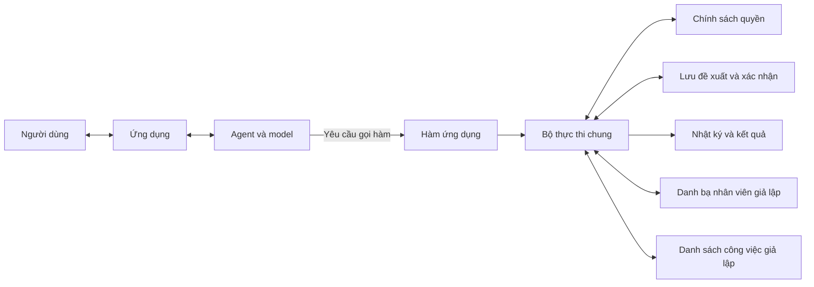
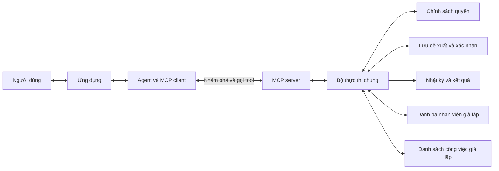
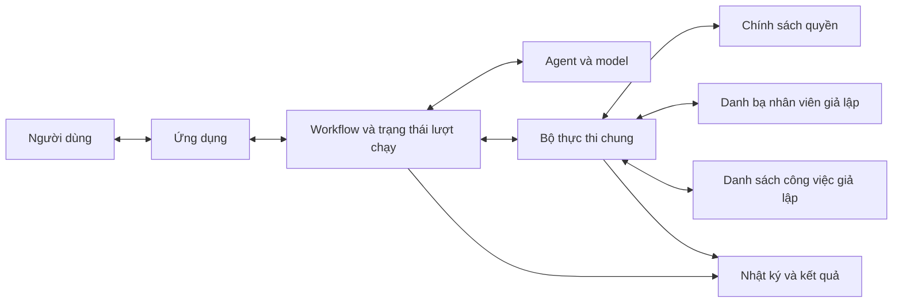
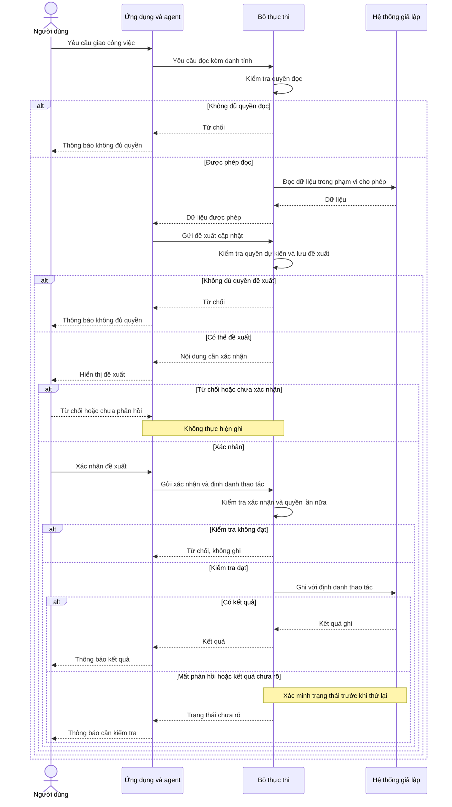

# Sơ đồ giải pháp ứng viên

Trạng thái: bản nháp, chưa review và chưa chọn kiến trúc.

## 5.1. Ứng viên A - Gọi hàm trực tiếp

Ứng viên này dùng các hàm do ứng dụng cung cấp để agent yêu cầu đọc dữ liệu hoặc đề xuất cập nhật.
Một bộ thực thi chung kiểm tra quyền và là đường đi dự kiến duy nhất tới hai hệ thống giả lập.
Việc ghi chỉ được thực hiện sau khi người dùng xác nhận đúng nội dung đề xuất.

### Sơ đồ thành phần

Các mũi tên tới hệ thống giả lập thể hiện đường truy cập dự kiến, không khẳng định việc chặn các đường truy cập khác đã được triển khai.
Ứng dụng chuyển đề xuất cho người dùng xác nhận và gửi xác nhận đó tới bộ thực thi.

### Luồng xử lý

1. Người dùng yêu cầu giao một công việc cho một nhân viên.
2. Ứng dụng chuyển yêu cầu và danh sách hàm cho agent.
3. Agent yêu cầu gọi hàm đọc thông tin nhân viên và công việc cần thiết.
4. Bộ thực thi kiểm tra danh tính, quyền đọc và phạm vi dữ liệu trước khi truy cập các hệ thống giả lập.
5. Agent dùng dữ liệu được phép đọc để tạo đề xuất cập nhật và chuyển đề xuất qua hàm ứng dụng tới bộ thực thi.
6. Bộ thực thi kiểm tra quyền dự kiến, lưu nội dung đề xuất và trả đề xuất cho ứng dụng hiển thị.
7. Người dùng xác nhận hoặc từ chối nội dung cụ thể đó.
8. Nếu được xác nhận, ứng dụng gửi xác nhận gắn với đề xuất đã lưu đến bộ thực thi.
9. Bộ thực thi kiểm tra lại quyền, người xác nhận, thời hạn và nội dung đã duyệt trước khi ghi vào hệ thống công việc.
10. Bộ thực thi ghi nhận kết quả và trả lại cho ứng dụng để thông báo cho người dùng.

### Trách nhiệm

| Thành phần | Trách nhiệm dự kiến |
| --- | --- |
| Ứng dụng | Hiển thị đề xuất, nhận xác nhận và chuyển yêu cầu kèm danh tính đã xác thực. |
| Agent và model | Diễn giải yêu cầu, chọn hàm và đề xuất thay đổi, không tự quyết định quyền hay trực tiếp ghi. |
| Hàm ứng dụng | Cung cấp giao diện gọi bộ thực thi và chuyển tham số theo hợp đồng hàm. |
| Bộ thực thi | Kiểm tra và thực thi quyền đọc, xác minh xác nhận, kiểm tra lại quyền trước khi ghi và ghi nhận kết quả. |
| Chính sách quyền | Cung cấp quy tắc để đánh giá quyền của người dùng và agent đối với hành động và dữ liệu. |
| Lưu đề xuất và xác nhận | Lưu nội dung cần duyệt và trạng thái xác nhận để đối chiếu trước khi ghi. |
| Hệ thống giả lập | Cung cấp dữ liệu nhân viên và lưu trạng thái công việc. |

### Trường hợp cần xử lý

| Trường hợp | Hành vi dự kiến |
| --- | --- |
| Không có quyền đọc hoặc ghi | Từ chối hành động tương ứng và không thực hiện ghi. |
| Người dùng từ chối hoặc chưa xác nhận | Không ghi thay đổi. |
| Nội dung thay đổi sau khi duyệt hoặc xác nhận hết hạn | Không dùng xác nhận cũ, yêu cầu tạo hoặc xác nhận lại đề xuất. |
| Quyền thay đổi trong lúc chờ | Kiểm tra lại trước khi ghi và từ chối nếu không còn quyền. |
| Ghi thất bại hoặc mất phản hồi | Không giả định ghi thành công hay thất bại khi chưa biết kết quả, cần xác minh trạng thái trước khi thử lại. |
| Yêu cầu ghi được gửi lại | Dùng định danh thao tác ổn định và cơ chế chống ghi lặp được kiểm chứng ở nơi thực thi hoặc hệ thống đích. |

### Giả thuyết cần kiểm chứng

- Hai agent có thể dùng lại cùng bộ thực thi mà vẫn được cấp quyền độc lập.
- Mọi đường đọc và ghi đều đi qua nơi kiểm tra quyền, không có đường gọi trực tiếp bỏ qua bộ thực thi.
- Xác nhận gắn đúng người, đúng đề xuất và không thể dùng cho nội dung đã thay đổi.
- Khi mất phản hồi hoặc gửi lại yêu cầu, cơ chế chống ghi lặp không tạo thêm thay đổi ngoài ý muốn.
- Nhật ký có thể liên kết người yêu cầu, agent, quyết định quyền, xác nhận và kết quả mà không chứa dữ liệu nhạy cảm.

Các hành vi trên là mục tiêu thiết kế và giả thuyết kiểm thử, chưa phải kết quả triển khai hoặc đo lường.

## 5.2. Ứng viên B - Công cụ qua MCP

Agent khám phá và gọi công cụ qua MCP server thay vì nhận danh sách hàm trực tiếp từ ứng dụng.
Bộ thực thi phía sau server vẫn kiểm tra quyền, xác nhận và truy cập hệ thống giả lập.
MCP là giao diện tích hợp trong ứng viên này, không phải cơ chế tự động bảo đảm quyền hoặc duyệt ghi.

### Sơ đồ thành phần

Ứng dụng chuyển đề xuất cho người dùng và gửi xác nhận tới bộ thực thi qua một đường giao tiếp được bảo vệ.
Danh tính người dùng và agent phải được xác thực và truyền tới nơi kiểm quyền, nhưng cách thực hiện cụ thể chưa được quyết định.

### Luồng xử lý

1. Người dùng yêu cầu giao một công việc cho một nhân viên.
2. MCP client khám phá danh sách công cụ và cấu trúc tham số do MCP server cung cấp.
3. Agent yêu cầu gọi công cụ đọc thông tin cần thiết.
4. MCP server chuyển yêu cầu và ngữ cảnh danh tính đã xác thực tới bộ thực thi.
5. Bộ thực thi kiểm tra quyền và phạm vi dữ liệu trước khi đọc từ hệ thống giả lập.
6. Agent tạo đề xuất cập nhật từ dữ liệu được phép đọc và gửi đề xuất qua công cụ tương ứng.
7. Bộ thực thi kiểm tra quyền dự kiến, lưu đề xuất và trả nội dung cho ứng dụng hiển thị.
8. Người dùng xác nhận hoặc từ chối đề xuất.
9. Sau xác nhận, bộ thực thi đối chiếu nội dung đã duyệt, kiểm tra lại danh tính và quyền, rồi mới thực hiện ghi.
10. Kết quả được trả về ứng dụng và ghi nhận để đối chiếu.

### Trách nhiệm

| Thành phần | Trách nhiệm dự kiến |
| --- | --- |
| Ứng dụng | Hiển thị đề xuất, nhận xác nhận và bảo vệ đường gửi xác nhận. |
| Agent và MCP client | Khám phá, chọn và gọi công cụ, không tự quyết định quyền ghi. |
| MCP server | Công bố hợp đồng công cụ và chuyển yêu cầu tới bộ thực thi. |
| Bộ thực thi | Xác minh ngữ cảnh danh tính đáng tin cậy, kiểm tra quyền và xác nhận, đọc hoặc ghi qua hệ thống giả lập. |
| Chính sách, kho đề xuất và nhật ký | Hỗ trợ kiểm quyền, đối chiếu xác nhận và liên kết kết quả với yêu cầu. |

### Trường hợp cần xử lý

| Trường hợp | Hành vi dự kiến |
| --- | --- |
| Không có quyền hoặc thiếu danh tính đáng tin cậy | Từ chối yêu cầu tương ứng, không ghi. |
| Từ chối, chưa xác nhận hoặc xác nhận không khớp | Không ghi và yêu cầu xác nhận hợp lệ nếu cần. |
| Kết nối MCP bị gián đoạn | Trả lỗi hoặc trạng thái chưa rõ, không tự coi thao tác ghi là an toàn để gửi lại. |
| Gửi lại lời gọi ghi | Dùng định danh thao tác ổn định và cơ chế chống ghi lặp được kiểm chứng tại bộ thực thi hoặc hệ thống đích. |
| Công cụ hoặc tham số không hợp lệ | Từ chối trước khi thực thi và ghi nhận lỗi phù hợp. |

### Giả thuyết cần kiểm chứng

- Agent thứ hai có thể khám phá và dùng lại công cụ mà không thừa hưởng quyền của agent thứ nhất.
- Danh tính và quyền được kiểm tra đúng qua ranh giới client, server và bộ thực thi.
- Cùng một tình huống cho phép đối chiếu việc tích hợp và tái sử dụng công cụ với ứng viên A.
- Việc gián đoạn kết nối hoặc gửi lại lời gọi không làm mất xác nhận hay gây ghi trùng.

## 5.3. Ứng viên C - Workflow điều phối

Một workflow quản lý trình tự đọc, đề xuất, chờ xác nhận và ghi.
Agent tham gia tạo đề xuất, còn bộ thực thi kiểm tra quyền và truy cập hệ thống giả lập.
Workflow có thể kết hợp với gọi hàm trực tiếp hoặc MCP, vì vậy bản phác thảo này chưa xác định giao diện công cụ cuối cùng.

### Sơ đồ thành phần

Workflow lưu trạng thái đề xuất và điểm chờ xác nhận trong thiết kế này.
Đường xác nhận từ ứng dụng đến workflow phải xác thực người duyệt và gắn với đúng lượt chạy cùng nội dung đề xuất.

### Luồng xử lý

1. Người dùng gửi yêu cầu và ứng dụng khởi tạo một lượt chạy workflow.
2. Workflow yêu cầu bộ thực thi kiểm tra quyền và đọc dữ liệu cần thiết từ các hệ thống giả lập.
3. Workflow chuyển dữ liệu được phép đọc cho agent tạo đề xuất.
4. Workflow lưu nội dung đề xuất và chuyển cho ứng dụng hiển thị.
5. Workflow chờ người dùng xác nhận hoặc từ chối.
6. Ứng dụng gửi kết quả xác nhận đã xác thực, gắn với lượt chạy và nội dung đã hiển thị.
7. Nếu được xác nhận, workflow chuyển đúng nội dung đã duyệt cùng định danh thao tác ổn định tới bộ thực thi.
8. Bộ thực thi kiểm tra lại quyền, xác nhận và nội dung trước khi ghi vào hệ thống công việc.
9. Workflow lưu kết quả và ứng dụng thông báo cho người dùng.

### Trách nhiệm

| Thành phần | Trách nhiệm dự kiến |
| --- | --- |
| Ứng dụng | Khởi tạo lượt chạy, hiển thị đề xuất và nhận xác nhận. |
| Workflow | Quản lý thứ tự, trạng thái, điểm chờ và tiếp tục đúng lượt chạy. |
| Agent và model | Tạo đề xuất từ dữ liệu được phép đọc, không tự duyệt hoặc ghi. |
| Bộ thực thi | Kiểm tra quyền và xác nhận trước khi đọc hoặc ghi, phối hợp cơ chế chống ghi lặp. |
| Chính sách và hệ thống giả lập | Cung cấp quy tắc quyền và dữ liệu nghiệp vụ cho bộ thực thi. |

### Trường hợp cần xử lý

| Trường hợp | Hành vi dự kiến |
| --- | --- |
| Không có quyền | Từ chối bước tương ứng và không ghi. |
| Từ chối, chưa xác nhận hoặc hết hạn | Không ghi, lưu trạng thái phù hợp để người dùng biết. |
| Workflow tiếp tục sau gián đoạn | Khôi phục đúng lượt chạy và dùng lại đề xuất đã lưu, không tạo lại nội dung rồi coi là đã duyệt. |
| Ghi thất bại hoặc mất phản hồi | Xác minh trạng thái thao tác trước khi thử lại và giữ cùng định danh thao tác. |
| Tín hiệu xác nhận bị gửi lại | Không tạo thêm lần ghi, kể cả khi workflow nhận tín hiệu lặp. |

### Giả thuyết cần kiểm chứng

- Workflow có thể khôi phục trạng thái chờ và tiếp tục đúng lượt chạy sau gián đoạn.
- Nội dung được ghi luôn khớp với nội dung đã được người có thẩm quyền xác nhận.
- Cơ chế chạy lại kết hợp với bộ thực thi hoặc hệ thống đích không gây ghi trùng.
- Agent thứ hai có thể dùng lại năng lực tích hợp mà không thừa hưởng quyền của agent đầu tiên.

## 6. Sơ đồ trình tự cho tình huống chung

Sơ đồ dưới đây thể hiện hợp đồng hành vi chung, không thay thế sơ đồ thành phần của từng ứng viên.
Đường gọi cụ thể đi qua hàm ứng dụng, MCP server hoặc workflow tùy ứng viên.

Việc gửi lại phải giữ cùng định danh thao tác và được xử lý chống ghi lặp tại ranh giới có thể kiểm chứng.
Sơ đồ không khẳng định hệ thống đích đã có khả năng này.

## 7. Bảng đối chiếu sơ bộ

| Tiêu chí | A - Gọi hàm trực tiếp | B - MCP | C - Workflow |
| --- | --- | --- | --- |
| Giao diện tích hợp | Hàm ứng dụng gọi bộ thực thi. | MCP client gọi tool qua server. | Chưa chốt, có thể kết hợp hàm trực tiếp hoặc MCP. |
| Quyền và xác nhận | Bộ thực thi kiểm quyền và đối chiếu xác nhận. | Bộ thực thi giữ trách nhiệm tương tự, cần bảo vệ ngữ cảnh qua server. | Bộ thực thi kiểm quyền và xác nhận, workflow quản lý điểm chờ. |
| Lỗi và chạy lại | Ứng dụng và bộ thực thi cần quản lý trạng thái và chống ghi lặp. | Cần xử lý thêm gián đoạn qua kết nối MCP, chống ghi lặp vẫn cần kiểm chứng. | Workflow quản lý trạng thái lượt chạy, nhưng bước ghi vẫn cần chống ghi lặp. |
| Agent thứ hai | Cần thử dùng lại hợp đồng hàm và bộ thực thi với quyền riêng. | Cần thử dùng lại công cụ qua MCP với quyền riêng. | Cần xác định giao diện tích hợp rồi thử dùng lại với quyền riêng. |
| Mở rộng | Cần khảo sát thay đổi khi thêm hệ thống hoặc hàm. | Cần khảo sát thay đổi khi thêm server hoặc công cụ. | Cần khảo sát thay đổi khi thêm bước và hệ thống. |
| Vận hành và bảo trì | Cần xác định thành phần và quy trình vận hành. | Cần xác định thêm vận hành client và server. | Cần xác định thêm vận hành workflow và kho trạng thái. |
| Chi phí | Chưa đo. | Chưa đo. | Chưa đo. |

Bảng chỉ mô tả phương án dự kiến, không xếp hạng và không kết luận phương án nào tốt hơn.
C không loại trừ B, nên cần chốt tổ hợp cụ thể và điều kiện thử tương đương trước khi so sánh thực nghiệm.

## 8. Câu hỏi mở và cách kiểm chứng

| Câu hỏi | Cách kiểm tra dự kiến | Bằng chứng cần thu |
| --- | --- | --- |
| Agent thứ hai có dùng lại công cụ mà không nhận quyền của agent đầu tiên? | Chạy cùng tác vụ với hai agent có quyền khác nhau. | Cấu hình quyền, yêu cầu và kết quả cho phép hoặc từ chối. |
| Có thể bỏ qua nơi kiểm quyền để đọc hoặc ghi trực tiếp không? | Thử các đường truy cập ngoài bộ thực thi trong môi trường giả lập. | Cấu hình ranh giới và kết quả các lần thử. |
| Xác nhận có gắn đúng người và đúng nội dung không? | Thử thay đổi tham số, dùng xác nhận hết hạn hoặc dùng người xác nhận không hợp lệ. | Đề xuất, trạng thái xác nhận và kết quả từ chối. |
| Điều gì xảy ra khi mất phản hồi sau khi gửi lệnh ghi? | Gây lỗi tại ranh giới ghi và gửi lại cùng định danh. | Nhật ký thao tác, trạng thái hệ đích và số thay đổi thực tế. |
| Workflow có tiếp tục đúng nội dung đã duyệt sau gián đoạn không? | Ngắt và khôi phục lượt chạy trước hoặc sau xác nhận. | Trạng thái lượt chạy, nội dung duyệt và nội dung ghi. |
| A và B khác nhau thế nào khi thêm agent? | Tích hợp cùng agent thứ hai với cùng kịch bản và quyền. | Hợp đồng tích hợp, cấu hình, thay đổi cần thiết và kết quả chạy. |
| Độ trễ, độ ổn định và chi phí của các tổ hợp là bao nhiêu? | Thiết lập baseline và kịch bản đo trước khi chạy thử. | Cấu hình, phương pháp đo, kết quả thô và giới hạn phép đo. |

## 9. Trạng thái và quản lý tài liệu

- Chủ sở hữu: Phạm Bách Hiệp.
- Người review: chưa xác định.
- Trạng thái: bản nháp, chưa review.
- Định nghĩa hoàn thành: các sơ đồ và giả định được người review xác nhận phạm vi; câu hỏi mở có cách kiểm chứng; kết quả so sánh và quyết định kiến trúc được ghi ở tài liệu tương ứng sau khi có bằng chứng.
- Bằng chứng: sơ đồ và kịch bản trong tài liệu này là đề xuất thiết kế, chưa có kết quả chạy hoặc đo.
- Nguồn căn cứ: [yêu cầu chương trình](../program/Appota_AgentLize_Next_Gen_AI_RnD_8_Tuan_2026_Cap_Nhat.txt) và các tiêu chí, điều kiện cần kiểm chứng được ghi trực tiếp ở mục 8.
- Cập nhật 2026-11-13: tạo bản nháp cho ba ứng viên, luồng chung, bảng đối chiếu và câu hỏi kiểm chứng.
