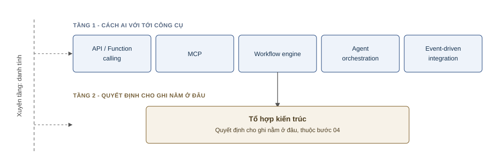

> **CHƯA REVIEW - KHÔNG TIN HOÀN TOÀN.** Bản nháp v0.3 do trợ lý soạn, chưa được Phạm Bách Hiệp review.
> Đã khảo sát đủ năm phương pháp, mỗi mục 3.x có đủ bảy ô.
> Hai mươi lăm nguồn trong mục 6 đã được mở lại ngày 2026-11-13.
> Sáu mươi tám câu trích đã được kiểm chéo, kết quả 68 khớp, 0 lỗi; phương pháp ghi ở mục 6.
> Không có số đo nào, không chọn phương pháp nào, không phải ADR.

# Bước 01 - Khảo sát năm phương pháp nối AI với hệ thống nghiệp vụ

**Người:** Phạm Bách Hiệp. **Track:** 01 - AI Platform & MCP. **Mentor:** Kevin.  
**Vị trí:** bước 01 Explore của khung bảy bước, sau bước 0 và trước bước 02 Compare.  
**Ngày:** 2026-11-12, cập nhật 2026-11-13, revision 0.3.  
**Trạng thái:** bản nháp, chưa review. Chưa có số đo, chưa chọn phương pháp, chưa có ADR.

Bước 01 của chương trình yêu cầu khảo sát tối thiểu ba mô hình, tìm nguồn gốc thiết kế và tình huống áp dụng, với đầu ra là research note có liên kết tài liệu gốc và bản đồ các phương án.
Chương trình R&D chia công việc thành bảy bước: khảo sát, so sánh, đặt câu hỏi, đề xuất, xây, đánh giá, đóng gói. Báo cáo này là đầu ra của bước 01.
Đề bài Track 01 nêu tên năm mô hình phải khảo sát trước: API/Function Calling, MCP, Workflow Engine, Agent Orchestration, Event-driven Integration.
Năm là sàn của đề bài, ba là sàn của chương trình.
File này làm năm.

Câu hỏi của file này hẹp: một agent cần đọc dữ liệu nghiệp vụ, đề xuất thay đổi và chỉ ghi sau khi có người xác nhận, thì các phương pháp đã có để nối agent với hệ thống nghiệp vụ là gì, chúng ra đời để giải vấn đề nào, và mỗi phương pháp trả lời sẵn câu hỏi nào của hệ thống.

Phạm vi: năm phương pháp ở tầng kết nối, nguồn gốc thiết kế của chúng, và phần nào của bài toán chúng giải sẵn.
Ngoài phạm vi: chọn phương pháp, xếp hạng, báo giá, đo hiệu năng, chọn kiến trúc tổ hợp, viết ADR.

Báo cáo này chỉ khảo sát tầng phương pháp. Việc chọn tổ hợp kiến trúc thuộc bước 04, và không câu nào ở đây được dùng làm bằng chứng cho quyết định đó.
Ranh giới giữa hai tầng ghi ở mục 5.

Định nghĩa dùng trong cả file: "hệ nguồn" là hệ thống nghiệp vụ giữ dữ liệu thật, ví dụ danh bạ nhân viên và danh sách công việc của AI Operations Connector Lab. "Lab" trong file này là chính lab đó.

## 0. Tóm tắt

| Việc                                                                       | Mục     |
| -------------------------------------------------------------------------- | ------- |
| Đặt câu hỏi hẹp: nối agent với hệ nguồn bằng gì, và để giải vấn đề nào     | -       |
| Năm luật trích dẫn nguồn, ba điều cố ý không làm, tám ràng buộc SR1-SR8    | 1, 1.1  |
| Bản đồ hai tầng và ma trận phủ bảy thành phần                              | 2, 2.1  |
| Khảo sát năm phương pháp, mỗi phương pháp bảy ô cố định                    | 3.1-3.5 |
| Ma trận phủ SR1-SR8 và bốn phát hiện của bước 01                           | 4, 4.1  |
| Ranh giới với tầng kiến trúc                                               | 5       |
| Sổ nguồn: 25 nguồn, 68 câu trích khớp nguyên văn ngày 2026-11-13           | 6       |
| Chưa làm: chưa có số đo, chưa xếp hạng, chưa chọn phương pháp, chưa có ADR | -       |

Bước tiếp theo là bước 02 Compare: so sánh năm phương pháp theo cùng một bộ trục và chốt tiêu chí lựa chọn.
Bảng ở mục 4 là đầu vào của bước đó, và bước đó không được đọc bảng này như một bảng xếp hạng.

# Phần 1 - Cách làm và bản đồ

## 1. Cách làm

Năm luật áp cho mọi mục của file:

1. Mỗi khẳng định về nguồn ngoài phải có một URL mở được, và câu trích phải khớp nguyên văn.
2. Trích tối đa 25 từ, giữ nguyên tiếng Anh, đặt trong blockquote, kèm mã nguồn.
3. Chỉ dùng nguồn gốc: đặc tả, RFC, bài báo, thông báo chính thức, tài liệu của chính sản phẩm.
4. Không suy ra tính chất từ tên sản phẩm, không suy ra hiệu năng từ kiến trúc.
5. Điều không tìm thấy thì ghi "không tìm thấy" kèm ngày, không đoán.

Ba điều cố ý không làm trong file này:

- Không chấm điểm phương pháp. Chúng trả lời các câu hỏi khác nhau, không cùng đơn vị.
- Không ghi số tiền. Giá niêm yết là việc của bước 02, và phải đọc lại tại ngày đo.
- Không kết luận phương pháp nào nên dùng. Đó là bước 04.

### 1.1. Tám ràng buộc dùng để đọc bản đồ

Tám ràng buộc dưới đây là điều kiện đúng/sai của bài toán, không phải tiêu chí chấm điểm.
Chúng lấy từ báo cáo trước ngày 11/11/2026 và được nhắc lại ở đây để đọc bảng mà không cần mở báo cáo đó.

| Mã | Tên | Yêu cầu | Kiểm bằng |
| --- | --- | --- | --- |
| SR1 | Danh tính và cửa ghi | Mọi thay đổi đi qua một đường thực thi duy nhất, mang danh tính người yêu cầu, không phải danh tính dịch vụ. | Người không có quyền bị từ chối; trace ghi đúng người yêu cầu. |
| SR2 | Luật chạy được | Quyền kiểm ở tầng thực thi, không bằng câu dặn trong prompt. | Xóa câu dặn quyền trong prompt, quyết định không đổi. |
| SR3 | Phạm vi quyền | Quyền nói được phạm vi: trường nào, bản ghi nào, hành động nào. | Ngoài phạm vi bị từ chối. |
| SR4 | Điểm dừng rủi ro | Hành vi rủi ro cao có điểm dừng bắt buộc, gắn hash của đúng tham số, có thời hạn. | Sửa tham số sau khi duyệt thì quyết định mất hiệu lực. |
| SR5 | Fail-closed | Không xác định được quyền thì từ chối. | Kho quyền không trả lời, không có thay đổi nào được ghi. |
| SR6 | Không tạo hiệu ứng thứ hai | Phân biệt "chưa gọi" với "gọi rồi nhưng chưa biết kết quả"; retry trả lại kết quả cũ, không tạo bản ghi mới. | Retry sau khi mất phản hồi không tạo bản ghi thứ hai. |
| SR7 | Trace xuyên suốt | Một trace nối người yêu cầu, quyết định, thay đổi và chi phí. | Một truy vấn trả lời được ai, lúc nào, vì sao, kết quả, chi phí. |
| SR8 | Tái dùng tách quyền | Tái dùng lớp tích hợp tách khỏi tái dùng quyền. | Agent thứ hai dùng lại lớp tích hợp nhưng không thừa hưởng quyền. |

## 2. Bản đồ các phương án

Năm phương pháp của đề bài không loại trừ nhau, chúng nằm ở các tầng khác nhau và chồng lấn khi triển khai.
Vì vậy bản đồ phải có hai tầng, và một trục xuyên tầng.

Hình 1. Hai tầng của bản đồ và trục danh tính xuyên tầng.

| Tầng                       | Câu hỏi tầng này trả lời                          | Đơn vị so sánh                        | Thuộc bước   |
| -------------------------- | ------------------------------------------------- | ------------------------------------- | ------------ |
| 1. Cách AI với tới công cụ | Nối bằng gì, công cụ được phát hiện và gọi ra sao | Năm phương pháp                       | 01, file này |
| 2. Tổ hợp kiến trúc        | Quyết định "cho ghi" nằm ở đâu                    | Các tổ hợp kiến trúc, thuộc bước 04    | 04           |
| Xuyên tầng. Danh tính      | Ai chịu trách nhiệm, ai đang chạy                 | Không phải phương án, mà là ràng buộc | 01 đến 04    |

Hệ quả của việc tách hai tầng: so năm phương pháp với nhau theo kiểu "cái nào tốt hơn" là sai đơn vị.
Cách so đúng là hỏi mỗi phương pháp phủ thành phần nào của bài toán, và phần còn thiếu thì ai phải dựng.

### 2.1. Ma trận phủ thành phần

Khung cột lấy từ bảy thành phần mà một agent có ghi dữ liệu cần có: runtime, connector, điểm thực thi, điểm phán quyết, danh tính, registry, observability.
Đây là khung phân tích của lab, không phải kết luận rút từ nguồn ngoài.

| Phương pháp          | Runtime | Connector | Điểm thực thi | Điểm phán quyết | Danh tính | Registry | Observability |
| -------------------- | ------- | --------- | ------------- | --------------- | --------- | -------- | ------------- |
| API/Function calling | không   | hỗ trợ    | không         | không           | không     | không    | không         |
| MCP                  | không   | sở hữu    | không         | không           | hỗ trợ    | một phần | không         |
| Workflow engine      | sở hữu  | không     | không         | không           | không     | không    | một phần      |
| Agent orchestration  | sở hữu  | hỗ trợ    | một phần      | một phần        | một phần  | không    | một phần      |
| Event-driven         | không   | sở hữu    | không         | không           | không     | không    | một phần      |

Mỗi ô suy từ bảng ở mục 3.x.4 và 3.x.5 của chính phương pháp đó, không suy từ tên sản phẩm.
Ba giá trị dùng trong ô: `sở hữu` nghĩa là phương pháp định nghĩa cơ chế đó, `hỗ trợ` nghĩa là có quy định nhưng không đủ để chạy một mình, `không` nghĩa là không nói gì tới.

Ba điều bản đồ này nói ngay, trước khi khảo sát bốn phương pháp còn lại:

- Không phương pháp nào trong năm phủ đủ bảy thành phần. Một phương pháp trong năm không thể là toàn bộ câu trả lời.
- Trục quyết định là hai chỗ khác nhau: nơi chặn request và nơi ra phán quyết. Chỉ cần một trong hai là thiếu một lớp lỗi.
- Danh tính là trục xuyên tầng, không phải một phương án cạnh tranh. Nó đúng hay sai như nhau với mọi phương pháp.

# Phần 2 - Năm phương pháp

## 3. Năm phương pháp

Mỗi phương pháp có bảy ô cố định để đọc song song được:

1. Là gì
2. Nguồn gốc thiết kế
3. Cơ chế cốt lõi
4. Cho sẵn gì
5. Không cho gì
6. Tốn gì
7. Tình huống áp dụng và phản ví dụ

MCP đứng trước vì đây là trọng tâm của Track 01; bốn phương pháp còn lại theo đúng thứ tự của đề bài.

### 3.1. MCP

#### 3.1.1. Là gì

MCP là giao thức mở để một ứng dụng AI kết nối tới nơi dữ liệu và công cụ đang nằm, thay vì mỗi nguồn phải viết một connector riêng.
Hai phía là client và server: server công bố công cụ, client gọi công cụ.

> "a new standard for connecting AI assistants to the systems where data lives" (E1)

Đơn vị trao đổi là tool, gồm tên, mô tả và một schema tham số.
Nền giao thức là JSON-RPC 2.0: mỗi lời gọi là một Request object, server trả Response khớp theo trường `id`.

> "A rpc call is represented by sending a Request object to a Server" (E5)

> "This member is used to correlate the context between the two objects" (E5)

#### 3.1.2. Nguồn gốc thiết kế

| Mốc                                         | Ai                                             | Vấn đề cần giải                                                   | Nguồn  |
| ------------------------------------------- | ---------------------------------------------- | ----------------------------------------------------------------- | ------ |
| Dự án nội bộ ở Anthropic, trước khi công bố | David Soria Parra, sau đó Justin Spahr-Summers | Phải copy dữ liệu qua lại giữa Claude Desktop và trình soạn thảo  | E2     |
| 2024-11-25                                  | Anthropic công bố, mã nguồn mở                 | Mỗi nguồn dữ liệu cần một connector riêng, nên không mở rộng được | E1, E2 |

Tác giả của giao thức, nguyên văn từ thông báo gốc:

> "MCP was created at Anthropic by David Soria Parra and Justin Spahr-Summers." (E1)

Hai câu mô tả đúng vấn đề gốc, và chúng khớp với nhau:

> "Every new data source requires its own custom implementation, making truly connected systems difficult to scale." (E1)

> "Recognizing this as a classic M×N problem where multiple applications need multiple integrations, David pitched building a protocol to solve this to Justin." (E2)

Nguồn gốc hình thức: MCP lấy LSP làm mẫu, theo lời Anthropic.

> "They designed MCP based on the popular Language Server Protocol and open-sourced it in November 2024" (E2)

Điều này giải thích hai lựa chọn trong thiết kế: tách client khỏi server, và dùng JSON-RPC làm đường dây.
Nó cũng giải thích vì sao MCP chuẩn hoá phần phát hiện và gọi công cụ, chứ không chuẩn hoá phần quyết định nghiệp vụ.

Khoảng trống của ô này: chưa mở nguồn gốc của chính LSP, nên chưa nói được LSP ra đời năm nào, do ai, và MCP giữ lại đúng phần nào.

#### 3.1.3. Cơ chế cốt lõi

1. Mỗi request mang phiên bản giao thức và capability của client trong `_meta`; giao thức không có bước bắt tay và không có phiên.
2. Client gọi `tools/list`, server trả danh sách tool kèm tên, mô tả và `inputSchema`.
3. Model chọn tool, client gửi `tools/call` kèm tên và tham số.
4. Server validate tham số, chạy, trả kết quả; lỗi nghiệp vụ trả trong kết quả với cờ lỗi, lỗi giao thức trả bằng JSON-RPC error.
5. Nếu server cần thêm thông tin giữa lượt gọi, nó trả một kết quả yêu cầu nhập thêm, và client gửi lại lời gọi kèm câu trả lời.

> "Make MCP stateless: remove the initialize/notifications/initialized handshake." (E25)

MCP để phần điều khiển ở model, và không quy định giao diện người dùng.

> "Tools in MCP are designed to be model-controlled" (E3)

> "the protocol itself does not mandate any specific user interaction model" (E3)

Về quyền, MCP chỉ chuẩn hoá ở tầng vận chuyển: server là resource server OAuth 2.1, token phải đúng audience, và server không được chuyển tiếp token của client xuống hệ nguồn.

> "A protected MCP server acts as an OAuth 2.1 resource server" (E4)

> "MCP servers MUST NOT accept or transit any other tokens" (E4)

Phần quyền này là tuỳ chọn, không phải điều kiện để chạy MCP.

> "Authorization is OPTIONAL for MCP implementations" (E4)

MCP tự nhận là dùng một tập con của các chuẩn đó, không phải toàn bộ.

> "implements a selected subset of their features" (E4)

#### 3.1.4. Cho sẵn gì

| Ràng buộc của bài toán                               | MCP cho tới đâu                                                                             | Bằng chứng |
| ---------------------------------------------------- | ------------------------------------------------------------------------------------------- | ---------- |
| SR1, một đường thực thi mang danh tính người yêu cầu | một phần: có danh tính và audience ở tầng vận chuyển, không có khái niệm "đường duy nhất"   | E4         |
| SR2, quyền kiểm ở tầng thực thi                      | một phần: server MUST tự cài access control, nhưng giao thức không có ngôn ngữ policy       | E3         |
| SR3, quyền nói được phạm vi                          | một phần: phạm vi theo scope của token, danh sách tool có thể khác theo quyền của người gọi | E3, E4     |
| SR4, điểm dừng có ràng buộc tham số                  | không                                                                                       | E3         |
| SR5, không xác định thì từ chối                      | không                                                                                       | E3, E4     |
| SR6, chống ghi trùng                                 | không                                                                                       | E3         |
| SR7, một trace đủ để dựng lại quyết định             | không                                                                                       | E3, E6     |
| SR8, tái dùng lớp tích hợp tách khỏi quyền           | có: một server dùng cho nhiều client, quyền đi theo token từng client                       | E4, E6     |

Hai chỗ mạnh nhất của MCP là SR8 và phần phát hiện tool.
Đây cũng là lý do MCP sống được: nó giải đúng bài toán M×N, không giải bài toán quyền nghiệp vụ.

#### 3.1.5. Không cho gì

Năm điều dưới đây đều là chỗ lab phải tự dựng. Bốn trong năm điều có câu gốc; điều thứ tư là khẳng định về chỗ vắng mặt, kiểm bằng cách tìm và không thấy.

1. Không có phiên ở tầng giao thức, nên không có chỗ giữ trạng thái chờ duyệt.

> "MCP has no protocol-level session" (E3)

> "The protocol has no concept of a state handle" (E3)

2. Không áp đặt bước duyệt người, chỉ khuyến nghị.
Câu gốc dùng "SHOULD", và đặt việc đó vào tay ứng dụng.

> "there SHOULD always be a human in the loop with the ability to deny tool invocations" (E3)

> "Prompt for user confirmation on sensitive operations" (E3)

3. Không ràng buộc tham số giữa lần duyệt và lần ghi.
Khi cần nhập thêm rồi gửi lại, client phải dùng một id khác, tức lần gửi lại là một request mới, không phải cùng một request được xác nhận.

> "Note that the JSON-RPC id MUST be different between the initial request and the retry" (E3)

4. Không có cơ chế chống ghi trùng.
Trang Tools của đặc tả không nhắc tới khoá chống trùng cho `tools/call`. Phần security considerations của bản 2026-07-28 chưa được mở, nên chưa kết luận được trang đó có nhắc hay không.

5. Không có trace nghiệp vụ.
MCP không định nghĩa trường người yêu cầu, và một connector lớn ghi nhận traffic MCP như lời gọi API bình thường.

> "MCP traffic appears in standard GitHub audit logs as normal API calls" (E6)

Một điều gần với duyệt nhưng không phải duyệt: kết quả trả về có thể yêu cầu nhập thêm, và phần tham số có thể bị từ chối với cờ lỗi.
Đó là cơ chế trao đổi thêm dữ liệu, không phải cơ chế chặn theo nội dung đã duyệt.

Về bề mặt tool: đặc tả cho phép danh sách tool khác nhau theo quyền của người gọi, nhưng đó là thu hẹp theo scope, không thu hẹp theo bản ghi.

> "The set MAY vary by the authorization presented on the request" (E3)

Và bản thân handle trạng thái cũng không phải quyền.

> "a handle is a name, not a capability" (E3)

#### 3.1.6. Tốn gì

Định tính, không có số tiền:

- Mỗi hệ nguồn cần một server, cộng một client trong mỗi ứng dụng AI.
- Mỗi server cần một quyết định về vận chuyển: stdio hay HTTP, và nếu HTTP thì cần cấu hình OAuth 2.1.
- Toàn bộ phần policy, duyệt, hash tham số, idempotency và trace phải dựng ngoài giao thức.
- Chi phí bảo trì nằm ở schema tool: đổi một trường trong hệ nguồn là đổi `inputSchema`, và mọi client phải nhận lại danh sách.

Mục 3.1.4 và 3.1.5 cộng lại cho ra đúng một câu: MCP giảm số connector phải viết, nhưng không giảm số cơ chế an toàn phải viết.

#### 3.1.7. Tình huống áp dụng và phản ví dụ

Dùng đúng:

- Nhiều client AI cùng cần một hệ nguồn. Một server, nhiều client, quyền theo token của từng người.
- Công cụ cần được phát hiện động, không nhúng danh sách hàm vào mã ứng dụng.
- Hệ nguồn đã có mô hình quyền đủ tốt, và connector chỉ cần thu hẹp bề mặt. GitHub nói thẳng điều này:

> "Users and apps cannot use an MCP server to access more resources than they could otherwise access normally via the API" (E6)

Dùng sai, hoặc dùng một mình sẽ hở:

- Cần bảo đảm tham số được ghi đúng bằng tham số đã duyệt. Giao thức không giữ được điều này, và lần gửi lại là request mới.
- Cần chờ người duyệt vài giờ hoặc vài ngày. Không có phiên ở tầng giao thức, nên chỗ chờ phải là ứng dụng hoặc một workflow engine.
- Cần trả lời "ai đã yêu cầu thay đổi này" chỉ bằng dữ liệu connector ghi ra. Connector lớn ghi như lời gọi API thường, nên câu trả lời không có sẵn (E6).

Chưa đủ căn cứ để kết luận: Stripe và Atlassian có nhãn xác nhận người ở vài tool.
Hai trường hợp đó chưa được mở lại trong lượt này, nên chưa dùng làm bằng chứng.

### 3.2. API/Function calling

#### 3.2.1. Là gì

Function calling là cơ chế model trả về một lời gọi hàm có cấu trúc thay vì chỉ trả về văn bản tự do.
Hàm do phía gọi khai báo trước, model chỉ chọn hàm và điền tham số.

> "The model generates function calls and structured arguments based on the functions you specify." (E8)

Điểm quyết định nằm ở chỗ ai thực thi: model không chạy hàm, ứng dụng chạy.

> "Your application executes the functions and returns the results to the model, so you remain in control of the actions taken." (E8)

#### 3.2.2. Nguồn gốc thiết kế

| Mốc                                    | Ai                              | Vấn đề cần giải                                                         | Nguồn                      |
| -------------------------------------- | ------------------------------- | ----------------------------------------------------------------------- | -------------------------- |
| 2023-02-09                             | Meta AI, Timo Schick và cộng sự | Model không tự biết khi nào cần gọi công cụ ngoài và truyền tham số nào | E7                         |

> "Submitted on 9 Feb 2023" (E7)

> "In this paper, we show that LMs can teach themselves to use external tools via simple APIs and achieve the best of both worlds." (E7)

Ghi chú: thông báo gốc của OpenAI không mở được trong lượt này.
Trang gốc trả về trang chặn của Cloudflare, và bản lưu trên web.archive.org chỉ trả về 604 ký tự rỗng.
Vì vậy câu "ai công bố function calling đầu tiên, vào ngày nào" chưa trả lời được bằng bằng chứng.
Phần còn lại của ô này chỉ dựa trên bài báo của Meta AI.

#### 3.2.3. Cơ chế cốt lõi

1. Phía gọi khai báo danh sách hàm, mỗi hàm gồm tên, mô tả và schema tham số.
2. Gửi yêu cầu kèm danh sách đó.
3. Model trả về một đối tượng JSON gồm tên hàm và tham số.
4. Ứng dụng kiểm tham số rồi tự thực thi hàm.
5. Kết quả được gửi lại cho model để model viết tiếp.
6. Vòng lặp dừng khi model không yêu cầu gọi hàm nữa.

> "When the model decides to call a function, it responds with a JSON object that includes the arguments for the function." (E8)

#### 3.2.4. Cho sẵn gì

| Ràng buộc                                            | Function calling cho tới đâu                                                                | Bằng chứng |
| ---------------------------------------------------- | ------------------------------------------------------------------------------------------- | ---------- |
| SR1, một đường thực thi mang danh tính người yêu cầu | không: lời gọi chỉ có tên hàm và tham số, không có trường danh tính người yêu cầu           | E8         |
| SR2, quyền kiểm ở tầng thực thi                      | một phần: ứng dụng là nơi duy nhất thực thi, nhưng không có cơ chế quyền đi kèm             | E8         |
| SR3, quyền nói được phạm vi                          | không: schema mô tả tham số, không mô tả phạm vi bản ghi                                    | E7, E8     |
| SR4, điểm dừng có ràng buộc tham số                  | không: không có cơ chế dừng nào                                                             | E8         |
| SR5, không xác định thì từ chối                      | không: không có hành vi mặc định từ chối                                                    | E8         |
| SR6, chống ghi trùng                                 | không: không có trạng thái của lời gọi                                                      | E8         |
| SR7, một trace đủ để dựng lại quyết định             | không: không có trường trace                                                                | E8         |
| SR8, tái dùng lớp tích hợp tách khỏi quyền           | một phần: schema là mô tả tĩnh nên chép sang ứng dụng khác được, nhưng quyền không tách rời | E8         |

#### 3.2.5. Không cho gì

1. Không có cơ chế phát hiện công cụ động. Danh sách hàm do phía gọi khai báo trước, không có bước model hay hệ thống tự tìm công cụ mới.
KHÔNG TÌM THẤY, ngày 2026-11-12. Đã tìm trong E7 và E8.

2. Không có chuẩn chung giữa các nhà cung cấp. Không tài liệu nào trong lượt này đặt ra một chuẩn liên nhà cung cấp cho function calling.
KHÔNG TÌM THẤY, ngày 2026-11-12. Đã tìm trong E7 và E8.

3. Không có tầng quyền. Không có trường hay bước nào nói về quyền của người yêu cầu.
KHÔNG TÌM THẤY, ngày 2026-11-12. Đã tìm trong E7 và E8.

4. Không có chống ghi trùng. Không có khoá hay cấu trúc nào bảo đảm gọi lại không tạo bản ghi thứ hai.
KHÔNG TÌM THẤY, ngày 2026-11-12. Đã tìm trong E7 và E8.

5. Không bảo đảm đầu ra hợp lệ, nên việc kiểm tra thuộc về ứng dụng.

> "The JSON response might not always be valid so you need to add additional logic to your code to be able to handle errors." (E8)

#### 3.2.6. Tốn gì

- Tốn một lớp schema phải giữ đồng bộ với API thật và với từng phiên bản API.
- Tốn logic kiểm tra và xử lý lỗi ở phía ứng dụng, vì đầu ra của model không bảo đảm hợp lệ.
- Tốn một lần viết lại cho mỗi ứng dụng, vì danh sách hàm nằm trong mã của từng ứng dụng.
- Tốn ngữ cảnh khi số hàm khai báo tăng, và độ chọn đúng hàm giảm theo.

#### 3.2.7. Tình huống áp dụng và phản ví dụ

Dùng đúng:

- Một ứng dụng, một hệ nguồn, vài hàm, ít thay đổi. Danh sách hàm tĩnh là đủ.
- Thao tác đọc, kết quả quay lại ngay trong cùng một lượt.
- Ứng dụng đã có sẵn lớp thực thi để kiểm và ghi log, vì model không tự chạy hàm (E8).

Dùng sai:

- Nhiều ứng dụng cùng cần một hệ nguồn, vì mỗi ứng dụng phải khai báo lại danh sách hàm.
- Cần biết ai yêu cầu, vì lời gọi không mang danh tính.
- Cần điểm dừng có ràng buộc tham số, vì không có cơ chế dừng.

Trường hợp thật đã chạy production: KHÔNG TÌM THẤY, ngày 2026-11-12.
Đã đọc một trang hợp đồng khách hàng của AWS có tên hệ thống và số liệu vận hành, nhưng trang đó không nhắc tới function calling, nên không dùng làm bằng chứng.

### 3.3. Workflow engine

#### 3.3.1. Là gì

Workflow engine là dịch vụ chạy một quy trình nhiều bước thay cho mã ứng dụng.
Định nghĩa quy trình là mã hoặc một state machine; mỗi lời gọi hệ thống ngoài được đóng gói thành một activity.
Engine ghi từng bước vào lịch sử sự kiện, nên tiến trình chết thì tiến trình khác chạy tiếp từ chỗ đã ghi.
Khi cần người quyết, workflow dừng lại và chờ một tín hiệu từ bên ngoài.

> "It uses Workflow Signals with custom input data to unblock Workflows, enabling approval processes, manual reviews, and decision gates in automated business processes." (E11)

Cơ chế chờ hệ thống ngoài là task token, và tài liệu của AWS nêu đúng ba tình huống cần chờ.

> "A task might need to wait for a human approval, integrate with a third party, or call legacy systems." (E10)

#### 3.3.2. Nguồn gốc thiết kế

| Mốc hoặc phiên bản | Ai | Vấn đề cần giải | Nguồn |
| --- | --- | --- | --- |
| 2017                    | Uber     | Gom persistence, queue và timer vào một engine để mã microservice không thành mớ callback | E9                        |
| không xác minh được năm | AWS      | Tách orchestration khỏi mã dịch vụ, chờ bằng task token                                   | E10                       |
| không xác minh được năm | Temporal | Đưa mẫu phê duyệt bằng signal thành mẫu thiết kế có tên                                   | E11                       |
| không xác minh được năm | OMG      | Chuẩn hoá bản vẽ quy trình, BPMN 2.0                                                      | không mở được, không dùng |

> "In 2017, we made Cadence an open source project" (E9)

> "To help our microservices work in harmony, we built Cadence, our orchestration engine" (E9)

Ghi chú: năm 2016 của Step Functions, năm 2019 của Temporal và năm 2011 của BPMN 2.0 đều không xác minh được từ trang nguồn trong lượt này, nên không đưa vào bảng như mốc có năm.
Chỉ mốc 2017 là có câu gốc.

#### 3.3.3. Cơ chế cốt lõi

1. Viết định nghĩa workflow bằng mã dùng SDK, hoặc bằng JSON state machine với các state Task, Choice, Wait.
2. Đặt mọi lời gọi hệ thống ngoài vào activity, không gọi trực tiếp trong mã workflow.
3. Engine ghi kết quả activity vào lịch sử sự kiện, và lần chạy lại đọc kết quả đã ghi thay vì gọi lại.

> "By design, completed Activities will not re-execute as part of a Workflow Replay" (E13)

4. Mã workflow phải deterministic, cùng đầu vào thì cùng chuỗi lệnh.

> "A Workflow Definition must be deterministic to support replay." (E12)

5. Chờ người: workflow chặn ở một điều kiện, người duyệt gửi signal chứa dữ liệu quyết định (E11).
6. Chờ hệ thống ngoài: phát một task token, bên ngoài gọi API để đánh thức workflow.

> "Callback tasks provide a way to pause a workflow until a task token is returned." (E10)

#### 3.3.4. Cho sẵn gì

| Ràng buộc                                            | Workflow engine cho tới đâu                                                                       | Bằng chứng                         |
| ---------------------------------------------------- | ------------------------------------------------------------------------------------------------- | ---------------------------------- |
| SR1, một đường thực thi mang danh tính người yêu cầu | một phần: danh tính người duyệt nằm trong payload signal do workflow tự lưu, engine không kiểm    | E11                                |
| SR2, quyền kiểm ở tầng thực thi                      | không: chỉ có quyền hạ tầng, không có mô hình quyền nghiệp vụ                                     | E10                                |
| SR3, quyền nói được phạm vi                          | không: engine không có khái niệm trường, bản ghi hay hành động                                    | E13                                |
| SR4, điểm dừng có ràng buộc tham số                  | một phần: có chỗ dừng và có timeout, không có hash của tham số                                    | E11                                |
| SR5, không xác định thì từ chối                      | không: không có hành vi mặc định từ chối, workflow phải tự viết nhánh đó                          | KHÔNG TÌM THẤY trong E10, E11, E13 |
| SR6, chống ghi trùng                                 | một phần: engine chạy lại bước đã ghi, nhưng activity vẫn có thể chạy hai lần                     | E13                                |
| SR7, một trace đủ để dựng lại quyết định             | một phần: lịch sử sự kiện là trace của các bước, nhưng không có chi phí và không có người yêu cầu | E13                                |
| SR8, tái dùng lớp tích hợp tách khỏi quyền           | một phần: activity tái dùng được cho nhiều workflow, nhưng quyền không tách rời                   | E13                                |

#### 3.3.5. Không cho gì

1. Không biết quyền nghiệp vụ. Engine chỉ có quyền hạ tầng.

> "Service integrations that use the .sync or .waitForTaskToken patterns require additional IAM permissions." (E10)

2. Không ràng buộc tham số sau khi duyệt.
KHÔNG TÌM THẤY, ngày 2026-11-12. Đã tìm trong E10, E11 và E13.

3. Không có idempotency sẵn, activity phải tự lo.

> "Temporal recommends that Activities be idempotent." (E13)

4. Không phân biệt "chưa gọi" với "gọi rồi nhưng chưa biết kết quả", vì activity chạy lại được.

> "If an Activity fails to report to the server at all, it will be retried." (E13)

5. Không có trace chi phí.
KHÔNG TÌM THẤY, ngày 2026-11-12. Đã tìm trong E9 đến E13.

#### 3.3.6. Tốn gì

- Tốn một dịch vụ phải chạy, giám sát và nâng cấp, cộng một nơi lưu lịch sử sự kiện.
- Tốn công giữ mã workflow deterministic qua mọi lần chạy lại.

> "The Temporal Platform requires that Workflow Definitions be deterministic." (E12)

- Tốn công tự làm idempotency ở tầng activity, engine không làm hộ.
- Tốn công tự lưu người duyệt, lý do và thời điểm vào payload của signal, engine không kiểm các trường này.

#### 3.3.7. Tình huống áp dụng và phản ví dụ

Dùng đúng:

- Quy trình phải chờ người duyệt lâu, và không nên giữ compute trong lúc chờ (E11).
- Bước gọi hệ thống ngoài hay lỗi tạm thời và cần chạy lại bền qua lần chết của tiến trình (E13).
- Nhiều hệ thống, nhiều bước, chạy dài ngày, cần một chỗ ghi trạng thái duy nhất (E10).

Dùng sai:

- Cần chặn theo trường và bản ghi, vì engine chỉ có quyền hạ tầng (E10).
- Cần đúng một lần ở hệ thống nghiệp vụ, vì activity có thể chạy lại (E13).
- Cần khoá tham số sau khi duyệt, vì không có hash tham số.

Trường hợp thật đã chạy production: quy trình của Uber Eats chạy trên Cadence.

> "He shows how Cadence synchronizes the eight standard steps in an Uber Eats workflow" (E9)

Trường hợp thật dùng workflow engine để chờ phê duyệt: KHÔNG TÌM THẤY, ngày 2026-11-12.

### 3.4. Agent orchestration

#### 3.4.1. Là gì

Agent orchestration là một runtime chạy vòng lặp: gọi model, nhận hành động model đề xuất, thực thi công cụ, ghi kết quả, rồi lặp lại.
Model chỉ sinh quyết định; thứ tự thực thi, chỗ dừng và chỗ lưu trạng thái do runtime quyết định.
Ý tưởng gốc là cho model vừa suy luận vừa hành động xen kẽ trong cùng một lượt.

> "we explore the use of LLMs to generate both reasoning traces and task-specific actions in an interleaved manner" (E14)

Cổng duyệt công cụ nằm ngay trong chuỗi xử lý lời gọi công cụ, không nằm ở model.

> "the review happens as the tool call starts, inside the tool-call middleware chain" (E17)

Khi có nhiều agent, runtime là nơi ghi việc chuyển giao, và chuyển giao được biểu diễn thành một công cụ.

> "Handoffs are represented as tools to the LLM." (E18)

#### 3.4.2. Nguồn gốc thiết kế

| Mốc        | Ai                    | Vấn đề cần giải                                                                                | Nguồn |
| ---------- | --------------------- | ---------------------------------------------------------------------------------------------- | ----- |
| 2022-10-06 | Shunyu Yao và cộng sự | Suy luận và hành động bị nghiên cứu tách rời, nên cách chỉ suy luận mắc lỗi bịa đặt lan truyền | E14   |
| 2023-08-16 | Qingyun Wu và cộng sự | Nhiều agent cần nói chuyện với nhau, cần hạ tầng chung thay vì mỗi ứng dụng tự nối             | E15   |

> "Submitted on 6 Oct 2022" (E14)

> "Submitted on 16 Aug 2023" (E15)

> "ReAct overcomes issues of hallucination and error propagation prevalent in chain-of-thought reasoning" (E14)

> "AutoGen is an open-source framework that allows developers to build LLM applications via multiple agents that can converse with each other" (E15)

> "AutoGen serves as a generic infrastructure to build diverse applications of various complexities and LLM capacities." (E15)

#### 3.4.3. Cơ chế cốt lõi

1. Khai báo công cụ kèm quy tắc duyệt trong mã runtime, theo tên công cụ hoặc theo toàn bộ công cụ.
2. Chạy vòng lặp: runtime gọi model, nhận lời gọi công cụ, đối chiếu với quy tắc đã khai báo.
3. Nếu lời gọi cần duyệt, dừng trước khi thực thi và đưa ra ngoài một bản ghi chờ duyệt gồm tên công cụ, tham số và id của lời gọi.
4. Lưu trạng thái tại đúng điểm dừng, để tiến trình có thể tắt và bật lại.

> "the checkpointer writes the exact graph state so you can resume later, even when in an error state" (E16)

5. Nhận quyết định từ phía gọi: duyệt nguyên tham số, sửa tham số rồi chạy, hoặc từ chối kèm lý do.
6. Chạy tiếp: nạp lại trạng thái theo đúng định danh của lần chạy, và đi qua điểm dừng với quyết định đã có.
7. Nhiều agent: mỗi đích chuyển giao là một công cụ riêng để model chọn (E18).

#### 3.4.4. Cho sẵn gì

| Ràng buộc | Agent orchestration cho tới đâu | Bằng chứng |
| --- | --- | --- |
| SR1, một đường thực thi mang danh tính người yêu cầu | một phần: mọi lời gọi đi qua chuỗi xử lý của runtime, nhưng danh tính người duyệt do ứng dụng tự gắn | E19 |
| SR2, quyền kiểm ở tầng thực thi | có: quy tắc khai báo trong mã và được kiểm trước khi công cụ chạy | E17 |
| SR3, quyền nói được phạm vi | một phần: gác được theo tên công cụ và theo giá trị tham số, không có mô hình trường hay bản ghi | E17 |
| SR4, điểm dừng có ràng buộc tham số | một phần: có điểm dừng bắt buộc, quyết định gắn theo id lời gọi, không có hash tham số và không có hạn dùng | E19 |
| SR5, không xác định thì từ chối | có: quy tắc duyệt đóng lại khi không đọc được tham số | E19 |
| SR6, chống ghi trùng | không: tài liệu nói rõ duyệt không bảo đảm chạy đúng một lần | E19 |
| SR7, một trace đủ để dựng lại quyết định | một phần: trạng thái lưu quyết định, lời gọi và lượng dùng, nhưng không nối được người yêu cầu | E19 |
| SR8, tái dùng lớp tích hợp tách khỏi quyền | một phần: công cụ và quy tắc tách rời được, nhưng quyết định đã duyệt không đi theo công cụ | E19 |

#### 3.4.5. Không cho gì

1. Không có hash của tham số đã duyệt: quyết định duyệt bám vào một lời gọi cụ thể, và người duyệt có quyền sửa tham số trước khi công cụ chạy.

> "Modify the tool arguments before execution." (E17)

Cơ chế băm đúng tham số đã duyệt và hạn dùng của quyết định: KHÔNG TÌM THẤY, ngày 2026-11-12. Đã tìm trong E16, E17 và E19.

2. Không bảo đảm chạy đúng một lần.

> "Approval permits a tool call to execute; it does not guarantee exactly-once execution." (E19)

> "Answering them again runs those tools twice." (E17)

3. Quyền không nằm ở tầng danh tính: runtime chỉ so quy tắc theo tên công cụ và tham số, không xác thực người bấm duyệt.

> "Do not take the reviewer's identity from the approval request body." (E19)

4. Cổng duyệt tái dùng được cho agent thứ hai, nhưng quyết định đã duyệt thì không đi theo.

> "A different agent's function tool does not inherit a decision merely because the tool has the same name." (E19)

#### 3.4.6. Tốn gì

- Tốn thêm một tiến trình có trạng thái bền và một nơi lưu checkpoint, thay vì một lời gọi API rồi xong.
- Tốn dung lượng: mỗi lần dừng là một lần ghi và nạp lại toàn bộ trạng thái, nên checkpoint phình dần và cần chính sách xoá.
- Tốn con người: mọi lời gọi bị gác đều chờ người, đặt quy tắc sai thì hoặc chặn oan hoặc lọt.
- Tốn công tự làm khoá chống trùng ở hệ thống đích, vì runtime không hứa chạy đúng một lần.

#### 3.4.7. Tình huống áp dụng và phản ví dụ

Dùng đúng:

- Việc gồm nhiều bước, mỗi bước một công cụ khác nhau, và cần dừng giữa đường để người quyết (E16).
- Cần chuyển việc giữa các agent chuyên môn mà vẫn giữ một mạch hội thoại (E18).
- Người duyệt trả lời muộn, khác phiên, khác tiến trình, vì trạng thái đang chờ nạp lại được (E19).

Dùng sai:

- Chỉ có một lời gọi cố định, không có vòng lặp và không có bước sau, vì chi phí giữ trạng thái không đổi lấy được gì.
- Cần chống trùng cho một giao dịch có tác dụng phụ bên ngoài, vì duyệt không bảo đảm chạy đúng một lần (E19).
- Cần biết chắc ai là người bấm duyệt chỉ bằng dữ liệu runtime trả về (E19).

Trường hợp thật đã chạy production: Claude Code ở chế độ quyền thủ công.

> "When it needs to edit files, run tests, or execute commands, it asks you first" (E20)

### 3.5. Event-driven integration

#### 3.5.1. Là gì

Hệ thống nghiệp vụ ghi thay đổi vào cơ sở dữ liệu của nó, rồi phát một bản ghi sự kiện sang một kênh trung gian.
Bên tiêu thụ đọc sự kiện từ kênh, không gọi ngược vào hệ thống nguồn.
Kiểu giao phổ biến là giao ít nhất một lần, không phải giao đúng một lần.

> "If there is a system failure, messages are never lost, but they may be delivered more than once." (E21)

Vì vậy phía nhận phải tự nhận diện bản lặp.

> "As a result, a message consumer must be idempotent, perhaps by tracking the IDs of the messages that it has already processed." (E22)

#### 3.5.2. Nguồn gốc thiết kế

| Mốc hoặc phiên bản | Ai | Vấn đề cần giải | Nguồn |
| --- | --- | --- | --- |
| không xác minh được năm | CloudEvents, CNCF                  | Mỗi bên mô tả sự kiện một kiểu, nên không dùng chung được thư viện và công cụ | E24   |
| không xác minh được năm | Chris Richardson, microservices.io | Không thể ghi cơ sở dữ liệu và gửi message trong một giao dịch phân tán       | E22   |
| phiên bản 0.11.0.0      | Apache Kafka                       | Producer có thể gửi lặp khi có sự cố                                          | E21   |

> "Events are everywhere. However, event producers tend to describe events differently." (E24)

> "The lack of a common way of describing events means developers are constantly re-learning how to consume events." (E24)

> "The command must atomically update the database and send messages in order to avoid data inconsistencies and bugs." (E22)

Ghi chú: không mốc nào trong bảng có năm xác minh được.
Kafka ra đời năm 2011 và mẫu outbox ra đời năm nào là hai điều tôi không kiểm được trong lượt này, nên không ghi.

#### 3.5.3. Cơ chế cốt lõi

1. Mở một giao dịch trên cơ sở dữ liệu nghiệp vụ.
2. Trong cùng giao dịch, ghi bản ghi nghiệp vụ và ghi một dòng vào bảng outbox: id sự kiện, loại sự kiện, payload, thời điểm.
3. Commit thì sự kiện tồn tại; rollback thì không sự kiện nào được phát.
4. Một tiến trình riêng đọc bảng outbox và đẩy từng dòng sang broker.

> "A separate process then sends the messages to the message broker." (E22)

5. Tiến trình đó chỉ đánh dấu dòng là đã gửi sau khi broker xác nhận, nên chết giữa hai bước thì dòng được gửi lại.

> "The Message relay might publish a message more than once." (E22)

6. Broker giao ít nhất một lần, nên phía nhận giữ id đã xử lý và bỏ qua bản lặp (E22).
7. Nếu bước ghi nằm sau một API bên ngoài, bên gọi gửi kèm khoá idempotency.

> "For API v1, all POST requests accept idempotency keys." (E23)

#### 3.5.4. Cho sẵn gì

| Ràng buộc                                            | Event-driven cho tới đâu                                                       | Bằng chứng    |
| ---------------------------------------------------- | ------------------------------------------------------------------------------ | ------------- |
| SR1, một đường thực thi mang danh tính người yêu cầu | không: sự kiện không mang danh tính người yêu cầu                              | E21, E22, E24 |
| SR2, quyền kiểm ở tầng thực thi                      | không: tài liệu outbox và relay không có bước kiểm quyền                       | E22           |
| SR3, quyền nói được phạm vi                          | không: không có mô tả phạm vi quyền trong các nguồn đã đọc                     | E22, E23      |
| SR4, điểm dừng có ràng buộc tham số                  | không: không có điểm duyệt người; khoá idempotency không phải điểm duyệt       | E23           |
| SR5, không xác định thì từ chối                      | không: không có nhánh từ chối vì thiếu quyền                                   | E22, E23      |
| SR6, chống ghi trùng                                 | một phần: retry trả lại kết quả đã lưu, nhưng chỉ sau khi lời gọi bắt đầu chạy | E23           |
| SR7, một trace đủ để dựng lại quyết định             | không: không nguồn nào trong E21 đến E24 nói tới trace                         | E21, E22, E24 |
| SR8, tái dùng lớp tích hợp tách khỏi quyền           | một phần: relay tách thành tiến trình riêng, nhưng không nói gì về quyền       | E22           |

#### 3.5.5. Không cho gì

1. Không có điểm duyệt người: sự kiện được đẩy sang broker bởi một tiến trình riêng, không qua bước cho phép của người.

> "A separate process then sends the messages to the message broker." (E22)

2. Sự kiện không mang danh tính người yêu cầu.
KHÔNG TÌM THẤY, ngày 2026-11-12. Đã tìm trong E21, E22 và E24.

3. Thứ tự không được bảo đảm khi tiến trình phát lại sau sự cố.

> "Messages must be sent to the message broker in the order they were sent by the service." (E22)

> "The Message relay might publish a message more than once." (E22)

4. Không có chống trùng sẵn trong phương pháp: bỏ qua bản lặp là việc của phía nhận (E22).

#### 3.5.6. Tốn gì

- Tốn độ trễ: thay đổi phải qua bảng outbox và qua tiến trình phát, nên bên nhận thấy sau, không tức thời.
- Tốn vận hành: phải chạy và giám sát tiến trình phát, phải xử lý dòng outbox kẹt và dòng gửi lặp.
- Tốn dữ liệu: phía nhận phải giữ id sự kiện và trạng thái đã xử lý, tăng dung lượng và tăng logic.
- Tốn hợp đồng: sự kiện đã phát là cam kết với mọi bên tiêu thụ, đổi schema là đổi với tất cả bên đọc.

#### 3.5.7. Tình huống áp dụng và phản ví dụ

Dùng đúng:

- Hệ thống nguồn đã có giao dịch, và cần sự kiện tồn tại đúng khi và chỉ khi giao dịch commit (E22).
- Bên nhận chấp nhận xử lý lặp và tự chống trùng theo id sự kiện (E22).
- Bước ghi cuối là một API nhận khoá idempotency (E23).

Dùng sai:

- Cần chặn thay đổi trước khi ghi, vì không có điểm duyệt người (E22).
- Cần biết ai yêu cầu thay đổi, vì sự kiện không mang danh tính người yêu cầu.
- Cần thứ tự toàn cục, vì tiến trình phát có thể phát lại một sự kiện (E22).

Trường hợp thật đã chạy production: Stripe dùng khoá idempotency cho request ghi.

> "For API v1, all POST requests accept idempotency keys." (E23)

# Phần 3 - Tổng hợp cho bước 02

## 4. Ma trận phủ ràng buộc

Bảng này là đầu ra chính của bước 01, và cũng là đầu vào của bước 02.
Nó không có điểm số, chỉ có ba mức.
Ba mức: `có` nghĩa là phương pháp định nghĩa và vận hành được cơ chế; `một phần` nghĩa là có quy định hoặc có chỗ dừng nhưng phần còn lại phải tự dựng; `không` nghĩa là nguồn gốc không nói tới.

| Ràng buộc                              | Function calling | MCP      | Workflow engine | Agent orchestration | Event-driven |
| -------------------------------------- | ---------------- | -------- | --------------- | ------------------- | ------------ |
| SR1 một đường, danh tính người yêu cầu | không            | một phần | một phần        | một phần            | không        |
| SR2 quyền ở tầng thực thi              | một phần         | một phần | không           | có                  | không        |
| SR3 phạm vi theo trường và bản ghi     | không            | một phần | không           | một phần            | không        |
| SR4 dừng có ràng buộc tham số          | không            | không    | một phần        | một phần            | không        |
| SR5 không xác định thì từ chối         | không            | không    | không           | có                  | không        |
| SR6 chống ghi trùng                    | không            | không    | một phần        | không               | một phần     |
| SR7 trace đủ để dựng lại               | không            | không    | một phần        | một phần            | không        |
| SR8 tái dùng tách khỏi quyền           | một phần         | có       | một phần        | một phần            | một phần     |

Đọc bảng: không hàng nào có đủ tám ô ở mức `có`.
SR4 chỉ đạt `một phần` ở hai phương pháp, và cả hai đều dựng điểm dừng dựa trên id của lời gọi, không dựa trên nội dung tham số.
Đó là dữ kiện cho bước 03, không phải kết luận của bước này.

### 4.1. Bốn phát hiện của bước 01

1. **Không phương pháp nào phủ đủ tám ràng buộc.** Mỗi cột có tối đa một ô `có`, và ô đó nằm ở một năng lực khác nhau. Không cột nào có quá một ô `có` trên cả tám hàng.
2. **SR4 không thuộc về phương pháp nào ở mức đầy đủ.** Chỉ workflow engine và agent orchestration đạt `một phần`, và cả hai đều neo quyết định duyệt theo id của lời gọi, không theo hash của tham số (3.3.4, 3.4.4).
3. **Danh tính là trục xuyên tầng, không phải phương án.** MCP có OAuth ở tầng vận chuyển nhưng không có khái niệm một đường thực thi duy nhất; workflow engine và agent orchestration để ứng dụng tự gắn danh tính (3.1.3, 3.3.4, 3.4.4).
4. **Mỗi phương pháp mạnh ở một năng lực khác nhau.** Function calling ở schema tham số, MCP ở phát hiện tool và tái dùng, workflow engine ở chờ và replay, agent orchestration ở điểm dừng trong vòng lặp, event-driven ở chống trùng và outbox (3.1.4 đến 3.5.4).

## 5. Ranh giới với tầng kiến trúc

Báo cáo này khảo sát tầng phương pháp: nối bằng gì, công cụ được phát hiện và gọi ra sao, và mỗi phương pháp trả lời sẵn câu hỏi nào của hệ thống.
Nó không khảo sát tầng tổ hợp kiến trúc: quyết định "cho ghi" nằm ở đâu.
Việc chọn tổ hợp thuộc bước 04.

Hai tầng không so được với nhau bằng một điểm số.
Một phương pháp không phải một kiến trúc, và một kiến trúc có thể dùng nhiều phương pháp.
Vì vậy bảng ở mục 2 tách hai tầng, và bảng ở mục 4 chỉ đọc theo từng phương pháp.

Không có kết luận nào trong báo cáo này dùng bằng chứng từ tầng kiến trúc, và ngược lại.

## 6. Sổ nguồn

Cột "khớp" là `có` khi tôi đã mở URL ngày 2026-11-12 và so khớp nguyên văn ít nhất một câu dùng trong file này.

| ID  | Nguồn                                                 | Loại                             | URL                                                                                                                                                                                                | Ngày                                    | Khớp | Dùng ở                     |
| --- | ----------------------------------------------------- | -------------------------------- | -------------------------------------------------------------------------------------------------------------------------------------------------------------------------------------------------- | --------------------------------------- | ---- | -------------------------- |
| E1  | Anthropic, Introducing the Model Context Protocol     | Thông báo chính thức             | [https://www.anthropic.com/news/model-context-protocol](https://www.anthropic.com/news/model-context-protocol)                                                                                     | 2024-11-25                              | có   | 3.1.1, 3.1.2               |
| E2  | Claude, What is Model Context Protocol                | Tài liệu chính thức              | [https://claude.com/resources/articles/what-is-model-context-protocol](https://claude.com/resources/articles/what-is-model-context-protocol)                                                       | không hiển thị ngày                     | có   | 3.1.2                      |
| E3  | MCP specification 2026-07-28, Tools                   | Đặc tả                           | [https://modelcontextprotocol.io/specification/2026-07-28/server/tools](https://modelcontextprotocol.io/specification/2026-07-28/server/tools)                                                     | 2026-07-28                              | có   | 3.1.3, 3.1.4, 3.1.5, 4     |
| E4  | MCP specification 2026-07-28, Authorization           | Đặc tả                           | [https://modelcontextprotocol.io/specification/2026-07-28/basic/authorization](https://modelcontextprotocol.io/specification/2026-07-28/basic/authorization)                                       | 2026-07-28                              | có   | 3.1.3, 3.1.4, 3.1.5        |
| E5  | JSON-RPC 2.0 Specification                            | Đặc tả                           | [https://www.jsonrpc.org/specification](https://www.jsonrpc.org/specification)                                                                                                                     | không hiển thị ngày                     | có   | 3.1.1, 3.1.3               |
| E6  | GitHub MCP Server, policies and governance            | Mã nguồn                         | [https://raw.githubusercontent.com/github/github-mcp-server/main/docs/policies-and-governance.md](https://raw.githubusercontent.com/github/github-mcp-server/main/docs/policies-and-governance.md) | tài liệu ghi "as of July 2025"          | có   | 3.1.4, 3.1.5, 3.1.7        |
| E7  | Toolformer, arXiv:2302.04761                          | Bài báo gốc                      | [https://arxiv.org/abs/2302.04761](https://arxiv.org/abs/2302.04761)                                                                                                                               | 2023-02-09                              | có   | 3.2.1 đến 3.2.7            |
| E8  | Microsoft Learn, function calling with Foundry Models | Tài liệu chính thức              | [https://learn.microsoft.com/en-us/azure/ai-services/openai/how-to/function-calling](https://learn.microsoft.com/en-us/azure/ai-services/openai/how-to/function-calling)                           | không hiển thị ngày                     | có   | 3.2.1, 3.2.3 đến 3.2.7     |
| E9  | Uber, Cadence orchestration engine                    | Blog kỹ thuật của đội phát triển | [https://www.uber.com/us/en/blog/open-source-orchestration-tool-cadence-overview/](https://www.uber.com/us/en/blog/open-source-orchestration-tool-cadence-overview/)                               | không hiển thị ngày, trong bài ghi 2017 | có   | 3.3.2, 3.3.3, 3.3.7        |
| E10 | AWS, service integration patterns in Step Functions   | Tài liệu chính thức              | [https://docs.aws.amazon.com/step-functions/latest/dg/connect-to-resource.html](https://docs.aws.amazon.com/step-functions/latest/dg/connect-to-resource.html)                                     | không hiển thị ngày                     | có   | 3.3.1 đến 3.3.5, 3.3.7     |
| E11 | Temporal, Approval pattern                            | Tài liệu chính thức              | [https://docs.temporal.io/design-patterns/approval](https://docs.temporal.io/design-patterns/approval)                                                                                             | không hiển thị ngày                     | có   | 3.3.1 đến 3.3.5, 3.3.7     |
| E12 | Temporal, Workflow definition                         | Tài liệu chính thức              | [https://docs.temporal.io/workflow-definition](https://docs.temporal.io/workflow-definition)                                                                                                       | không hiển thị ngày                     | có   | 3.3.3, 3.3.6               |
| E13 | Temporal, Activity definition                         | Tài liệu chính thức              | [https://docs.temporal.io/activity-definition](https://docs.temporal.io/activity-definition)                                                                                                       | không hiển thị ngày                     | có   | 3.3.3 đến 3.3.7            |
| E14 | ReAct, arXiv:2210.03629                               | Bài báo gốc                      | [https://arxiv.org/abs/2210.03629](https://arxiv.org/abs/2210.03629)                                                                                                                               | 2022-10-06                              | có   | 3.4.1, 3.4.2               |
| E15 | AutoGen, arXiv:2308.08155                             | Bài báo gốc                      | [https://arxiv.org/abs/2308.08155](https://arxiv.org/abs/2308.08155)                                                                                                                               | 2023-08-16                              | có   | 3.4.2                      |
| E16 | LangGraph, Interrupts                                 | Tài liệu chính thức              | [https://docs.langchain.com/oss/python/langgraph/interrupts](https://docs.langchain.com/oss/python/langgraph/interrupts)                                                                           | không hiển thị ngày                     | có   | 3.4.3, 3.4.5, 3.4.7        |
| E17 | LangChain, Human-in-the-loop middleware               | Tài liệu chính thức              | [https://docs.langchain.com/oss/python/langchain/human-in-the-loop](https://docs.langchain.com/oss/python/langchain/human-in-the-loop)                                                             | không hiển thị ngày                     | có   | 3.4.1, 3.4.4, 3.4.5        |
| E18 | OpenAI Agents SDK, Handoffs                           | Tài liệu chính thức              | [https://openai.github.io/openai-agents-python/handoffs/](https://openai.github.io/openai-agents-python/handoffs/)                                                                                 | không hiển thị ngày                     | có   | 3.4.1, 3.4.3, 3.4.7        |
| E19 | OpenAI Agents SDK, Human-in-the-loop                  | Tài liệu chính thức              | [https://openai.github.io/openai-agents-python/human_in_the_loop/](https://openai.github.io/openai-agents-python/human_in_the_loop/)                                                            | không hiển thị ngày                     | có   | 3.4.4, 3.4.5, 3.4.7        |
| E20 | Claude Code, Security                                 | Tài liệu chính thức              | [https://code.claude.com/docs/en/security](https://code.claude.com/docs/en/security)                                                                                                               | không hiển thị ngày                     | có   | 3.4.7                      |
| E21 | Confluent, Kafka message delivery guarantees          | Tài liệu kỹ thuật chính thức     | [https://docs.confluent.io/kafka/design/delivery-semantics.html](https://docs.confluent.io/kafka/design/delivery-semantics.html)                                                                   | không hiển thị ngày                     | có   | 3.5.1, 3.5.2, 3.5.4, 3.5.5 |
| E22 | microservices.io, Transactional outbox                | Mẫu thiết kế có tên              | [https://microservices.io/patterns/data/transactional-outbox.html](https://microservices.io/patterns/data/transactional-outbox.html)                                                               | không hiển thị ngày                     | có   | 3.5.1 đến 3.5.7            |
| E23 | Stripe, Idempotent requests                           | Tài liệu API chính thức          | [https://docs.stripe.com/api/idempotent_requests](https://docs.stripe.com/api/idempotent_requests)                                                                                                | không hiển thị ngày                     | có   | 3.5.3, 3.5.4, 3.5.7        |
| E24 | CloudEvents, spec 1.0.3-wip                           | Đặc tả                           | [https://raw.githubusercontent.com/cloudevents/spec/main/cloudevents/spec.md](https://raw.githubusercontent.com/cloudevents/spec/main/cloudevents/spec.md)                                         | không hiển thị ngày                     | có   | 3.5.2, 3.5.4, 3.5.5        |
| E25 | MCP, Key Changes 2026-07-28                           | Changelog chính thức             | [https://modelcontextprotocol.io/specification/2026-07-28/changelog](https://modelcontextprotocol.io/specification/2026-07-28/changelog)                                                           | 2026-07-28                              | có   | 3.1.3                      |

Kiểm chéo: một script đọc đúng 68 câu trích trong file, nhóm theo 25 nguồn, mở lại từng URL và so khớp nguyên văn; kết quả 68 khớp, 0 lỗi, chạy ngày 2026-11-13.

Ghi chú ngày của E1: trang hiển thị "Nov 25, 2024" và có trường `datePublished` là `2024-11-25`.
Ghi chú E2: trang không hiển thị ngày công bố, chỉ ghi "open-sourced it in November 2024", nên ngày công bố lấy từ E1.

Ghi chú phiên bản: bản 2025-06-18 của trang authorization có câu "The MCP server MUST NOT pass through the token it received from the MCP client".
Bản 2026-07-28 chuyển phần chi tiết đó sang tài liệu security considerations, và ở trang chính chỉ còn câu "MCP servers MUST NOT accept or transit any other tokens".
Tôi chưa mở tài liệu security considerations của bản 2026-07-28, nên file này chỉ dùng câu còn lại ở trang chính.
Đây là ví dụ cho luật 5: thay đổi giữa hai phiên bản phải ghi lại, không được lặng lẽ dùng câu của bản cũ.
