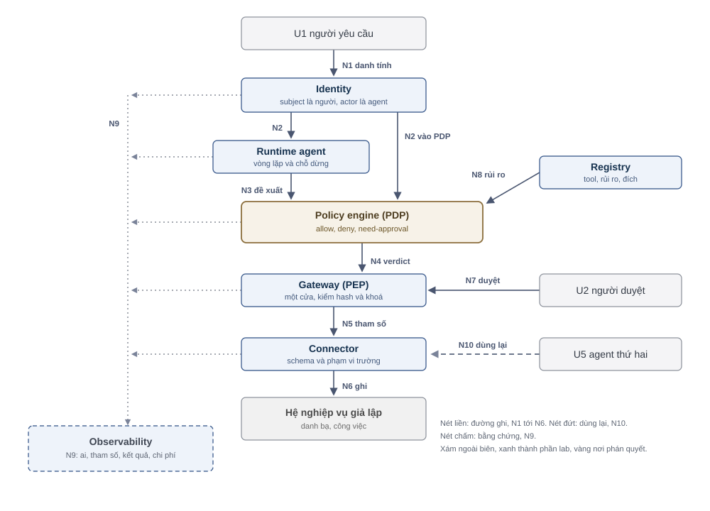

> **KHÔNG HỢP LỆ - KHÔNG ĐƯỢC THAM KHẢO.** Người sở hữu kết luận bản này chưa đạt ngày 2026-11-13.
> Không trích, không dùng làm nền cho bản sau, không dùng câu hỏi, mối nối hay ngưỡng nào trong đây cho bất kỳ mục đích nào.
> Bước 03 phải viết lại từ đầu; chưa có bản thay thế.
> File giữ nguyên tại chỗ làm bản ghi. Trạng thái: [`../REVIEW-STATUS.md`](../REVIEW-STATUS.md).

# Bước 03 - Câu hỏi nghiên cứu và giả thuyết kiểm được

Owner: Phạm Bách Hiệp. Mentor: Kevin.
Ngày: 2026-11-13. Revision 0.1.
Trạng thái: không hợp lệ, không được tham khảo. Không phải ADR.

Đây là đầu ra của bước 03 trong bảy bước của chương trình: chỉ ra điểm chưa rõ, giới hạn và giả định còn thiếu bằng chứng, rồi biến chúng thành research questions và giả thuyết kiểm chứng được.
Đơn vị của bước 03 là **kiến trúc đã ghép**, không phải năm phương pháp của bước 01.
Bước 01 hỏi mỗi phương pháp cho sẵn gì.
Bước 02 so năm phương pháp trên sáu trục.
Bước 03 hỏi điều gì còn chưa biết **sau khi ghép** bảy thành phần thành một hệ thống có ghi dữ liệu.

Đầu vào, tất cả đều là bản nháp chưa review:

- [`../reports/buoc-0-van-de-mo-hinh-he-thong-va-yeu-cau.md`](../reports/buoc-0-van-de-mo-hinh-he-thong-va-yeu-cau.md): SR1-SR8, M1-M6, bảy thành phần và ranh giới của chúng.
- [`07-kien-truc-ung-vien-tu-he-thong-that.md`](07-kien-truc-ung-vien-tu-he-thong-that.md): bốn phát hiện từ 44 mục khảo sát, tổ hợp P1-P5, giả thuyết H1-H7.
- [`08-khao-sat-nam-phuong-phap-tich-hop.md`](08-khao-sat-nam-phuong-phap-tich-hop.md): bản đồ hai tầng, ma trận phủ bảy thành phần, bốn phát hiện.
- [`09-bang-so-sanh-va-tieu-chi-lua-chon.md`](09-bang-so-sanh-va-tieu-chi-lua-chon.md): sáu trục so sánh, tiêu chí C1-C6, quy tắc loại, bảng phủ SR.
- `../program/Appota_AgentLize_Next_Gen_AI_RnD_8_Tuan_2026_Cap_Nhat.pdf`, trang 5: bước 03 yêu cầu research questions và giả thuyết có thể kiểm chứng.

Không file nào trong danh sách trên là bằng chứng.
Chúng là chỗ đặt câu hỏi, không phải chỗ lấy câu trả lời.
Bằng chứng của bước 03 là **thiết kế phép thử**, không phải câu trích.
Một câu hỏi ở đây chỉ được coi là đã trả lời khi có một lần chạy để lại lệnh, dữ liệu đầu vào và log.

## 0. Cách đọc

### 0.1. Năm điều kiện để một câu hỏi được nhận

1. Trả lời được bằng một lần chạy trên lab, không bằng đọc thêm tài liệu.
2. Phép thử nêu rõ đầu vào, số lần chạy và cách đếm.
3. Bác được: nêu trước kết quả nào làm câu trả lời đảo chiều.
4. Trỏ được về một mối nối giữa hai thành phần, và về ít nhất một mã SR hoặc M.
5. Nêu được cái gì đổi ở bước 04 nếu câu trả lời là ngược lại.

Một câu hỏi mà mọi câu trả lời đều dẫn tới cùng một hành động là câu hỏi giả, và bị loại ở mục 5.

### 0.2. Quy ước đánh số

- `N1` đến `N10`: mối nối giữa hai thành phần, định nghĩa ở mục 1.2.
- `Q1` đến `Q7`: câu hỏi chặn ADR, định nghĩa ở mục 2.
- `G1` đến `G10`: giả thuyết, định nghĩa ở mục 3.

Giả thuyết dùng chữ `G`, không nối tiếp `H1`-`H7` của file 07, để hai bộ không đụng số khi file 07 được review.
Quan hệ giữa hai bộ ở mục 3.2.

### 0.3. Ba nhãn

- `chặn ADR`: bước 04 không được chọn tổ hợp khi câu này chưa có câu trả lời kèm log.
- `đo ở 06`: câu trả lời cần bộ đo đầy đủ, nên để bước 06.
- `KHÔNG BIẾT`: chưa có dữ kiện. Không được thay bằng ước lượng, và không được quy thành 0.

## 1. Kiến trúc đang bị hỏi

### 1.1. Bảy thành phần và mười mối nối

Sơ đồ dưới đây lấy nguyên bảy thành phần của bước 0 mục 2.1, và thêm một thứ bước 0 chưa vẽ: **nhãn cho từng mối nối**.
Mỗi mối nối là một hợp đồng phải chốt giữa hai thành phần.
Câu hỏi của bước 03 nằm ở mối nối, không nằm trong lòng một thành phần, vì trong lòng thành phần thì không còn gì chưa biết: ai viết cũng biết code mình viết gì.
Cái chưa biết là chỗ hai thành phần hiểu khác nhau về cùng một dữ kiện.

Hình 1. Bảy thành phần của bước 0, cộng mười mối nối mà bước 0 chưa đặt tên.

### 1.2. Mười mối nối

| Mã | Từ | Tới | Hợp đồng phải chốt | Vỡ ngầm khi | Câu hỏi |
| --- | --- | --- | --- | --- | --- |
| N1 | Người yêu cầu, hệ ngoài | Identity | Danh tính hai lớp: subject là người, actor là agent | Agent dùng credential dịch vụ rồi tự nhận là người | Q2, Q7 |
| N2 | Identity | Runtime agent, Policy engine | Cặp danh tính đi nguyên vẹn qua mọi hop, không hop nào được nâng quyền | Một hop đổi sang token dịch vụ, các tầng sau mất người yêu cầu | Q2, Q7 |
| N3 | Runtime agent | Policy engine | Payload đề xuất gồm tool, tham số, hash, và dữ liệu đã đọc để đề xuất | Runtime tính hash một kiểu, executor tính lại kiểu khác | Q5, Q6 |
| N4 | Policy engine | Gateway | Verdict allow, deny hoặc need-approval, kèm mã luật và hash | Verdict không mang hash, hoặc gateway tự tính lại hash | Q5, Q6 |
| N5 | Gateway | Connector | Danh sách trường cụ thể và tham số đã chuẩn hoá | Connector chuyển nguyên payload hệ đích trả về lên agent | Q3 |
| N6 | Gateway, Connector | Hệ nghiệp vụ | Khoá chống trùng, trạng thái "đã gọi", cách đối soát | Hệ đích bỏ qua khoá, và không ai ghi ý định trước khi gọi | Q4 |
| N7 | Người duyệt | Gateway, tức nơi thực thi | Quyết định gắn hash, hạn dùng, id người duyệt, và tiền điều kiện của bản ghi | Duyệt theo id lời gọi, hoặc bản ghi đổi giữa lúc duyệt và lúc ghi | Q5, Q6 |
| N8 | Registry | Policy engine | Tool nào tồn tại, mức rủi ro mặc định, đích nào được duyệt | Hai nguồn sự thật, tool mới không có luật thành đường vòng | Q2 |
| N9 | Mọi thành phần | Observability | Danh sách trường bằng chứng, gồm chi phí và danh tính người duyệt | Trace thiếu người yêu cầu, thiếu người duyệt, thiếu chi phí | Q7 |
| N10 | Connector | Agent thứ hai | Đơn vị tái dùng, và biên quyền riêng của agent thứ hai | Chia sẻ credential của connector, quyền đi theo | Q2 |

Ba mối nối dễ bị bỏ qua nhất, đọc từ bảng trên:

- **N2** vì nó là một trục xuyên tầng, không phải một cạnh trong sơ đồ, nên không ai viết test cho nó.
- **N6** vì nó là biên với hệ thật, và hệ thật là thứ lab giả lập, nên lab có thể vô tình làm nó dễ hơn thực tế.
- **N8** vì registry và policy là hai kho dữ liệu khác nhau, và không ai bắt chúng phải đồng ý.

## 2. Bảy câu hỏi chặn ADR

Mỗi câu dưới đây theo cùng bảy mục, để đọc so sánh được.

### Q1. Thành phần nào trong bảy thật sự chịu lực?

**Mối nối:** toàn bộ N1 đến N10, đo bằng cách bỏ từng thành phần.

**Vì sao chưa trả lời được:** bước 0 mục 2.1 tự ghi sơ đồ bảy thành phần là "giả thuyết để hình dung, không phải kết luận".
Cách cắt "mỗi thành phần sở hữu đúng một quyết định" là một tiêu chí thiết kế, chưa phải một phép thử.
File 07 mục 2 cho thấy hệ thống thật tách bảy thành phần, nhưng đó là mô tả tài liệu sản phẩm, không phải phép thử trên lab.
Chưa có lần chạy nào bỏ một thành phần để xem quyết định của nó có còn chỗ trả lời không.

**Trả lời bằng:** bảy lần chạy, mỗi lần thay một thành phần bằng stub, giữ nguyên sáu thành phần còn lại, chạy bộ tám test SR trên dữ liệu giả lập (danh bạ, công việc).

**Đạt khi:** mỗi thành phần có một dòng kết quả ghi rõ bỏ nó thì test SR nào fail.
Thành phần không làm fail test nào là thành phần không chịu lực ở quy mô lab.

**Nếu câu trả lời là ngược lại:** nếu Gateway không chịu lực, tổ hợp tối thiểu nhỏ hơn P2, và tiêu chí C3 ở bước 02 phải chấm lại.
Nếu Registry không chịu lực, cả một nhóm cấu hình biến mất khỏi phạm vi MVP.

**Không được trả lời bằng:** "kiến trúc tham chiếu của nhà cung cấp có thành phần đó nên ta cũng cần". Đó là lập luận từ tên sản phẩm, đúng loại lập luận mà file 08 mục 1 đã cấm.

### Q2. Cái gì chứng minh chỉ có một đường ghi?

**Mối nối:** N4, N6, N8, N10.

**Vì sao chưa trả lời được:** SR1 nói "một đường thực thi duy nhất" nhưng không nói phép thử nào chứng minh điều đó.
Bước 0 mục 2.1 đặt Gateway làm cửa duy nhất, và đó là thiết kế, chưa phải kết quả.
File 07 mục 3.2 dẫn một câu của Microsoft Foundry rằng endpoint MCP không chặn `tools/call`, nhưng đó là sản phẩm khác, không phải lab.
Chưa ai gọi thử đường vòng.

**Trả lời bằng:** ba lần chạy riêng biệt.

1. Một client thứ hai gọi thẳng endpoint ghi, không qua runtime agent.
2. Agent thứ hai không có quyền gọi tool ghi, nhưng dùng chung connector.
3. Một tool mới khai rủi ro cao trong registry, chưa có luật policy.

**Đạt khi:** cả ba lần bị từ chối, và mỗi lần từ chối để lại một bản ghi trace có lý do đọc được, không chỉ có mã lỗi.

**Nếu câu trả lời là ngược lại:** nếu lần 1 ghi được, điểm dừng không được đặt ở runtime, và Q6 có câu trả lời bằng dữ kiện thay vì bằng lập luận.
Nếu lần 3 ghi được, mặc định của hệ thống là allow, tức SR5 sai ở đường tool mới.

**Không được trả lời bằng:** sơ đồ. Sơ đồ là chỗ đặt giả thuyết, không phải chỗ kiểm nó.

### Q3. Phạm vi trường và bản ghi bị cắt ở đâu?

**Mối nối:** N5.

**Vì sao chưa trả lời được:** bước 0 mục 2.2 giao Policy engine quyết phạm vi và Connector áp danh sách trường.
Nhưng không có dòng nào nói ai kiểm rằng danh sách đó được tôn trọng.
Cả hai hệ nghiệp vụ đều do lab viết, nên "hệ đích trả đúng trường" là giả định của người viết, không phải tính chất của hệ đích.

**Trả lời bằng:** một lần đọc với phạm vi hai trường, trong khi hệ đích trả về toàn bộ bản ghi.
Kiểm payload ở ba điểm: connector trả ra, gateway trả ra, agent nhận.
Chạy 100 lần, đếm số trường ngoài phạm vi ở từng điểm.

**Đạt khi:** 0 trường ngoài phạm vi ở điểm agent nhận, 100 trên 100 lần, và ghi rõ tầng nào đã cắt.

**Nếu câu trả lời là ngược lại:** nếu phải cắt ở gateway, SR3 vẫn đạt nhưng dữ liệu ngoài phạm vi đã đi qua một hop nội bộ, và ADR phải nói rõ điều đó thay vì nói "connector tự cắt".
Nếu phải cắt ở cả hai, đó là hai chỗ cùng một luật, tức vi phạm C3.

**Không được trả lời bằng:** đọc code connector. Code nói nó định cắt, không nói nó đã cắt.

### Q4. "Gọi rồi nhưng chưa biết" được ghi ở đâu?

**Mối nối:** N6.

**Vì sao chưa trả lời được:** SR6 tự ghi điều kiện "chỉ đúng khi hệ thống nghiệp vụ tôn trọng khóa".
Lab viết cả hai hệ giả lập, nên có thể chọn đích biết tôn trọng khoá, làm SR6 đúng một cách giả tạo.
Đó là cái bẫy lớn nhất của bước 05, và bước 03 phải chặn nó trước khi nó xảy ra.
Chưa có quyết định nào về chỗ ghi ý định trước khi gọi.

**Trả lời bằng:** hai cấu hình đích, một biết tôn trọng khoá và một không.
Cùng một kịch bản: cắt phản hồi sau khi đích đã ghi, rồi retry 10 lần.
Đếm số bản ghi ở đích, và đếm số lần hệ thống biết chắc "chưa gọi" so với "đã gọi nhưng chưa biết kết quả".

**Đạt khi:** với đích không tôn trọng khoá, hoặc đếm được số bản ghi trùng, hoặc chứng minh được cơ chế bù (ghi ý định trước khi gọi, cộng một bước đối soát) và chỉ ra nó nằm ở thành phần nào.

**Nếu câu trả lời là ngược lại:** nếu cần ghi ý định trước khi gọi, đó là một kho dữ liệu mới, tức thành phần thứ tám ở mức dữ liệu, và ADR phải nói nó nằm ở đâu chứ không được để nó mọc ra trong lúc code.

**Không được trả lời bằng:** "đích giả lập của lab có hỗ trợ khoá". Đó chính là giả định cần kiểm.

### Q5. Quyết định duyệt ràng buộc cái gì, và sống bao lâu?

**Mối nối:** N3, N4, N7.

**Vì sao chưa trả lời được:** file 07 mục 3.1 kết luận không hệ thống nào trong 12 hệ thống đã đọc có hash hoặc chữ ký trên tham số tại thời điểm duyệt.
Nghĩa là phần này chắc chắn do lab viết, không mua được.
Nhưng chưa có quyết định về ba thứ: hash tính trên dạng dữ liệu nào, quyết định duyệt có ràng buộc tiền điều kiện của bản ghi hay không, và hạn dùng dài bao lâu.

**Trả lời bằng:** ba nhánh thử trên cùng một đề xuất.

1. Serialize cùng một payload theo 20 biến thể tương đương: thứ tự khoá, số 1 so với 1.0, Unicode NFC so với NFD, khoảng trắng, escape.
2. Sửa một trường tham số sau khi duyệt.
3. Đổi trạng thái bản ghi giữa lúc duyệt và lúc ghi, và một nhánh riêng để quyết định duyệt quá hạn.

**Đạt khi:** nhánh 1 cho đúng một hash; nhánh 2 và nhánh 3 bị chặn 100 trên 100 lần.

**Nếu câu trả lời là ngược lại:** nếu nhánh 3 không bị chặn, SR4 chỉ đúng trên giấy: quyết định duyệt ràng buộc tham số nhưng không ràng buộc thế giới mà tham số đó nói tới.
Khi đó ADR phải thêm tiền điều kiện vào payload duyệt, và đó là một yêu cầu mới phát sinh từ bước 03.

**Không được trả lời bằng:** "dùng hash SHA-256 là đủ". Hash đúng thuật toán vẫn sai nếu đầu vào không được chuẩn hoá trước.

### Q6. Điểm dừng gắn hash tham số đặt ở runtime hay ở executor?

**Mối nối:** N3, N4, N7.

**Vì sao chưa trả lời được:** ba tài liệu nói ba kiểu.
Bước 0 mục 2.1 đặt bước duyệt trên cạnh từ policy engine tới gateway.
File 07 mục 7 khuyến nghị đặt hash ở executor.
File 09 mục 5 ghi SR4 chỉ đạt `một phần` ở ba mô hình, và cả ba đều neo quyết định duyệt theo id của lời gọi.
Chưa có phép thử nào so hai chỗ đặt.

**Trả lời bằng:** hai bản dựng nhỏ trên cùng một bộ test.
Bản (i) dừng trong vòng lặp agent, bản (ii) dừng trong executor.
Chạy G2 và toàn bộ tám test SR trên cả hai.

**Đạt khi:** một trong hai qua toàn bộ SR1-SR8, và số thành phần phải chạy ít hơn.

**Nếu câu trả lời là ngược lại:** nếu cả hai cùng qua, quyết định theo C3 (ít thành phần hơn) và ghi lại là hòa có lý do, đúng quy tắc hòa ở file 09 mục 2.5.
Nếu cả hai cùng trượt, SR4 không đạt ở tổ hợp nào đã dựng, và ADR phải nói rõ phải dựng thêm gì.

**Ghi chú về số hiệu:** câu này mang số Q6 vì file 09 mục 2.6 và mục 10 đã gọi tên "câu Q6 của file 08 về chỗ đặt SR4".
File 08 không có câu hỏi nào được đánh số, nên tên đó đang treo.
File này nhận lại số Q6 cho đúng câu đó; chỗ vênh ghi ở mục 6.1.

### Q7. Bằng chứng tối thiểu để dựng lại một quyết định là gì, và nó nằm ở một nguồn hay ba?

**Mối nối:** N9, cộng N2 và N7 cho phần danh tính.

**Vì sao chưa trả lời được:** SR7 đòi một trace trả lời ai, lúc nào, vì sao, kết quả, chi phí.
Kiến trúc hiện có ba danh tính đi qua một lần ghi: người yêu cầu, agent, người duyệt.
Bước 0 mục 2.2 chỉ định nghĩa hai lớp danh tính, nên người duyệt chưa có chỗ trong mô hình.
Chưa có danh sách trường tối thiểu, và chưa có phép thử nào hỏi người kiểm tra trả lời được mấy câu chỉ bằng trace.

**Trả lời bằng:** một lần ghi có duyệt, rồi trả lời năm câu của U4 trong bước 0 mục 1.2, chỉ dùng trace, không mở hệ thống khác.
Đếm số câu trả lời được và số lần phải mở nguồn thứ hai.

**Đạt khi:** 5 trên 5 câu, 0 lần mở nguồn thứ hai, và chi phí của lần ghi đó nằm trong cùng trace.

**Nếu câu trả lời là ngược lại:** nếu thiếu danh tính người duyệt, phải tự định nghĩa một trường, và trường đó phải được khai trong evidence contract chứ không được thêm tuỳ tiện.
Nếu chi phí không join được, M3 phải tính bằng một phép join riêng, và ADR phải ghi rõ khoá join.

**Không được trả lời bằng:** "OpenTelemetry có trace là đủ". Đủ để xem một lời gọi, chưa chắc đủ để dựng lại một quyết định.

## 3. Mười giả thuyết

Mỗi giả thuyết viết như một rủi ro, theo cách của file 07 mục 6: phát biểu điều có thể hỏng, rồi nói trước kết quả nào bác nó.
Cột "bị bác khi" là phần quan trọng nhất; một giả thuyết không bác được thì không phải giả thuyết.

### 3.1. Bảng giả thuyết

| Mã | Giả thuyết | Câu | Phép thử | Bị bác khi | Nếu được ủng hộ |
| --- | --- | --- | --- | --- | --- |
| G1 | Bỏ Gateway (PEP) và để policy engine gọi connector trực tiếp vẫn qua đủ tám test SR | Q1 | Bảy lần chạy, mỗi lần bỏ một thành phần, giữ sáu thành phần còn lại | Ít nhất một test SR fail ở lần bỏ Gateway | Gateway không chịu lực ở quy mô lab; tổ hợp tối thiểu nhỏ hơn P2; C3 phải chấm lại |
| G2 | Bước duyệt đặt trong runtime agent thì client thứ hai gọi thẳng endpoint ghi vẫn ghi được, không cần duyệt | Q2, Q6 | Client thứ hai gọi cùng endpoint với tham số hợp lệ, không có phiên duyệt, 100 lần | 100 trên 100 lần bị từ chối | Điểm dừng phải nằm ở executor; Q6 có câu trả lời bằng dữ kiện |
| G3 | Hash tính trên JSON thô không ổn định qua các lần serialize tương đương | Q5 | 20 biến thể tương đương và 5 biến thể khác nghĩa của cùng một payload | Đúng một hash cho 20 biến thể, và 5 hash khác nhau cho 5 biến thể khác nghĩa | Phải chuẩn hoá trước khi hash; ADR phải ghi chuẩn hoá nằm ở thành phần nào |
| G4 | Quyết định duyệt không có hạn dùng và không ràng buộc tiền điều kiện vẫn thực thi được khi bối cảnh đã đổi | Q5 | Hai nhánh: chờ quá hạn, và đổi trạng thái bản ghi giữa duyệt và ghi; 10 lần mỗi nhánh | Cả hai nhánh bị chặn ở 100 phần trăm số lần | SR4 chỉ đúng trên giấy; phải thêm hạn dùng và tiền điều kiện vào payload duyệt |
| G5 | Với đích không tôn trọng khoá, retry sau khi mất phản hồi tạo bản ghi thứ hai dù đã có khoá ở biên | Q4 | Đích giả lập bỏ qua header khoá; cắt phản hồi sau khi ghi; retry 10 lần | Đúng một bản ghi ở 10 trên 10 lần chạy | SR6 cần ghi ý định trước khi gọi cộng đối soát, không chỉ khoá; ADR phải chỉ chỗ đặt |
| G6 | Nếu chỉ cắt phạm vi ở một tầng, trường ngoài phạm vi vẫn tới được agent | Q3 | Đọc với phạm vi hai trường trong khi đích trả toàn bộ; kiểm payload ở ba điểm; 100 lần | 0 trường ngoài phạm vi ở cả ba điểm, 100 trên 100 lần | Ghi rõ tầng nào để lọt; SR3 chưa đạt ở tổ hợp đang dựng |
| G7 | Khi policy engine không trả lời, hệ thống chặn đúng nhưng treo theo timeout mặc định, làm p95 vượt ngưỡng sàn | Q2 | Tắt policy engine; 100 request; đếm số request đi qua và p95 của nhánh bị chặn | 0 request đi qua và p95 nhánh chặn không quá 1 giây | Fail-closed đúng nhưng cần timeout riêng; M1 phải tách nhánh chặn khỏi nhánh chạy |
| G8 | Tool mới khai rủi ro cao trong registry nhưng chưa có luật policy sẽ được cho qua | Q2 | Thêm một tool ghi, không thêm luật, gọi 10 lần | 10 trên 10 lần bị từ chối | Mặc định không an toàn; ADR phải nói rõ nguồn rủi ro là registry hay policy |
| G9 | Một trace dựng theo chuẩn không trả lời được "ai đã duyệt" và không chứa chi phí trong cùng một nguồn | Q7 | Một lần ghi có duyệt; trả lời năm câu của U4 chỉ bằng trace | 5 trên 5 câu trả lời được, 0 lần mở nguồn thứ hai | Phải có evidence contract với trường tự định nghĩa, và một khoá join cho chi phí |
| G10 | Credential nằm trong connector thì agent thứ hai dùng lại connector sẽ thừa hưởng quyền | Q2 | Agent A có quyền ghi, agent B không; B gọi cùng tool; đếm số lần B ghi được và số dòng connector phải sửa để thêm B | B bị từ chối 10 trên 10 lần và 0 dòng connector phải sửa | Credential phải nằm ở gateway, không ở connector; M6 và SR8 cùng sai nếu ngược lại |

### 3.2. Quan hệ với H1-H7 của file 07

Không giả thuyết nào ở trên thay H1-H7; chúng bổ sung phần ở tầng ghép mà H1-H7 chưa phủ.
Bảng dưới để không ai phải kiểm hai lần một việc.

| Giả thuyết file 07 | Câu hỏi ở file này | Ghi chú |
| --- | --- | --- |
| H1 duyệt không ràng buộc tham số | Q5 | G3 và G4 chia H1 thành hai nhánh: dạng dữ liệu, và thế giới đổi |
| H2 policy theo tham số chặn được khi prompt bị viết lại | Q2 | Trùng ý với lần chạy 1 của Q2, dùng chung một log |
| H3 khoá idempotency ở executor tốt hơn ở client | Q4 | G5 là bản khó hơn: đích không tôn trọng khoá |
| H4 hai agent chung connector thừa hưởng quyền | Q2, SR8 | G10 là phép thử của H4, thêm phép đếm dòng sửa connector |
| H5 chờ duyệt bằng durable workflow rẻ hơn giữ process | Q6 | Tính trước bằng giá niêm yết, đo lại ở 06; đảo được thứ tự P1 và P3 |
| H6 gateway và policy làm tăng p95 | Q1, Q2 | G7 tách nhánh chặn; G1 đo chi phí của việc giữ thành phần |
| H7 OTel thiếu danh tính người dùng cuối | Q7 | G9 mở rộng sang người duyệt và chi phí |

## 4. Ngưỡng phải chốt trước lần chạy đầu

Ngưỡng dưới đây là đề xuất, chưa chốt.
Theo quy tắc ở file 09 mục 2.7, ngưỡng phải được ghi ngày trước lần chạy đầu tiên, và sửa sau khi đã chạy thì giả thuyết tương ứng bị vô hiệu.

| Ngưỡng | Giá trị đề xuất | Giả thuyết | Ngày chốt | Người chốt |
| --- | --- | --- | --- | --- |
| Số trường ngoài phạm vi ở điểm agent nhận | 0 | G6 | chưa chốt | |
| Số hash cho 20 biến thể tương đương | 1 | G3 | chưa chốt | |
| Số lần client thứ hai ghi được ngoài luồng duyệt | 0 trên 100 | G2 | chưa chốt | |
| p95 của nhánh bị chặn khi policy engine chết | không quá 1 giây | G7 | chưa chốt | |
| Số câu U4 trả lời được chỉ bằng trace | 5 trên 5 | G9 | chưa chốt | |
| Số dòng connector phải sửa để thêm agent thứ hai | 0 | G10 | chưa chốt | |
| Số bản ghi trùng khi đích không tôn trọng khoá | 0, hoặc có cơ chế bù đã chứng minh | G5 | chưa chốt | |

## 5. Câu hỏi cố ý không hỏi

Bước 03 chỉ có giá trị khi nó cũng nói được cái gì không hỏi.

| Không hỏi | Vì sao |
| --- | --- |
| Phương pháp nào tốt hơn | Sai đơn vị, đã chốt ở file 09 mục 1: năm phương pháp không cùng tầng và không cùng đơn vị giá |
| Model nào thông minh hơn | Không thuộc câu hỏi trung tâm; Track 01 hỏi đường đi và quyền, không hỏi chất lượng model |
| Giá của nhà cung cấp là bao nhiêu | Là số đọc lại tại ngày đo, và không thay được M3; đo ở 06 |
| Tổ hợp nào thắng | Là đầu ra của bước 04, sau khi Q1 đến Q7 có câu trả lời |
| Giao diện màn hình duyệt trông thế nào | Là yêu cầu của U2 ở bước 0 mục 1.2, không phải câu hỏi nghiên cứu; làm ở bước 05 |
| Chạy nhiều người dùng, nhiều tổ chức cùng lúc | Ngoài phạm vi MVP; M4 chỉ đo 3 lên 30 tool, không đo đa tổ chức |

## 6. Chỗ vênh phải sửa trước khi dùng file này

Năm chỗ dưới đây là chỗ các bản nháp đang nói khác nhau.
Không chỗ nào được tự sửa trong file khác khi file đó chưa review.

### 6.1. Câu Q6 đang treo

`grep -n "Q6" docs/research/09-bang-so-sanh-va-tieu-chi-lua-chon.md` trả về đúng hai dòng, ở mục 2.6 và mục 10.
Cả hai gọi "câu Q6 của file 08", nhưng `grep -n "Q[0-9]" docs/research/08-khao-sat-nam-phuong-phap-tich-hop.md` không trả về dòng nào: file 08 không có câu hỏi nào được đánh số.
Cách sửa: file này nhận Q6 cho đúng câu "chỗ đặt SR4"; lần sửa file 09 tới đổi "của file 08" thành "của file 11".

### 6.2. Định nghĩa ba mức chưa chốt

File 08 mục 4 và file 09 mục 5 lệch nhau ở ba ô: SR2 và SR5 của agent orchestration, SR8 của event-driven.
Nguyên nhân là hai file dùng "một phần" theo hai nghĩa khác nhau.
Đề nghị chốt bằng một câu, áp cho cả hai file:

- `cung cấp sẵn`: nguồn gốc định nghĩa cơ chế **và** tự thi hành nó.
- `một phần`: có mốc nối, nhưng quyết định cuối cùng thuộc bên tích hợp.
- `không nói tới`: nguồn gốc không có khái niệm này.

Theo định nghĩa đó, ba ô lệch phải chốt lại: SR2 và SR5 của agent orchestration là `một phần` vì nguồn chỉ nói quy tắc duyệt, không nói kiểm quyền; SR8 của event-driven là `cung cấp sẵn` vì định dạng event tách hẳn khỏi giao thức.
Đây là đề xuất, chưa phải quyết định.

### 6.3. "30 tool" chưa có nghĩa

File 09 mục 7 ghi ô này là ô trống phải chốt trước lần đo M4.
Đề nghị: 30 tool nghĩa là 30 mục trong `tools/list` của cùng một connector, mỗi mục có schema riêng, không phải 30 endpoint và không phải 30 loại sự kiện.
Chốt câu này trước lần chạy đo M4, và ghi ngày.

### 6.4. Hai hệ tên cho cùng một thứ

File 05 gọi ba kiến trúc A, B, C; file 07 gọi năm tổ hợp P1 đến P5, và mục 4.1 đã ánh xạ A, B, C vào P1 và P3.
Đề nghị: bước 04 dùng P1 đến P5 làm đơn vị quyết định, giữ A, B, C làm khung đo của file 05.
Không đổi tên trong file nào trước khi chúng được review.

### 6.5. Ba tiền đề chưa review

Mọi tiền đề của file này đến từ 07, 08, 09 và bước 0, và cả bốn đều chưa được review xong.
Nghĩa là bước 03 đang đặt câu hỏi trên một nền chưa xác nhận.
Hai cách xử lý, chọn một trước khi viết ADR: review xong ba file, hoặc chạy lại ba script kiểm nguồn tại chỗ.

| Script | Phủ gì | Số phép kiểm |
| --- | --- | --- |
| `bash docs/research/checks/verify-sources-08.sh` | 68 câu trích của file 08 | 68 |
| `bash docs/research/checks/verify-sources-09.sh` | 21 câu trích của file 09 | 21 |
| `bash docs/research/checks/verify-report-2.sh` | 9 phép kiểm mục 2.3 của bước 0 | 9 |

## 7. Thứ tự trả lời và việc tiếp theo

### 7.1. Thứ tự

Thứ tự dưới đây theo quan hệ phụ thuộc, không theo số hiệu.

1. **Q6** trước, vì nó là biến thiết kế. Chưa chốt chỗ đặt điểm dừng thì không dựng được gì để thử.
2. **Q5** sau Q6, vì phép thử đường vòng ở Q2 chỉ có nghĩa khi đã có một quyết định duyệt thật để vòng qua.
3. **Q2**, rồi **Q3**, rồi **Q4**, vì ba câu này dùng chung một bản dựng.
4. **Q1** sau cùng trong nhóm chặn ADR, vì phép bỏ thành phần cần một bản dựng đã chạy được.
5. **Q7** sau Q2 và Q5, vì trace chỉ kiểm được khi đã có một lần ghi có duyệt.

### 7.2. Việc tiếp theo

| Thứ tự | Việc | Xong khi |
| --- | --- | --- |
| 1 | Chốt định nghĩa ba mức ở 6.2 | Có một câu, có ngày, áp cho cả file 08 và 09 |
| 2 | Chốt nghĩa "30 tool" ở 6.3 | Có một câu và một ngày, sớm hơn ngày đo M4 |
| 3 | Chốt bảy ngưỡng ở mục 4 | Mỗi dòng có ngày và người chốt, sớm hơn lần chạy đầu |
| 4 | Trả lời Q6 bằng hai bản dựng nhỏ | Có log của G2 trên cả hai bản |
| 5 | Trả lời Q1 đến Q5, Q7 | Mỗi câu có một log, một lệnh, một dữ liệu đầu vào |
| 6 | Sửa tên Q6 trong file 09 | `grep -n "Q6" docs/research/09-bang-so-sanh-va-tieu-chi-lua-chon.md` không còn dòng nào trỏ file 08 |

## 8. Giới hạn của file này

- Không có số đo. Mọi ngưỡng ở mục 4 là đề xuất.
- Không chọn tổ hợp, không xếp hạng. Q6 là câu hỏi, không phải câu trả lời.
- Mười mối nối là cách cắt của người viết, chưa được kiểm. Nếu một câu hỏi không nằm gọn trong một mối nối, đó là dấu hiệu cách cắt sai, và phải sửa mục 1.2 chứ không sửa câu hỏi.
- Bảy câu hỏi chưa được thử với người ngoài. Một câu hỏi chỉ thật sự rõ khi người thứ hai đọc và nêu được phép thử mà không cần hỏi lại.
- Dữ liệu dùng cho mọi phép thử là dữ liệu giả lập, theo ranh giới dữ liệu ở `AGENTS.md` mục 5. Không dùng dữ liệu thật, không dùng credential thật.

## Nhật ký revision

| Ngày | Người | Thay đổi | Trạng thái |
| --- | --- | --- | --- |
| 2026-11-13 | Agent (Pi) | Tạo file. Bảy câu hỏi chặn ADR ở tầng kiến trúc ghép, mười mối nối, mười giả thuyết, bảy ngưỡng đề xuất, năm chỗ vênh. Không có số đo, không chọn tổ hợp | Chưa review |
| 2026-11-13 | Phạm Bách Hiệp | Kết luận chưa đạt. Đánh dấu không hợp lệ, không được tham khảo. Không có bản thay thế | Không hợp lệ |
