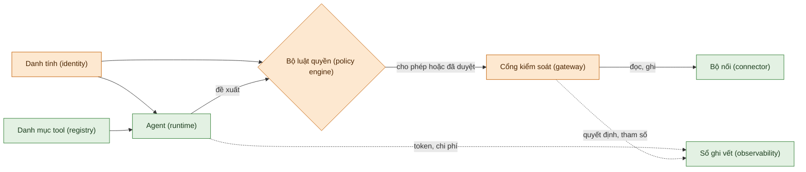

# So sánh phương án

Ngày: 2026-11-15. Trạng thái: bản nháp, chưa chọn kiến trúc, chưa có số đo của Lab.

Mọi đánh giá dưới đây là kết quả đọc tài liệu nguồn, chưa thử trên Lab.
Tám yêu cầu dùng để đối chiếu lấy từ [PRD](../00-frame/prd-ai-platform.md).

## Đọc nhanh

- Để AI chuyển một việc từ người này sang người khác thay cho một nhân viên, Lab phải chọn một trong năm cách phổ biến để nối AI với hệ thống công việc.
- Năm cách không thay thế nhau: mỗi cách làm sẵn một việc khác, như gọi công cụ, dùng chung công cụ, giữ việc đang chờ duyệt, chia việc cho nhiều AI, báo tin sau khi ghi.
- Không cách nào tự biết ai đang yêu cầu và người đó được làm gì, cũng không cách nào tự chặn việc ghi hai lần.
- Đề xuất: Lab tự dựng một cửa chung cho các việc đó, đặt cạnh nhau hai cách nối công cụ là gọi hàm trực tiếp và cách chuẩn chung cho nhiều nơi gọi, ba cách còn lại chỉ thêm khi phép thử cho thấy thiếu.
- Tiếp theo: biến những điều chưa biết thành phép thử, rồi chốt cách làm trong một bản ghi quyết định.

## Nhân vật và tình huống

Ví dụ trong bài dùng chung một câu chuyện ở phòng Vận hành, lấy từ [PRD, mục 1.1 và 3.2](../00-frame/prd-ai-platform.md#11-một-buổi-sáng-của-chị-hoa).
Mọi người và dữ liệu đều là giả lập.

| Ai | Là ai | Được làm gì với task |
| --- | --- | --- |
| Chị Hoa | Nhân viên phòng Vận hành, người nhờ AI | Chuyển task của phòng mình; chuyển từ 5 task trở lên phải chờ duyệt |
| Nam | Thực tập sinh phòng Vận hành | Chỉ xem và sửa mô tả task, không được chuyển task |
| Anh Quang | Trưởng nhóm Vận hành, người duyệt | Chuyển task phòng mình, kể cả hàng loạt; duyệt lệnh của nhân viên |
| Chị Lan | Đồng nghiệp đang nghỉ ốm | Đang phụ trách các task cần chuyển |
| Anh Minh | Đồng nghiệp nhận việc | Người nhận task |

Không ai trong năm người trên được sửa task của phòng khác, ví dụ phòng Kinh doanh, hay xem số điện thoại cá nhân của đồng nghiệp.

Ba tình huống lặp lại trong bài:

- **Chuyển T-12:** chị Hoa nhờ AI chuyển task T-12 "Gọi lại khách hàng X" từ chị Lan sang anh Minh, hạn thứ Sáu.
- **Nam gõ đúng câu đó:** AI phải từ chối, vì Nam không được chuyển task.
- **Chuyển 30 task:** chị Hoa nhờ chuyển hết 30 task của chị Lan; lệnh dừng lại chờ anh Quang duyệt, lời duyệt hết hạn lúc 15:30.

# 1. Năm cách, năm việc khác nhau

Chương trình R&D yêu cầu khảo sát năm cách ([chương trình R&D, trang 5-6](../../docs/program/Appota_AgentLize_Next_Gen_AI_RnD_8_Tuan_2026_Cap_Nhat.txt)).
Bảng dưới đặt yêu cầu "chuyển T-12 sang anh Minh, hạn thứ Sáu" của chị Hoa vào từng cách.

| Cách | Việc nó làm | Với yêu cầu của chị Hoa |
| --- | --- | --- |
| Gọi hàm (function calling) | Model nói "gọi hàm này với tham số này"; ứng dụng chạy hàm rồi trả kết quả cho model. | Agent gọi `get_employee` tra email công việc của anh Minh, rồi đề xuất gọi `update_task` cho T-12; khung trò chuyện tự chạy hai hàm đó. |
| MCP (Model Context Protocol) | Cách chuẩn chung để agent tìm và gọi công cụ; công cụ nằm ở một máy chủ MCP, nơi gọi nào hỗ trợ MCP cũng xem được danh sách và gọi. | Khung trò chuyện của Lab và một công cụ lập trình cùng gọi một máy chủ chứa `get_employee` và `update_task`, không nơi nào phải chép code. |
| Công cụ chạy quy trình (workflow engine) | Giữ trạng thái từng bước của quy trình, kể cả lúc dừng chờ. | Lệnh chuyển 30 task chờ anh Quang duyệt đến 15:30; ứng dụng khởi động lại giữa chừng vẫn nhớ đề xuất. |
| Điều phối agent (agent orchestration) | Quyết định agent nào làm bước nào. | Một agent tra danh bạ tìm anh Minh, một agent khác sửa T-12. |
| Tích hợp theo sự kiện (event-driven) | Một bên phát tin "đã xảy ra việc X", các bên khác tự nhận tin và xử lý. | Sau khi T-12 đổi người phụ trách, hệ thống công việc phát tin để gửi thông báo cho anh Minh. |

Mỗi cách làm một việc, nên câu hỏi đúng là "cách này làm sẵn việc gì", không phải "cách nào thắng".
Các cách ghép được với nhau, ví dụ MCP cung cấp công cụ còn công cụ chạy quy trình giữ đề xuất đang chờ duyệt.

# 2. Mỗi cách làm sẵn thành phần nào

PRD chia hệ thống thành bảy thành phần ([PRD, phụ lục A](../00-frame/prd-ai-platform.md#phụ-lục-a---bảy-thành-phần-và-ranh-giới)).
Sơ đồ dưới tô màu theo kết quả đối chiếu: màu xanh là thành phần có cách làm sẵn một phần, màu cam là thành phần không cách nào làm sẵn.

| Thành phần | Việc của nó với yêu cầu của chị Hoa | Cách nào làm sẵn một phần | Lab tự dựng |
| --- | --- | --- | --- |
| Agent (runtime) | Hiểu câu của chị Hoa, soạn đề xuất, dừng lại khi lệnh cần duyệt. | Công cụ chạy quy trình và điều phối agent đều có bước tạm dừng chờ duyệt và giữ được tiến độ. | Quy tắc khi nào phải dừng chờ duyệt. |
| Bộ nối (connector) | Gọi hệ thống công việc để sửa T-12, chỉ trả về các trường được phép. | Gọi hàm và MCP đều có mô tả tool: tên, tham số, kiểu dữ liệu. | Code gọi hệ thống nghiệp vụ, đưa lỗi về một dạng chung, chỉ trả đúng các trường cổng cho phép. |
| Danh mục tool (registry) | Cho agent biết có `get_employee` và `update_task`, và chúng được gọi tới đâu. | MCP có lệnh liệt kê tool; với gọi hàm, ứng dụng tự khai báo. | Đích đến được duyệt và mức rủi ro mặc định của từng tool. |
| Cổng kiểm soát (gateway) | Là cửa duy nhất lệnh sửa T-12 phải đi qua. | Không cách nào. | Toàn bộ. |
| Bộ luật quyền (policy engine) | Trả lời chị Hoa có được sửa T-12 không, và Nam có được không. | Không cách nào. | Toàn bộ. |
| Danh tính (identity) | Ghi người yêu cầu là chị Hoa, bên thực hiện là agent qua khung trò chuyện. | Không cách nào làm sẵn việc biết người yêu cầu; MCP có cách xác thực tùy chọn, chỉ cho kết nối qua mạng (HTTP). | Hai lớp danh tính: người yêu cầu và agent thực hiện. |
| Sổ ghi vết (observability) | Trả lời anh Quang ai dời hạn T-12, vì sao, tốn bao nhiêu. | Công cụ chạy quy trình lưu lịch sử từng lần chạy; điều phối agent có vết và thống kê token (đơn vị tính lượng chữ model đọc và viết). | Một vết nối người yêu cầu, quyết định, lời duyệt, thay đổi và chi phí; không để dữ liệu cá nhân lọt vào vết. |

Ba thành phần không cách nào làm sẵn là cổng kiểm soát, bộ luật quyền và danh tính.
Đó đúng là ba thành phần trả lời gốc vấn đề của PRD: quyền phải theo người yêu cầu, không theo tài khoản bấm nút ([PRD, mục 1.2](../00-frame/prd-ai-platform.md#12-nguyên-nhân-gốc)).
Bốn thành phần còn lại có làm sẵn một phần, nhưng phần thiếu vẫn thuộc về Lab.

# 3. Mỗi cách đáp ứng tám yêu cầu đến đâu

PRD đặt tám yêu cầu SR1-SR8, mỗi yêu cầu có một phép thử trong Lab ([PRD, mục 6](../00-frame/prd-ai-platform.md#6-yêu-cầu-bắt-buộc)).
Bảng dưới hỏi: nếu chỉ dùng một cách, phép thử đó có tự đạt không?
"Một phần" nghĩa là tài liệu nguồn nêu cơ chế giúp được một phần.
"Không" nghĩa là tài liệu nguồn không nêu cơ chế nào cho việc đó.
Lý do của từng ô nằm ở [Phụ lục A](#phụ-lục-a---căn-cứ-từng-ô-của-mục-3).

## 3.1. Bảng đối chiếu

| Yêu cầu và phép thử trong Lab | Gọi hàm | MCP | Quy trình | Điều phối agent | Sự kiện |
| --- | --- | --- | --- | --- | --- |
| SR1 (danh tính và một cửa ghi): Nam nhờ chuyển T-12 thì bị từ chối, vết ghi tên Nam. | Một phần | Một phần | Một phần | Một phần | Không |
| SR2 (luật chạy được): bỏ câu dặn "chỉ sửa task phòng mình", chị Hoa sửa task phòng Kinh doanh vẫn bị chặn. | Không | Một phần | Không | Không | Không |
| SR3 (phạm vi quyền): chị Hoa tra anh Minh không nhận được số điện thoại cá nhân. | Không | Một phần | Không | Một phần | Không |
| SR4 (điểm dừng rủi ro): lệnh chuyển 30 task dừng chờ anh Quang; sửa đề xuất sau khi duyệt thì lời duyệt mất hiệu lực. | Không | Một phần | Một phần | Một phần | Không |
| SR5 (không chắc thì chặn): tắt kho quyền thì lệnh sửa task bị chặn. | Không | Không | Không | Không | Không |
| SR6 (không ghi trùng): mạng đứt rồi gửi lại, danh sách chỉ có một task nhắc cho anh Minh. | Không | Không | Không | Không | Không |
| SR7 (vết xuyên suốt): một lần tra trả lời được ai dời hạn T-12, vì sao, tốn bao nhiêu. | Không | Một phần | Một phần | Một phần | Không |
| SR8 (dùng lại, quyền theo người): nơi gọi thứ hai cho cùng kết quả mà không sửa bộ nối. | Một phần | Một phần | Không | Không | Không |

Tên cột rút gọn từ mục 1: "Quy trình" là công cụ chạy quy trình, "Sự kiện" là tích hợp theo sự kiện.

## 3.2. Điều bảng cho thấy

- Không ô nào là "có sẵn đủ", nên không cách nào một mình chặn được Nam mượn quyền của agent.
- SR5 (không chắc thì chặn) và SR6 (không ghi trùng) cả dòng là "Không".
  Hai yêu cầu này nằm hoàn toàn ở cổng kiểm soát và hệ thống đích.
- Muốn đạt SR6 (không ghi trùng), Lab cần chống ghi trùng (idempotency): gửi lại cùng một lệnh thì hệ thống không làm thêm lần nữa.
  Hệ thống đích phải kiểm mã lệnh và ghi trong cùng một bước, để hai lần gửi lại không chen vào giữa.
- MCP có nhiều ô "Một phần" hơn gọi hàm, nhưng các ô đó là việc đặc tả buộc hoặc khuyên máy chủ tự làm.
  Ví dụ đặc tả buộc máy chủ kiểm quyền truy cập, nhưng không nói luật là gì.

Vì vậy bảng này không chọn được giữa gọi hàm và MCP.
Hai cách được chọn bằng số đo trên cùng một cửa kiểm soát, theo mục 4.

# 4. Ghép thế nào để tự dựng ít nhất

PRD hỏi ghép những cách nào thì đạt đủ tám yêu cầu mà Lab tự dựng ít nhất.
Bảng dưới là tổ hợp cho bản thử đầu.
Quyết định cuối nằm trong bản ghi quyết định kiến trúc (ADR).

| Phần | Bản thử đầu | Vì sao | Xem lại khi |
| --- | --- | --- | --- |
| Nền: cổng kiểm soát, bộ luật quyền, danh tính, sổ ghi vết, chống ghi trùng với hệ thống đích | Lab tự dựng, dù chọn cách nối nào. | Mục 3: không cách nào làm sẵn SR5 (không chắc thì chặn) và SR6 (không ghi trùng). | Không xem lại; đây là phần chính của Lab. |
| Nối công cụ | Đặt cạnh nhau gọi hàm trực tiếp và MCP, trên cùng cửa kiểm soát và cùng bộ phép thử. | Cả hai chỉ cung cấp bộ nối và mô tả tool; chương trình yêu cầu dựng hai cách để so. | Số đo M6 (công sức dùng lại), M1 (thời gian), M3 (chi phí) và M5 (độ phức tạp vận hành) cho thấy một cách trội hơn. |
| Chờ duyệt | Ứng dụng tự lưu đề xuất đang chờ. | Mỗi thành phần thêm là thêm một chỗ có thể sai. | Lệnh 30 task đã duyệt bị đứt giữa chừng mà ứng dụng không chạy tiếp đúng; khi đó mới thêm công cụ chạy quy trình. |
| Điều phối agent | Chưa thêm. | SR8 (dùng lại, quyền theo người) chỉ cần một agent gọi từ hai nơi, không cần hai agent phối hợp. | Có nhiệm vụ thật sự cần chia vai. |
| Sự kiện | Chưa thêm. | Nó chỉ báo tin sau khi đã ghi, không thay bước duyệt hay xác nhận việc ghi. | Cần báo cho nhiều bên, ví dụ thông báo anh Minh khi nhận việc ([PRD, mục 8.2](../00-frame/prd-ai-platform.md#82-ngoài-phạm-vi)). |

Tổ hợp này khớp phạm vi thử ở [PRD, mục 3.3](../00-frame/prd-ai-platform.md#33-phạm-vi-thử).
Nếu bản ghi quyết định chọn khác, PRD mục 3.3 phải sửa theo.
Bước sau biến những điều còn chưa biết thành câu hỏi và phép thử ([câu hỏi kiểm chứng](../03-question/research-questions-and-validation-plan.md)), rồi bước đề xuất mới chọn.

# Phụ lục A - Căn cứ từng ô của mục 3

Mỗi yêu cầu ghi phần Lab phải tự dựng, rồi lý do của từng ô.
Nguồn của từng lý do nằm ở [phân tích từng phương pháp](comparison-framework.md#3-phân-tích-từng-phương-pháp) và [đối chiếu với nhu cầu](comparison-framework.md#5-đối-chiếu-với-nhu-cầu-của-hệ-thống).

**SR1 (danh tính và một cửa ghi).**
Lab tự dựng: cổng kiểm soát và danh tính hai lớp.

- Gọi hàm, một phần: lời gọi chạy qua ứng dụng, nhưng ứng dụng tự xác định người yêu cầu.
- MCP, một phần: lời gọi đi qua máy chủ, nhưng xác thực chỉ là tùy chọn.
- Quy trình, một phần: lưu lịch sử chạy, nhưng không ghi người yêu cầu.
- Điều phối agent, một phần: có ngữ cảnh đi cùng lần chạy, nhưng chia vai không đổi quyền.
- Sự kiện, không: tin được phát sau khi ghi, và quyền phát tin khác quyền sửa task.

**SR2 (luật chạy được).**
Lab tự dựng: bộ luật quyền chạy bằng code tại cổng.

- Gọi hàm, không: hàm đúng định dạng chưa có nghĩa là được phép.
- MCP, một phần: đặc tả buộc máy chủ kiểm quyền truy cập, nhưng không nói luật là gì.
- Quy trình, không: quyền hạ tầng khác quyền người dùng sửa task.
- Điều phối agent, không: ẩn hay lọc tool không kiểm được tham số và bản ghi.
- Sự kiện, không: quyền phát tin không phải quyền sửa task.

**SR3 (phạm vi quyền).**
Lab tự dựng: lọc trường và bản ghi tại cổng.

- Gọi hàm, không: không lọc trường hay bản ghi.
- MCP, một phần: danh sách tool có thể đổi theo quyền, nhưng trường và bản ghi vẫn phải tự lọc.
- Quy trình, không: không có cơ chế nào cho việc này.
- Điều phối agent, một phần: có bộ lọc dữ liệu khi chuyển việc giữa các agent, nhưng đó chưa phải kiểm quyền.
- Sự kiện, không: nội dung tin phải tự kiểm soát.

**SR4 (điểm dừng rủi ro).**
Lab tự dựng: lời duyệt gắn dấu vân tay nội dung (hash), thời hạn và người duyệt.

- Gọi hàm, không: vòng gọi hàm không có trạng thái chờ duyệt.
- MCP, một phần: đặc tả khuyên nơi gọi xác nhận việc nhạy cảm, nhưng không quy định cách duyệt.
- Quy trình, một phần: bước chờ giữ được tiến độ, nhưng không gắn dấu vân tay và thời hạn.
- Điều phối agent, một phần: có tạm dừng chờ duyệt, nhưng không gắn dấu vân tay và thời hạn.
- Sự kiện, không: tin sự kiện không thay được bước duyệt.

**SR5 (không chắc thì chặn).**
Lab tự dựng: bộ luật quyền mặc định từ chối khi không xác định được quyền.

- Cả năm cách, không: tài liệu nguồn không nêu cơ chế từ chối khi thiếu thông tin quyền.

**SR6 (không ghi trùng).**
Lab tự dựng: mã riêng cho từng lệnh; hệ thống đích kiểm mã và ghi trong cùng một bước.

- Gọi hàm, không: không có cơ chế nào cho việc này.
- MCP, không: không có cơ chế nào cho việc này.
- Quy trình, không: chỉ bảo đảm quy trình chạy một lần, không bảo đảm thay đổi ở hệ thống đích xảy ra một lần.
- Điều phối agent, không: lời duyệt không bảo đảm lệnh chỉ chạy một lần.
- Sự kiện, không: chỉ chống trùng lúc phát tin, không chống trùng lúc ghi task.

**SR7 (vết xuyên suốt).**
Lab tự dựng: sổ ghi vết nối người yêu cầu, quyết định, lời duyệt, thay đổi và chi phí.

- Gọi hàm, không: ứng dụng tự ghi.
- MCP, một phần: lời gọi và lỗi có dạng chuẩn.
- Quy trình, một phần: có lịch sử từng lần chạy.
- Điều phối agent, một phần: có vết và thống kê token, nhưng mặc định ghi cả dữ liệu nhạy cảm.
- Sự kiện, không: phải tự gắn mã để nối các bên.

**SR8 (dùng lại, quyền theo người).**
Lab tự dựng: mọi nơi gọi qua cùng cổng; quyền lấy theo người yêu cầu, không theo nơi gọi.

- Gọi hàm, một phần: các nơi gọi dùng chung được một thư viện hàm.
- MCP, một phần: nhiều nơi gọi cùng gọi một máy chủ.
- Quy trình, không: không có cơ chế nào cho việc này.
- Điều phối agent, không: chia vai giữa nhiều agent, không nói gì về quyền của người yêu cầu.
- Sự kiện, không: không có cơ chế nào cho việc này.

Mọi yêu cầu đều có phần Lab tự dựng, kể cả ở dòng có nhiều ô "Một phần".

# Phụ lục B - Nguồn

- [Phụ lục bằng chứng](comparison-framework.md): 26 nguồn, 16 trích dẫn ngắn, phân tích chi tiết từng cách.
  Mọi nhận định ở mục 2, 3 và Phụ lục A truy được về đó.
- [PRD, mục 6](../00-frame/prd-ai-platform.md#6-yêu-cầu-bắt-buộc) và [mục 7.3](../00-frame/prd-ai-platform.md#73-sáu-chỉ-số-đo): tám yêu cầu SR1-SR8 và sáu chỉ số M1-M6.
- [Chương trình R&D, trang 5-6](../../docs/program/Appota_AgentLize_Next_Gen_AI_RnD_8_Tuan_2026_Cap_Nhat.txt): năm cách cần khảo sát và mục tiêu của Lab.

Các sản phẩm trong phụ lục bằng chứng (OpenAI, MCP, AWS Step Functions, OpenAI Agents SDK, AWS EventBridge) chỉ đại diện minh họa cho từng nhóm, không phải lựa chọn đã duyệt.
