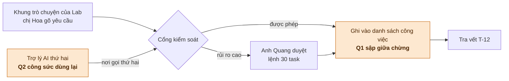

# Câu hỏi nghiên cứu và kế hoạch kiểm chứng

Ngày: 2026-11-15. Trạng thái: bản nháp, chưa chạy phép thử nào, chưa có số đo.

Mọi giả thuyết dưới đây đoán từ tài liệu nguồn và bước so sánh, chưa chạy trên Lab.
Tám yêu cầu dùng để đối chiếu lấy từ [PRD](../problem/prd-ai-platform.md).

## Đọc nhanh

- Bước so sánh đã chọn tạm cách làm cho Lab, nhưng mới dựa trên đọc tài liệu.
- Phần lớn điều còn chưa chắc đã có đáp án nhờ cách Lab tự dựng, nên chỉ cần kiểm tra khi dựng xong; chỉ hai điều thật sự chưa biết.
- Thứ nhất: lệnh chuyển 30 việc bị đứt giữa chừng thì tự viết phần làm tiếp có đủ đơn giản không, hay cần thêm một công cụ chuyên dụng.
- Thứ hai: cách nối chuẩn chung thật sự tiết kiệm bao nhiêu công so với cách nối thường, câu mà chương trình bắt buộc phải trả lời.
- Tiếp theo: chốt cách làm trong bản ghi quyết định, trả lời câu thứ nhất khi dựng và câu thứ hai khi đánh giá.

## Nhân vật và tình huống

Ví dụ trong bài dùng chung một câu chuyện ở phòng Vận hành, lấy từ [PRD, mục 1.1 và 3.2](../problem/prd-ai-platform.md#11-một-buổi-sáng-của-chị-hoa).
Mọi người và dữ liệu đều là giả lập.

| Ai | Là ai | Được làm gì với task |
| --- | --- | --- |
| Chị Hoa | Nhân viên phòng Vận hành, người nhờ AI | Chuyển task của phòng mình; chuyển từ 5 task trở lên phải chờ duyệt |
| Nam | Thực tập sinh phòng Vận hành | Chỉ xem và sửa mô tả task, không được chuyển task |
| Anh Quang | Trưởng nhóm Vận hành, người duyệt | Chuyển task phòng mình, kể cả hàng loạt; duyệt lệnh của nhân viên |
| Chị Lan | Đồng nghiệp đang nghỉ ốm | Đang phụ trách các task cần chuyển |
| Anh Minh | Đồng nghiệp nhận việc | Người nhận task |

Không ai trong năm người trên được sửa task của phòng khác, ví dụ phòng Kinh doanh, hay xem số điện thoại cá nhân của đồng nghiệp.

Ba tình huống lặp lại trong bài:

- **Chuyển T-12:** chị Hoa nhờ AI chuyển task T-12 "Gọi lại khách hàng X" từ chị Lan sang anh Minh, hạn thứ Sáu.
- **Nam gõ đúng câu đó:** AI phải từ chối, vì Nam không được chuyển task.
- **Chuyển 30 task:** chị Hoa nhờ chuyển hết 30 task của chị Lan; lệnh dừng lại chờ anh Quang duyệt, lời duyệt hết hạn lúc 15:30.

# 1. Hai câu hỏi

[So sánh phương án, mục 4](../research/option-comparison.md#4-ghép-thế-nào-để-tự-dựng-ít-nhất) chọn tạm một tổ hợp cho bản thử đầu, và còn nhiều điều chưa chắc.
Một điều chỉ thành câu hỏi khi qua đủ hai điều kiện:

1. **Chưa biết đáp án trước khi thử.**
2. **Đáp án khác nhau dẫn tới cách làm hoặc kết luận khác nhau.**

Điều nào đã biết đáp án vì chính Lab dựng ra thứ được thử thì là phép thử nghiệm thu, đã có ở [PRD, mục 6](../problem/prd-ai-platform.md#6-yêu-cầu-bắt-buộc).

Lab là bản thử trên dữ liệu giả lập, nên nơi gọi thứ hai cũng do Lab tự viết.
Nơi gọi thứ hai là chỗ thứ hai người dùng nhờ AI, ngoài khung trò chuyện của Lab; ở đây là một trợ lý AI thứ hai, ví dụ trợ lý tóm tắt task.
Vì Lab viết cả hai đầu, cách gửi danh tính người dùng và cách chống làm một việc hai lần đều là quyết định thiết kế đã biết đáp án, kiểm bằng phép thử nghiệm thu của PRD.
Cắm thử Lab vào phần mềm có sẵn của công ty, như Thổ Thần web, để sau, như [PRD, mục 8.1](../problem/prd-ai-platform.md#81-đã-có-và-cần-làm) đã ghi.

Chỉ hai điều qua đủ hai điều kiện, và chúng nằm ở hai điểm trên hành trình "chuyển T-12 sang anh Minh".

| Câu hỏi | Nếu bỏ qua, rủi ro là | Quyết định chờ câu này | Khi nào trả lời |
| --- | --- | --- | --- |
| Q1. Sập giữa chừng, chạy lại có đủ? | Task bị sót hoặc bị chuyển hai lần; hoặc Lab thêm một công cụ không cần thiết | Cách chạy tiếp lệnh hàng loạt bị đứt | Chọn trước, kiểm lại khi dựng |
| Q2. MCP tiết kiệm bao nhiêu công? | Kết luận về MCP không có số đo | Không có; đây là kết luận trong báo cáo đánh giá | Bước đánh giá |

Không câu nào chặn bản ghi quyết định.
Q1 có phương án mặc định đủ an toàn để chọn trước; Q2 chỉ cho kết luận.

# 2. Từng câu hỏi

Chi tiết kỹ thuật của mỗi câu, gồm các bước thử đầy đủ, đối chứng và giới hạn, nằm ở [Phụ lục A](#phụ-lục-a---chi-tiết-kỹ-thuật-từng-câu-hỏi).

## 2.1. Q1. Đang chuyển 30 task thì ứng dụng sập: chạy lại có đủ và không trùng không?

**Ý chính: nếu không, có task bị sót hoặc bị chuyển hai lần, và không ai biết là task nào.**

**Chuyện có thể xảy ra.**
Anh Quang đã duyệt chuyển 30 task của chị Lan sang anh Minh.
Ứng dụng sập khi đang làm task thứ 17.
Chạy lại, ứng dụng phải biết task nào xong, task nào chưa, kể cả task 17 có thể đã ghi mà chưa kịp đánh dấu.

**Ta đoán.**
Ứng dụng tự viết làm được, nếu hai điều cùng đúng.
Mỗi task mang một số phiếu riêng: nộp lại cùng số phiếu thì hệ thống không làm lần hai.
Ứng dụng lưu tiến độ sau mỗi task.

**Thử thế nào.**
Tắt ứng dụng ở ba thời điểm: trước task đầu, giữa chừng, và ngay trước khi báo xong.
Chạy lại rồi đếm: đủ 30 task, không task nào bị chuyển hai lần.

**Quyết định chờ câu này: cách chạy tiếp lệnh hàng loạt bị đứt.**

| Phương án | Đổi lại | Chọn khi |
| --- | --- | --- |
| 1A. Ứng dụng tự lưu tiến độ và chạy tiếp | Lab tự viết và tự giữ phần này | Mặc định; giữ nếu đủ 30 task, không trùng, và phần chạy tiếp không quá rối |
| 1B. Dùng công cụ chạy quy trình (workflow engine), loại phần mềm chuyên nhớ từng bước đã xong để chạy tiếp | Thêm một hệ thống phải cài và vận hành | Phương án 1A sót, trùng, hoặc quá rối |

## 2.2. Q2. Cách nối chuẩn chung (MCP) tiết kiệm được bao nhiêu công?

**Ý chính: đây là con số để trả lời câu chương trình bắt buộc: khi nào không nên dùng MCP.**

**Chuyện có thể xảy ra.**
Lab nối AI với công cụ theo hai cách đặt cạnh nhau.
Gọi hàm (function calling) là cách thường: mỗi ứng dụng tự khai báo công cụ cho AI.
MCP là cách chuẩn chung: viết công cụ một lần, phần mềm nào hỗ trợ MCP cũng dùng được.
MCP được giới thiệu là dùng lại dễ hơn, nhưng chưa ai đo hai cách trên cùng một việc.

**Ta đoán.**
Khi cả hai nơi gọi đều do Lab viết, hai cách tốn công gần bằng nhau.
MCP chỉ hơn rõ khi phải cắm vào phần mềm của bên khác, điều Lab chưa làm ở bản thử đầu.

**Thử thế nào.**
Thêm trợ lý AI thứ hai cho từng cách nối, đếm giờ công và số chỗ phải sửa.
Chạy mỗi cách 100 lần, đo thời gian và chi phí.

**Kết luận chờ câu này: mục "khi nào không nên dùng MCP" trong báo cáo đánh giá.**

| Nếu số đo cho thấy | Kết luận |
| --- | --- |
| MCP ít công hơn rõ, không chậm hơn và không đắt hơn đáng kể | Dùng MCP khi có từ hai nơi gọi trở lên, kể cả khi cùng một nhóm viết. |
| Hai cách ngang nhau, hoặc MCP chậm hơn, đắt hơn | Không nên dùng MCP khi mọi nơi gọi do cùng một nhóm viết; MCP chỉ đáng dùng khi phải cắm vào phần mềm của bên khác. |

Dù số đo ra sao, kết luận cũng ghi thêm một phát hiện từ đọc tài liệu.
Cắm MCP vào phần mềm có sẵn mà chỉ dùng một khóa cho cả bản cài thì ai dùng phần mềm đó cũng mượn được quyền của người đã cài ([phụ lục bằng chứng, mục 3.2](../research/comparison-framework.md#32-mcp)).

# Phụ lục A - Chi tiết kỹ thuật từng câu hỏi

Đối chứng (control) là phép thử đặt cạnh, để chắc kết quả đến từ đúng điều đang thử.
Ngoài đúng và sai, một phép thử có thể chưa đủ bằng chứng khi thiếu dữ liệu; khi đó Lab bổ sung dữ liệu rồi chạy lại.

## A.1. Q1 (sập giữa chừng)

**Vì sao chưa biết.**
Giữ một đề xuất đang chờ qua lần khởi động lại thì đơn giản: lưu nó vào cơ sở dữ liệu.
Chạy tiếp một việc nhiều bước bị đứt giữa chừng thì khó hơn, và đó là việc công cụ chạy quy trình làm sẵn.
Chưa biết ứng dụng tự viết có làm việc này đủ đúng và đủ đơn giản không.

**Các bước thử.**

1. Anh Quang duyệt lệnh 30 task.
2. Tắt ứng dụng ở ba thời điểm: trước task đầu tiên, giữa task 17, và sau task cuối nhưng trước khi báo kết quả.
3. Khởi động lại và để ứng dụng chạy tiếp.
4. Đếm trong lịch sử thay đổi: đủ 30 task, không task nào ghi hai lần, nội dung đúng như trên thẻ duyệt.
5. Đếm số dòng code và số chỗ cấu hình của phần chạy tiếp, làm số đo M5 (độ phức tạp vận hành).

| Kết quả | Phương án | Bản chạy nhỏ nhất (MVP) thay đổi |
| --- | --- | --- |
| Đúng, và phần chạy tiếp gọn | 1A | Giữ phần chạy tiếp tự viết; đưa ba thời điểm tắt vào bộ phép thử. |
| Sai, hoặc phần chạy tiếp tự viết quá rối | Thử 1B với cùng ba thời điểm tắt, so M5 (độ phức tạp vận hành) rồi chọn. | Có thể thêm một thành phần phải dựng và vận hành. |

- **Đối chứng:** mốc là ứng dụng tự viết.
  Nếu thử công cụ chạy quy trình, dùng cùng ba thời điểm tắt và cùng số phiếu.
  Không so công cụ chạy quy trình với tiến độ giữ trong bộ nhớ tạm rồi kết luận công cụ đó là cần thiết.
- **Chưa đủ bằng chứng khi:** không xem được trạng thái từng task sau khi khởi động lại.
- **Giới hạn:** công cụ chạy quy trình giữ tiến độ, nhưng không thay việc kiểm quyền hay chống ghi trùng ở danh sách công việc.

Kết quả câu này cũng là bằng chứng cho việc khi nào cần công cụ chạy quy trình, một trong năm cách chương trình yêu cầu khảo sát.

## A.2. Q2 (công sức dùng lại)

**Các bước thử.**

1. Thêm trợ lý AI thứ hai cho từng cách nối; ghi giờ công, số dòng code và số bộ nối phải sửa.
2. Chạy cùng tám phép thử nghiệm thu của PRD từ cả hai nơi gọi; kết quả phải giống nhau.
3. Chạy mỗi cách 100 lần trên khung trò chuyện của Lab, đo thời gian và chi phí theo [PRD, mục 7.3](../problem/prd-ai-platform.md#73-sáu-chỉ-số-đo).

Mức chênh thế nào là "rõ" được chốt sau lần đo đầu tiên (baseline), không chốt trước.

- **Đối chứng:** cùng nhiệm vụ, dữ liệu, bảng quyền và cổng; chỉ khác cách nối.
- **Chưa đủ bằng chứng khi:** một cách nối chưa chạy đủ tám phép thử nghiệm thu.
- **Giới hạn:** cả hai nơi gọi đều do Lab viết, nên phép thử không cho thấy điểm mạnh "phần mềm nào cũng dùng được" của MCP.
  Hai nơi gọi cũng không nói gì về tải lớn, đó là việc của M4 (khả năng mở rộng).

# Phụ lục B - Nguồn

- [So sánh phương án](../research/option-comparison.md): tổ hợp chọn tạm và điều kiện xem lại.
- [Phụ lục bằng chứng của bước so sánh](../research/comparison-framework.md): nguồn gốc từng nhận định; xác thực tùy chọn của MCP ở [mục 3.2](../research/comparison-framework.md#32-mcp); danh sách giả thuyết ban đầu ở [mục 7.3](../research/comparison-framework.md#73-câu-hỏi-chuyển-bước-03).
- [Khảo sát Thổ Thần, mục 5](../appota/tho-than-platform.md#52-lobehub-là-mcp-host-nên-thực-thể-1-có-thể-cắm-được-mcp-server): Thổ Thần web cắm được máy chủ công cụ, dùng cho việc để sau.
- [PRD, mục 6](../problem/prd-ai-platform.md#6-yêu-cầu-bắt-buộc) và [mục 7.3](../problem/prd-ai-platform.md#73-sáu-chỉ-số-đo): tám yêu cầu SR1-SR8, sáu chỉ số M1-M6 và các ca thử gốc.
- [Chương trình R&D, trang 5-6](../../docs/program/Appota_AgentLize_Next_Gen_AI_RnD_8_Tuan_2026_Cap_Nhat.txt): yêu cầu của bước Question và tiêu chí nghiệm thu của Track 01.
