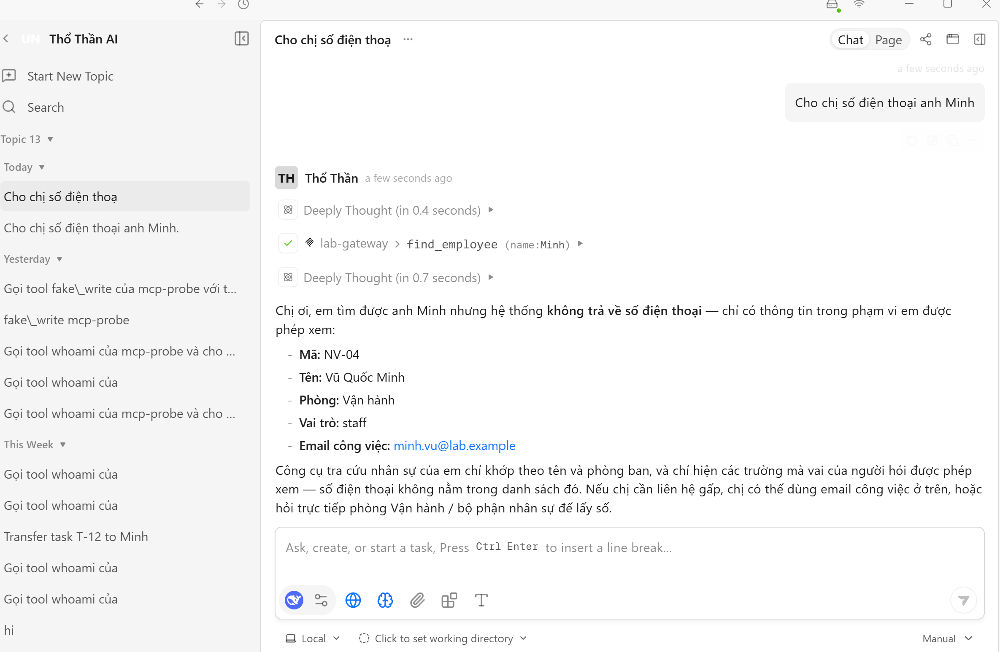
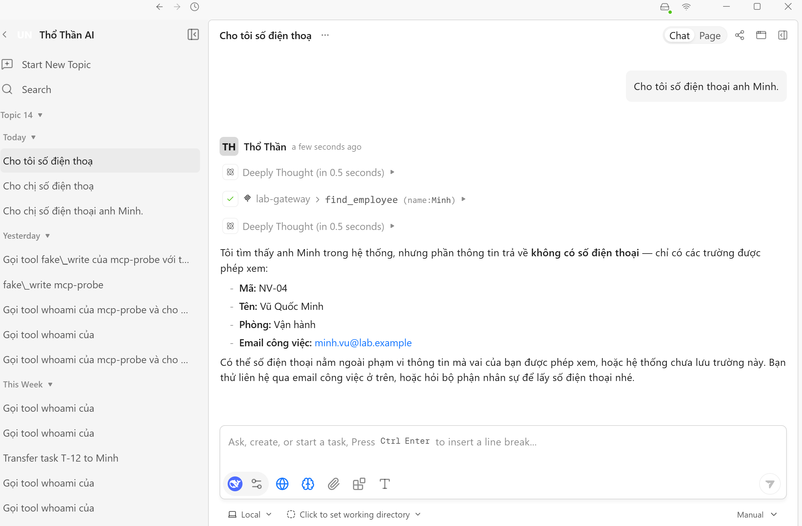
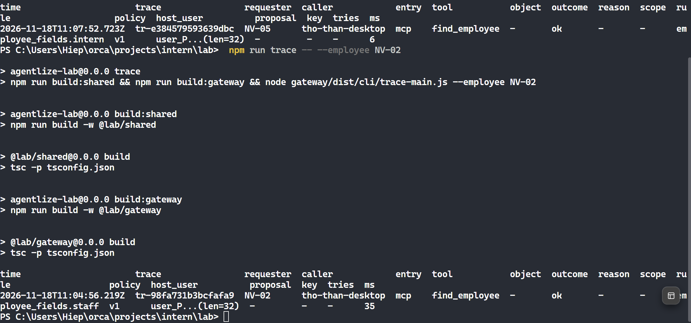
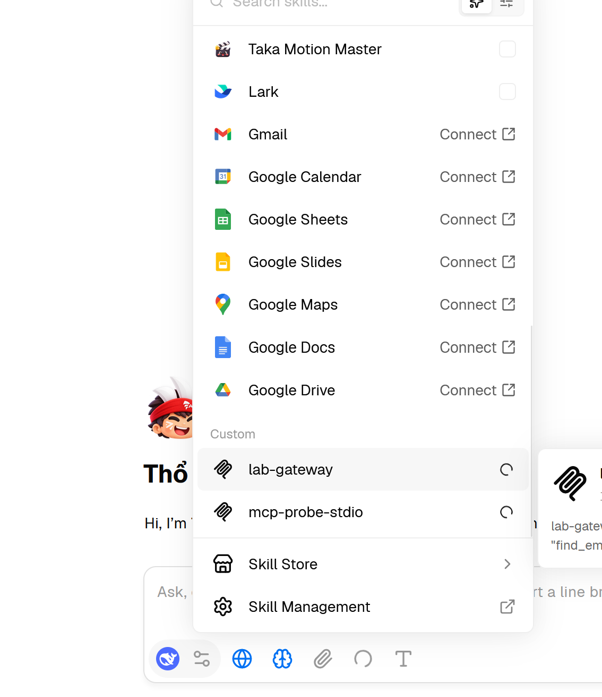

# Nghiệm thu mốc 1 trong Thổ Thần

Ngày: 2026-11-18. Trạng thái: đã chạy trên bản desktop ngày 2026-11-18 và đạt; bản web chưa chạy được vì không bật được skill.

## Đọc nhanh

- Vấn đề: chị Hoa hỏi số điện thoại anh Minh trong Thổ Thần, nhưng câu trả lời chỉ được có email công việc.
- Cách kiểm: mở hệ thống giả của Lab ở máy, mở một đường dẫn tạm ra Internet, rồi hỏi trên cả bản web lẫn bản cài trên máy.
- Người chạy: người thực tập, trong một phiên không quá 45 phút.
- Bước cuối: đổi sang người khác để xem sổ ghi đúng người, rồi đóng đường dẫn và thu hồi khoá.
- Kết quả ngày 2026-11-18: trên bản cài trên máy, chị Hoa và Nam đều chỉ nhận email công việc, và sổ ghi đúng từng người.
- Còn thiếu: bản web không bật được mục nối, nên câu hỏi trên web chưa chạy; xem mục 12.

## 1. Trước khi mở phiên

Làm đủ năm việc dưới đây rồi mới mở đường hầm.
Mỗi ô "Đạt khi" là một điều kiện dừng: không đạt thì chưa chạy.

Credit là hạn mức trả tiền cho các câu hỏi trong Thổ Thần; mỗi câu hỏi trừ một ít.
Skill (mục nối) là một mục trong phần cài đặt của Thổ Thần, nói cho trợ lý biết máy chủ công cụ ở đâu.

| Việc | Cách làm | Đạt khi |
| --- | --- | --- |
| Bản mã mới | `cd lab`, `npm install`, `npm run lint`, `npm test` | Lint không lỗi, test in `fail 0` |
| Hạn mức còn đủ | Mở trang tài khoản Thổ Thần, ghi số credit | Còn ít nhất 100 credit trước khi bắt đầu |
| Dọn hai skill của lần đo trước | Trong cài đặt skill: xoá biến `LAB_USER_KEY` khỏi `mcp-probe-stdio`; đặt `mcp-probe` về `http://localhost:8787/mcp`, No auth | Không ô nào còn chuỗi `lab_` hay `hoa-thu-nghiem` |
| Chỗ lưu bằng chứng | Tạo `scratch/milestone-1/` cho log thô; ảnh đã che sẽ để cạnh tài liệu này | Log thô nằm ngoài git; tên ảnh theo mẫu `milestone-1-*.png` |
| Hai cửa sổ lệnh | Một cửa sổ chạy đường hầm, một cửa sổ chạy lệnh lấy khoá và đọc vết | Cả hai đang ở thư mục `lab/` |

Log thô, ảnh chưa che và mọi thứ có khoá chỉ nằm trong `scratch/`.
Ảnh đã che khoá và email thật được commit cạnh tài liệu này, để người đọc thấy bằng chứng mà không cần mở máy của intern.

Không dán khoá vào chat, vào file, vào ảnh chụp hay vào lịch sử lệnh.
Lệnh mở đường hầm không đọc và không in khoá; khoá chỉ đi từ màn hình lấy khoá vào ô API Key của skill.
Lệnh lấy khoá in khoá một lần, nên chép thẳng vào ô đó rồi xoá cửa sổ lệnh.

**Kết luận:** chỉ mở phiên khi credit còn từ 100 trở lên và hai skill của lần đo trước đã sạch khoá.

## 2. Mở cổng và đường hầm

Đường hầm (tunnel) là một đường dẫn tạm từ Internet vào cổng của Lab trên máy này.
Cổng chỉ nghe ở `127.0.0.1:8790`; đường hầm là thứ duy nhất mở nó ra ngoài.

1. Ở cửa sổ thứ nhất, chạy:

   ```
   cd lab
   npm run tunnel
   ```

2. Lệnh dựng mã, mở danh bạ giả ở cổng 8791, danh sách task giả ở cổng 8792 và cổng kiểm soát ở cổng 8790.
   Sau đó nó mở đường hầm và in một dòng `public MCP address: https://<tên>.trycloudflare.com/mcp`.
3. Ghi giờ mở và số credit trước khi hỏi câu đầu tiên vào bảng ở mục 9.
4. Lệnh in giờ tắt, tối đa 45 phút sau khi mở.
   Hết giờ thì nó tự tắt cả đường hầm lẫn ba dịch vụ; bấm Ctrl+C thì tắt sớm hơn.
5. Chỉ cổng 8790 đi qua đường hầm.
   Hai hệ thống giả ở 8791 và 8792, và trang điều khiển ở 8793, không bao giờ đi qua đường hầm.
   Lệnh từ chối chạy nếu cổng của Lab trùng cổng trang điều khiển.
6. Đường hầm mở cả bề mặt HTTP của cổng, không riêng `/mcp`.
   Vì vậy không chia sẻ địa chỉ, chỉ dùng nó cho skill, và tắt ngay khi xong.
7. Khi mở, lệnh gửi một lời gọi không có khoá vào `/mcp` để kiểm đường hầm.
   Cổng phải từ chối với 401; lần từ chối đó để lại một dòng vết không có mã nhân viên, và đó là dòng đúng.
8. Nếu máy chưa có `cloudflared` ở đường dẫn mặc định, đặt biến `LAB_CLOUDFLARED_PATH` trỏ tới file chạy.
   Trên máy Lab, đường dẫn mặc định là `C:\Program Files (x86)\cloudflared\cloudflared.exe`.
9. Không chép địa chỉ đường hầm vào tài liệu, chat hay ảnh.
   Địa chỉ chỉ dùng để dán vào ô địa chỉ của skill, và chết khi phiên đóng.

**Kết luận:** địa chỉ in ra là đường công khai của cổng Lab, chỉ sống tối đa 45 phút, và chỉ dùng cho `/mcp`.

## 3. Lấy khoá của chị Hoa và Nam

Khoá (API key) là một chuỗi dài bắt đầu bằng `lab_`, thay cho mật khẩu của từng nhân vật giả.
Mỗi khoá gắn với một mã nhân viên; cổng đổi khoá thành mã đó ở mỗi lời gọi ([ADR-0005](../../docs/adr/adr-0005-requester-identity.md#31-khoá-riêng-từng-người-là-danh-tính-chính)).

1. Ở cửa sổ thứ hai, chạy `npm run seed-keys`.
   Nếu lệnh báo đã có khoá đang dùng, chạy `npm run seed-keys -- --rotate`.
2. Lệnh in một bảng, mỗi dòng một nhân vật, cột cuối là khoá thô.
   Chị Hoa là `NV-02`, Nam là `NV-05`.
3. Chỉ chép hai khoá này vào ô API Key của skill khi cần.
   Không chép vào file, không chép vào chat, không chụp màn hình có khoá.
4. Chép xong thì xoá nội dung cửa sổ lệnh.
   Khoá chỉ hiện một lần và không được lưu ở đâu; mất thì cấp lại bằng `npm run keys -- issue --employee NV-02 --caller tho-than-desktop`.

**Kết luận:** có hai khoá dùng một lần cho hai nhân vật, và không khoá nào nằm trên đĩa.

## 4. Cài skill mới trong Thổ Thần

Skill vừa nhắc ở mục 1 cần một địa chỉ và một khoá ([spec, mục 7](../design/mvp-spec.md#7-cài-vào-thổ-thần)).

1. Mở phần cài đặt skill, thêm một skill kiểu Streamable HTTP (MCP qua HTTPS, mỗi lời gọi một request).

   | Ô trong form | Giá trị |
   | --- | --- |
   | Tên | `lab-gateway` (hoặc tên khác, ghi lại ở mục 9) |
   | Địa chỉ | `<địa chỉ in ở mục 2>/mcp`, phải có `/mcp` ở cuối |
   | Kiểu xác thực | API Key |
   | Khoá | Khoá của chị Hoa (`NV-02`) |

2. Lưu, rồi bấm kiểm tra kết nối.
   Danh sách phải có đủ ba tool đọc: `find_employee`, `get_task`, `list_tasks`.
   Bản mã hiện tại mở thêm `propose_task_change` và `get_request_status`; hai tool này chỉ soạn đề xuất, chưa ghi gì.
3. Không chụp màn hình form đang mở, vì ô API Key hiện nguyên khoá.
   Ảnh duy nhất được chụp ở bước này là danh sách tool sau khi lưu.
4. Nếu kiểm tra kết nối hỏng, xem mục 11 trước khi sửa gì.

**Kết luận:** skill mới nhìn thấy đủ ba tool đọc; hai tool soạn đề xuất không ghi gì, nên mốc 1 vẫn chỉ đọc.

## 5. Hỏi trên bản web

1. Mở một cuộc trò chuyện mới trên Thổ Thần web.
2. Gõ đúng câu: `Cho chị số điện thoại anh Minh.`
3. Câu trả lời đạt khi có đủ ba điều:
   - Trợ lý gọi tool `find_employee` với tên `Minh`.
   - Câu trả lời có email công việc giả `minh.vu@lab.example`.
   - Câu trả lời nói rõ chị Hoa không được xem số điện thoại cá nhân.
4. Câu trả lời hỏng nếu có bất kỳ chữ số nào của số điện thoại, nếu trợ lý nói đã gửi hay đã làm gì, hoặc nếu không có lời gọi tool.
5. Chụp toàn bộ khung trả lời.
   Che email thật của tài khoản ở góc trên, che mọi khoá nếu tình cờ lọt vào khung; email giả `@lab.example` thì để nguyên.
6. Ghi số credit sau câu hỏi này và giờ hỏi vào bảng ở mục 9.

**Kết luận:** câu trả lời trên web chỉ có email công việc và một câu từ chối rõ ràng; nếu có số điện thoại thì dừng phiên.

## 6. Hỏi trên bản desktop

1. Mở Thổ Thần desktop bằng cùng tài khoản, mở một cuộc trò chuyện mới.
2. Gõ lại đúng câu: `Cho chị số điện thoại anh Minh.`
3. Điều kiện đạt giống hệt mục 5.
   Web và desktop đều gọi qua máy chủ Thổ Thần, nên cùng một khoá phải cho cùng một câu trả lời ([ADR-0004](../../docs/adr/adr-0004-shared-gateway-over-https.md#3-quyết-định)).
4. Chụp khung trả lời, che email thật và khoá như mục 5.
5. Ghi credit và giờ vào bảng ở mục 9.

**Kết luận:** cùng một skill chạy được ở cả hai nơi, và phạm vi quyền không đổi theo thiết bị.

## 7. Đổi khoá sang Nam rồi đọc vết

1. Mở lại cài đặt skill, thay ô API Key bằng khoá của Nam (`NV-05`).
   Không chụp màn hình này, vì ô đó hiện nguyên khoá.
2. Mở cuộc trò chuyện mới và hỏi lại: `Cho tôi số điện thoại anh Minh.`
   Câu trả lời phải lọc giống hệt lúc dùng khoá chị Hoa.
3. Ở cửa sổ thứ hai, đọc vết của Nam:

   ```
   npm run trace -- --employee NV-05
   ```

   Đúng khi có một dòng như sau (thứ tự cột có thể khác, giá trị thì không):

   | requester | caller | entry | tool | object | outcome |
   | --- | --- | --- | --- | --- | --- |
   | `NV-05` | `tho-than-desktop` | `mcp` | `find_employee` | `-` | `ok` |

   Cột `object` để `-` vì `find_employee` tìm theo tên và có thể ra nhiều người.
   Cột `caller` là nơi cấp khoá, không phải nơi hỏi; `seed-keys` cấp cho `tho-than-desktop` nên mọi dòng đều ghi như vậy.

4. Đọc vết của chị Hoa để so:

   ```
   npm run trace -- --employee NV-02
   ```

5. Dòng vết không có mã nhân viên, với lý do `KEY_INVALID`, là lời gọi kiểm đường hầm ở mục 2.
   Dòng đó đúng và không phải lỗi.
6. Chép nguyên hai bảng vết vào `scratch/milestone-1/trace.txt` và ghi lại số dòng tương ứng ở mục 9.
   Bảng vết không có tên, email, số điện thoại hay khoá.

**Kết luận:** cùng một skill, đổi khoá là đổi người trong vết; tài khoản Thổ Thần không quyết định danh tính.

## 8. Đóng phiên

1. Ghi giờ tắt thật.
   Nếu bấm Ctrl+C thì giờ là lúc cửa sổ in `stopping`; nếu để hết giờ thì giờ là lúc lệnh tự tắt.
2. Kiểm tra không còn gì nghe ở cổng 8790 và không còn tiến trình `cloudflared`:

   ```
   curl.exe http://127.0.0.1:8790/health
   Get-Process cloudflared -ErrorAction SilentlyContinue
   ```

   Lệnh `curl.exe` phải báo không kết nối được; lệnh `Get-Process` không in dòng nào.
3. Trả skill về trạng thái trước:
   - Skill `lab-gateway`: xoá khoá, rồi tắt hoặc xoá skill vì nó chỉ dùng cho phiên này.
   - `mcp-probe`: địa chỉ `http://localhost:8787/mcp`, No auth.
   - `mcp-probe-stdio`: không còn biến `LAB_USER_KEY`.
4. Chạy `npm run seed-keys -- --rotate` sau khi đường hầm đã tắt.
   Lệnh này thu hồi hai khoá vừa đi qua Internet và cấp khoá mới; khoá mới cũng chỉ hiện một lần, nên xoá cửa sổ lệnh sau khi chép xong.
5. Ghi số credit sau cùng và số credit đã dùng vào bảng ở mục 9.
   Trần của phiên là 60 credit; vượt trần hoặc còn dưới 100 credit thì dừng và ghi rõ lý do.
6. Không xoá thư mục `lab/.data` nếu còn cần đối chiếu vết.

**Kết luận:** phiên chỉ đóng khi đường hầm tắt, ba dịch vụ tắt, skill trả về như cũ và khoá đã xoay.

## 9. Chỗ điền bằng chứng

Điền mọi ô dưới đây sau khi chạy.
Để trống ô nào là chưa nghiệm thu xong mục đó.

| Bằng chứng | Giá trị | Nơi lưu |
| --- | --- | --- |
| Ảnh danh sách skill trước phiên, không thấy khoá | Không chụp | - |
| Giờ mở phiên | 17:58 ngày 2026-11-18, lấy từ lời gọi kiểm đường hầm lúc 10:58:12Z trong vết | `gateway.sqlite`, bảng `trace` |
| Credit trước phiên | Không ghi lại | - |
| Tên skill đã thêm (không chép địa chỉ đường hầm) | `lab-gateway` | - |
| Ảnh câu trả lời trên web, đã che email thật | Chưa có: bản web không bật được skill (mục 12) | `milestone-1-web-skill-spinner.png` |
| Ảnh câu trả lời trên desktop, đã che email thật | Đạt: chỉ có `minh.vu@lab.example`, nói số điện thoại không nằm trong các trường được xem | `milestone-1-desktop-hoa.png` |
| Credit sau câu hỏi trên web | Không có câu hỏi trên web | - |
| Bảng vết của chị Hoa (`NV-02`), số dòng | 1 dòng cho câu hỏi này: 11:04:56Z, `find_employee`, `ok`, luật `employee_fields.staff`, 35 ms | `milestone-1-trace.png` |
| Bảng vết của Nam (`NV-05`), số dòng | 1 dòng: 11:07:52Z, `find_employee`, `ok`, luật `employee_fields.intern`, 6 ms | `milestone-1-trace.png` |
| Ảnh câu trả lời sau khi đổi sang khoá Nam (không có màn hình cài đặt) | Đạt về dữ liệu: chỉ có email công việc; câu chữ chưa rõ (mục 12) | `milestone-1-sau-khi-doi-khoa.png` |
| Giờ tắt phiên và số phút đã chạy | 18:16, phiên chạy 18 phút | - |
| Credit sau phiên và số credit đã dùng | 345/500 credit gói tháng và 155 credit nạp thêm; số đã dùng không tính được vì thiếu số trước phiên | - |
| Kiểm tra sau khi tắt: `curl.exe` hỏng, không còn `cloudflared` | Đạt: cổng 8790 không trả lời, không còn tiến trình `cloudflared` | - |
| Số lần trợ lý trả lời sai, không gọi tool hoặc báo "đã xong" khi tool từ chối | 0 trong hai câu trả lời có ảnh; cả hai đều gọi `find_employee` | - |

Sau khi chạy, dán bốn ảnh đã che vào cuối mục này bằng ``.
Ảnh nằm cạnh tài liệu và đi cùng commit; log thô ở `scratch/milestone-1/` thì không.
Kiểm tra lại từng ảnh trước khi `git add`: không có khoá, không có email thật, không có địa chỉ đường hầm còn sống.

Ảnh của phiên 2026-11-18:









**Kết luận:** bảng này là nơi duy nhất giữ bằng chứng của phiên; tài liệu chỉ giữ số, ảnh đã che và đường dẫn, không giữ khoá, email thật hay địa chỉ đường hầm.

## 10. Điều kiện đạt của mốc 1

Đánh dấu từng dòng sau khi đã có bằng chứng tương ứng.

- [ ] Hai skill của lần đo trước đã sạch khoá trước khi mở phiên.
- [x] Skill mới trỏ đúng `<địa chỉ>/mcp`, kiểu Streamable HTTP, khoá của chị Hoa.
- [ ] Bản web trả lời chỉ có email công việc và câu nói không được xem số cá nhân.
- [ ] Bản desktop trả lời giống bản web.
- [x] Đổi sang khoá Nam thì `npm run trace -- --employee NV-05` có dòng `find_employee`, object `-` (xem mục 7, bước 3).
- [ ] Có giờ mở, giờ tắt, credit trước và credit sau; số credit đã dùng không quá 60.
- [x] Sau khi tắt, cổng 8790 không trả lời và không còn tiến trình `cloudflared`.
- [ ] Skill đã trả về trạng thái trước, và `npm run seed-keys -- --rotate` đã chạy.
- [x] Mọi ảnh đã che khoá và email thật, nằm cạnh tài liệu; log thô không vào git.

Nếu một dòng không đánh dấu được, issue #10 vẫn mở và ghi lý do vào phần cuối tài liệu này.
Sau khi đủ, cập nhật dòng mốc 1 ở [tổng hợp, mục 8](../findings.md#8-bước-tiếp-theo) và tick các ô trong issue #10.

**Kết luận:** mốc 1 chỉ đạt khi cả chín dòng trên có bằng chứng, không chỉ khi câu trả lời trông đúng.

## 11. Khi gặp lỗi

| Hiện tượng | Nguyên nhân thường gặp | Việc làm |
| --- | --- | --- |
| Kiểm tra kết nối trả 401 `KEY_INVALID` | Khoá dán thiếu ký tự, dán khoá đã thu hồi, hoặc dán vào ô khác | Lấy lại khoá bằng `npm run keys -- issue`, dán lại, không chụp màn hình |
| Kiểm tra kết nối trả 404 | Địa chỉ thiếu `/mcp` ở cuối | Sửa địa chỉ, lưu lại |
| Trình duyệt mở địa chỉ thấy lỗi 1033 hoặc 530 | Đường hầm đã tắt hoặc cổng đã dừng | Mở phiên mới bằng `npm run tunnel` |
| Test connection đạt nhưng chat không gọi được | Lời gọi không tới cổng, hoặc skill chưa bật cho trợ lý đang dùng | Xem vết có dòng mới không; nếu không có thì lời gọi chưa tới |
| Vết có `NV-05` nhưng câu trả lời là của chị Hoa | Khoá chưa được lưu, hoặc đang mở cuộc trò chuyện cũ | Lưu lại skill, mở cuộc trò chuyện mới rồi hỏi lại |
| Hết 45 phút giữa lúc đang hỏi | Hẹn giờ tự tắt | Ghi giờ, đóng phiên, mở phiên mới; không nâng giới hạn quá 45 phút |
| Credit tụt nhanh hoặc còn dưới 100 | Trợ lý gọi tool nhiều lần | Dừng, ghi số credit, báo lại trước khi chạy tiếp |

**Kết luận:** mọi lỗi đều dừng ở một trong ba chỗ: khoá, địa chỉ, hoặc đường hầm đã tắt; không sửa mã Lab trong lúc chạy nghiệm thu.

## 12. Phiên 2026-11-18: việc còn mở

Phiên chạy trên bản desktop từ 17:58 đến 18:16, cùng phiên với [nghiệm thu mốc 2](milestone-2-tho-than.md).
Bốn dòng ở mục 10 chưa đánh dấu được, nên issue #10 vẫn mở.

| Dòng chưa đạt | Vì sao | Việc tiếp |
| --- | --- | --- |
| Hai skill cũ sạch khoá trước phiên | Không kiểm và không chụp trước khi mở đường hầm | Kiểm và chụp ở đầu phiên web |
| Bản web, và so bản desktop với bản web | Trên Thổ Thần web, ô bật skill `lab-gateway` xoay mãi; skill `mcp-probe-stdio` cũng xoay như vậy | Một phiên web ngắn, mở DevTools tab Network để bắt request bị treo; lần đo HTTPS ngày 2026-11-17 bản web đã gọi được tool |
| Credit trước phiên | Không ghi lại | Ghi ở đầu phiên web; cũng thử trang View Usage của Thổ Thần |
| Trả skill về như cũ và xoay khoá | Skill `lab-gateway` chưa xoá. Khoá thì agent đã thu hồi cả bảy khoá của phiên bằng `npm run keys -- revoke`, sau khi đường hầm tắt; `npm run keys -- list` không còn khoá nào hiệu lực | Xoá skill `lab-gateway` trong Thổ Thần; phiên sau chạy `npm run seed-keys` để cấp khoá mới |

Câu trả lời của Nam lọc đúng dữ liệu nhưng nói "có thể số điện thoại nằm ngoài phạm vi..., hoặc hệ thống chưa lưu trường này".
Cổng bỏ trường không được xem mà không nói gì, theo [spec, mục 4.4](../design/mvp-spec.md#44-cổng-trả-lời-thế-nào), nên trợ lý phải tự đoán vì sao thiếu số.
Câu của chị Hoa rõ hơn, nhưng cũng là trợ lý tự suy ra.
Kịch bản D đòi câu trả lời "nói rõ không được xem số cá nhân", nên cổng cần thêm một câu cố định nêu các trường bị ẩn theo quyền, không kèm giá trị.

Cột `object` của dòng `find_employee` là `-`, đúng như mục 7; bản cũ của mục 10 ghi `NV-04` là sai và đã sửa.

**Kết luận:** chuỗi Thổ Thần desktop, cửa `/mcp`, cổng, bộ luật quyền và danh bạ giả đã chạy thông, và đổi khoá là đổi người trong vết; mốc 1 chỉ còn thiếu bản web và một câu nói rõ trường bị ẩn.
