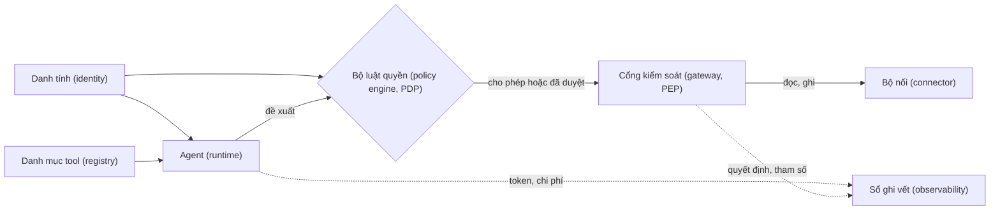

# PRD - AI Platform

Ngày: 2026-11-15. Trạng thái: bản nháp, chờ mentor review.
Câu chuyện, vai, ma trận quyền và mọi con số mục tiêu là giả định trên dữ liệu giả lập của Lab, chưa khảo sát người dùng và chưa đo.

## Đọc nhanh

- Nhân viên muốn nhờ AI làm việc thay mình trong hệ thống, ví dụ chuyển một việc sang đồng nghiệp hay tra email của ai đó.
- Hôm nay chỉ có hai cách: nhờ người có quyền làm hộ thì chậm, còn cho AI một tài khoản quyền rộng thì ai nói chuyện được với AI cũng có quyền đó.
- Gốc vấn đề: quyền đang gắn với tài khoản bấm nút, không gắn với người thật sự yêu cầu.
- Đề xuất: AI chỉ soạn đề xuất; mọi lần đọc và ghi đi qua một cửa, nơi kiểm quyền của đúng người yêu cầu, xin trưởng nhóm duyệt khi rủi ro cao, không làm một việc hai lần và ghi lại ai đã làm gì.
- Tiếp theo: chốt cách làm trong một bản ghi quyết định, rồi dựng bản thử trên danh bạ và danh sách công việc giả lập để đo tốc độ, độ ổn định và chi phí.

# 1. Bài toán

## 1.1. Một buổi sáng của chị Hoa

Chị Hoa làm ở phòng Vận hành, đang ngồi họp với khách bên ngoài.
Chị Lan, đồng nghiệp cùng phòng, báo nghỉ ốm đột xuất.
Task T-12 "Gọi lại khách hàng X" của chị Lan hạn hôm nay, cần chuyển gấp sang anh Minh và lùi hạn sang thứ Sáu.

Chị Hoa chỉ có điện thoại và hai lựa chọn:

1. **Nhờ người làm hộ.** Chị nhắn anh Quang, trưởng nhóm, hoặc một đồng nghiệp đang ở văn phòng mở hệ thống công việc sửa giúp.
   Chị phải chờ người kia rảnh.
   Lịch sử task ghi tên người làm hộ, không ghi chị Hoa là người yêu cầu.
2. **Nhờ AI.** Chị gõ cho agent: "chuyển task T-12 sang anh Minh, hạn thứ Sáu".
   **Agent** là chương trình AI nhận yêu cầu bằng lời rồi tự gọi công cụ để làm việc.
   Agent chạy bằng một tài khoản dịch vụ `svc-agent` có quyền sửa mọi task, nên làm xong ngay.

Cách thứ nhất chậm nhưng còn có người chịu trách nhiệm.
Cách thứ hai nhanh nhưng mở ra năm chỗ có thể hỏng, liệt kê ở 1.3.

## 1.2. Nguyên nhân gốc

**Quyền đang gắn với tài khoản bấm nút, không gắn với người thật sự yêu cầu.**

Khi đồng nghiệp làm hộ, quyền là của đồng nghiệp.
Khi agent làm, quyền là của `svc-agent`.
Trong cả hai trường hợp, hệ thống không biết chị Hoa có được làm việc này hay không, và cũng không ghi lại rằng chị đã yêu cầu.

Mục tiêu của Lab: nhanh như nhờ AI, nhưng an toàn và truy được trách nhiệm hơn cả nhờ người.

## 1.3. Năm chỗ có thể hỏng khi giao việc cho AI

**Tool** là một chức năng agent được phép gọi, ví dụ "tìm nhân viên" hay "cập nhật task".
**Nơi gọi (host)** là phần mềm người dùng mở để nói chuyện với agent, ví dụ khung chat Thổ Thần hay một công cụ lập trình.
**Prompt** là đoạn chữ hướng dẫn gửi kèm cho AI; AI có thể hiểu sai hoặc bị thuyết phục bỏ qua nó.

| Chỗ hỏng                     | Câu hỏi hệ thống chưa trả lời được                  | Chuyện có thể xảy ra                                                                                                                                                                                       | Cần có                                                                                                       |
| ---------------------------- | --------------------------------------------------- | ---------------------------------------------------------------------------------------------------------------------------------------------------------------------------------------------------------- | ------------------------------------------------------------------------------------------------------------ |
| Mượn quyền của agent         | Ai đang yêu cầu?                                    | Nam, thực tập sinh chưa được giao quyền chuyển việc, gõ đúng câu của chị Hoa. Agent vẫn chuyển T-12. Lịch sử chỉ ghi `svc-agent`.                                                                          | Phân biệt người yêu cầu với agent thực hiện. Quyền của agent không thay được quyền của người.                |
| Quyền chỉ là câu dặn         | Người đó được làm gì?                               | Prompt ghi "chỉ sửa task của phòng mình". Chị Hoa nhờ dời hạn một task của phòng Kinh doanh. Agent vẫn làm, vì không dòng code nào kiểm task thuộc phòng nào.                                              | Quyền được kiểm bằng code ở chỗ thực thi, không dựa vào việc AI nhớ lời dặn.                                 |
| Quyền không nói làm đến đâu  | Với dữ liệu nào, đến mức nào?                       | Chị Hoa gõ "chuyển hết 30 task của chị Lan sang anh Minh". Vẫn là tool `update_task`, nên chạy thẳng mà không ai duyệt. Khi tra anh Minh, tool `get_employee` trả cả số điện thoại cá nhân và địa chỉ nhà. | Quyền nói rõ trường nào, bản ghi nào, việc gì. Việc rủi ro cao dừng chờ duyệt. Không xác định được thì chặn. |
| Ghi trùng khi gửi lại        | Thay đổi đã xảy ra chưa, có hai lần không?          | Agent tạo thêm task nhắc "Gọi lại khách hàng X" cho anh Minh. Mạng đứt trước khi có phản hồi, agent gửi lại với mã mới. Hệ thống tạo hai task, anh Minh gọi khách hai lần.                                 | Mỗi lệnh có mã riêng; gửi lại cùng mã thì nhận lại kết quả cũ.                                               |
| Vết bị rời rạc               | Ai làm, lúc nào, vì sao, tốn bao nhiêu?             | Tuần sau anh Quang hỏi ai dời hạn T-12, vì sao, tốn bao nhiêu. Lời nhờ nằm ở công cụ chat, lần gọi tool nằm ở log ứng dụng, chi phí model không ghi ở đâu. Ba chỗ, ba loại mã.                             | Một vết xuyên suốt nối người yêu cầu, quyết định, thay đổi và chi phí.                                       |
| Nơi gọi mới thành đường vòng | Dùng lại tool ở nơi khác có đi vòng qua luật không? | Anh Quang cắm bộ tool danh bạ vào một công cụ lập trình, kèm một khóa quyền rộng cho nhanh. Nam mở công cụ đó và sửa được danh bạ, dù trong khung trò chuyện Nam bị chặn.                                  | Một bộ nối dùng được ở nhiều nơi gọi. Nơi gọi nào cũng qua cùng một cổng, và quyền vẫn theo người yêu cầu.   |

Năm chỗ hỏng này có chung một gốc ở 1.2.
Vì vậy Lab không vá từng chỗ, mà dựng một cửa chung cho mọi lần đọc và ghi, mô tả ở mục 4.

# 2. Vì sao quan trọng

## 2.1. So với cách làm hiện tại

| Tiêu chí               | Nhờ người có quyền làm hộ    | Cho AI một tài khoản quyền rộng                         | Đề xuất của Lab                                                      |
| ---------------------- | ---------------------------- | ------------------------------------------------------- | -------------------------------------------------------------------- |
| Ai thực hiện thay đổi  | Đồng nghiệp ở văn phòng      | Agent, bằng tài khoản `svc-agent`                       | Cổng kiểm soát, sau khi kiểm quyền của chính người yêu cầu           |
| Thời gian chờ          | Tùy người kia rảnh lúc nào   | Ngay                                                    | Ngay với việc thường; việc rủi ro cao chờ trưởng nhóm duyệt          |
| Quyền dựa vào          | Lòng tin giữa đồng nghiệp    | Quyền của agent, ai nói chuyện với agent cũng dùng được | Luật bằng code, theo đúng người, đúng trường dữ liệu, đúng việc      |
| Chuyển 30 task một lúc | Người làm hộ tự quyết        | Chạy thẳng, không ai duyệt                              | Dừng lại; trưởng nhóm thấy đủ 30 task, của ai, sang ai rồi mới duyệt |
| Mạng đứt rồi gửi lại   | Người làm hộ tự kiểm lại     | Có thể tạo hai task                                     | Hệ thống nhận ra lệnh cũ và không làm lần hai                        |
| Dấu vết                | Lịch sử ghi tên người làm hộ | Lịch sử ghi `svc-agent`                                 | Một vết: ai nhờ, ai duyệt, đổi gì, kết quả, tốn bao nhiêu            |
| Thêm nơi gọi thứ hai   | Không áp dụng                | Chép bộ tool và khóa quyền rộng sang nơi mới            | Dùng lại cùng bộ nối, qua cùng cổng, quyền vẫn theo người            |

Cột cuối giữ được tốc độ của cột giữa mà không mất người chịu trách nhiệm của cột đầu.

## 2.2. Vì sao cần làm ngay

1. **AI đang được nối vào công cụ nhanh hơn lớp kiểm soát được dựng.**
   Thổ Thần web đã là nơi cắm được máy chủ công cụ ([khảo sát Thổ Thần, mục 5](../appota/tho-than-platform.md#5-mcp-hai-điểm-nối-đã-kiểm-chứng)).
   Bản [PRD AgentLize Skill Studio](../../docs/context/prd-agentlize-skill-studio.docx) còn đề xuất cho mọi nhân viên tự đóng gói cách làm thành Skill.
   Mỗi Skill biết ghi dữ liệu sẽ gặp lại đủ năm chỗ hỏng ở 1.3 nếu không có một cửa chung.
2. **Sửa sau thì đắt.**
   Nếu mỗi agent tự kiểm quyền, đổi một luật là phải sửa từng agent.
   Nếu mỗi nơi gọi tự cầm một khóa quyền, mỗi nơi gọi mới lại là một đường vòng quanh luật.
3. **Danh bạ chứa dữ liệu cá nhân.**
   Số điện thoại cá nhân và địa chỉ nhà bị trả về cho người không cần chúng là rủi ro pháp lý, không chỉ rủi ro kỹ thuật.
   Điều khoản luật cụ thể chưa được kiểm.

## 2.3. Vị trí trong hệ sinh thái AI của Appota

Lab trả lời câu hỏi trung tâm của Track 01, nguyên văn:

> "Làm sao để AI kết nối, sử dụng và phối hợp công cụ/hệ thống nghiệp vụ một cách an toàn, quan sát được và tái sử dụng được?"

Trong bản PRD AgentLize Skill Studio, lớp "AgentLize Hook" kiểm "bạn là ai, thuộc phòng nào, có được dùng Skill này không".
Lớp đó kiểm theo Skill và theo tool, và phục vụ việc đọc dữ liệu.
Lab lo phần tiếp theo: khi Skill đã được bật và muốn ghi, từng lệnh ghi vẫn phải qua kiểm quyền theo từng tham số, duyệt khi rủi ro cao, chống ghi trùng và ghi vết.

Nói gọn, Lab là **lớp ghi an toàn phía sau Hook**.
Cách định vị này cần Kevin xác nhận.
Nếu được xác nhận, tám yêu cầu ở mục 6 trở thành hợp đồng mà Hook và Skill phải tuân theo.
Nếu không, Lab vẫn đứng riêng được, vì chạy hoàn toàn trên dữ liệu giả lập.

# 3. Người dùng và phạm vi thử

## 3.1. Bốn vai

Một thay đổi đi qua bốn vai, đều là người.
Công ty chỉ có một agent dùng chung; agent không có quyền riêng mà làm thay đúng người đang yêu cầu, nên agent không phải một vai.

| Vai            | Trong câu chuyện                                                              | Cần gì từ hệ thống                                                                                                 | Tuyệt đối không được xảy ra                                                        |
| -------------- | ----------------------------------------------------------------------------- | ------------------------------------------------------------------------------------------------------------------ | ---------------------------------------------------------------------------------- |
| Người yêu cầu  | Chị Hoa, nhân viên Vận hành; Nam, thực tập sinh                               | Gõ tiếng Việt thường; thấy đề xuất cụ thể trước khi gửi; biết mình bị từ chối vì thiếu quyền chứ không phải vì lỗi | Thấy hoặc sửa dữ liệu ngoài phạm vi; mượn được quyền của agent hay của đồng nghiệp |
| Người duyệt    | Anh Quang, trưởng nhóm Vận hành, duyệt trên điện thoại giữa lúc làm việc khác | Thấy ngay ai yêu cầu, đổi gì, bao nhiêu task, ảnh hưởng ai, vì sao; duyệt đúng một lần và có hạn                   | Phải đọc log kỹ thuật; duyệt một đề xuất đã bị sửa sau khi hiển thị                |
| Kỹ sư tích hợp | Người làm Lab, viết bộ nối và luật quyền                                      | Mô tả tool rõ ràng; sửa luật quyền ở một chỗ; đủ vết để tái hiện lỗi                                               | Phải sửa nơi gọi khi đổi quyền; phải viết lại bộ nối cho nơi gọi thứ hai           |
| Người kiểm tra | Mentor, người review, sau này là bộ phận tuân thủ; chỉ đọc bằng chứng         | Một chỗ trả lời được ai, lúc nào, vì sao, kết quả, chi phí                                                         | Cần quyền ghi mới đọc được; phải ghép log rời rạc từ ba nơi                        |

## 3.2. Ai được làm gì

Bảng dưới là dữ liệu quyền giả định của Lab, dùng thẳng làm dữ liệu thử cho mục 6.
"Cần duyệt" nghĩa là lệnh dừng lại chờ trưởng nhóm cùng phòng duyệt.
"Hàng loạt" nghĩa là một lệnh chạm từ 5 task trở lên (ngưỡng đề xuất).
Đổi trạng thái task phòng mình có cùng quyền như sửa mô tả, vì việc đó không chuyển trách nhiệm sang người khác.

| Vai                     | Tra email công việc | Tra số điện thoại cá nhân, địa chỉ nhà | Sửa mô tả task phòng mình | Đổi trạng thái task phòng mình | Đổi người phụ trách hoặc hạn task phòng mình | Đổi hàng loạt | Sửa task phòng khác | Sửa danh bạ |
| ----------------------- | ------------------- | -------------------------------------- | ------------------------- | ------------------------------ | -------------------------------------------- | ------------- | ------------------- | ----------- |
| Thực tập sinh (Nam)     | Được                | Không                                  | Được                      | Được                           | Không                                        | Không         | Không               | Không       |
| Nhân viên (chị Hoa)     | Được                | Không                                  | Được                      | Được                           | Được                                         | Cần duyệt     | Không               | Không       |
| Trưởng nhóm (anh Quang) | Được                | Không                                  | Được                      | Được                           | Được                                         | Được          | Không               | Không       |
| Nhân sự (chị Nhung)     | Được                | Được                                   | Được                      | Được                           | Được                                         | Cần duyệt     | Không               | Được        |

Agent và nơi gọi không có dòng nào trong bảng, vì chúng không mang quyền nghiệp vụ.

**Quy tắc làm thay:** khi agent làm thay người, quyền thực tế đúng bằng quyền của người yêu cầu, dù yêu cầu đến từ nơi gọi nào.
Một tác vụ có thể tự khai báo phạm vi hẹp hơn, ví dụ "chỉ đọc"; khi đó quyền thực tế là phần chung, lấy mức chặt hơn.
"Không" chặt hơn "Cần duyệt", "Cần duyệt" chặt hơn "Được".
Không có cách nào làm quyền thực tế rộng hơn quyền của người yêu cầu.

Hai ví dụ:

- Nam nhờ agent đổi người phụ trách T-12 thì bị từ chối, ở khung trò chuyện hay ở công cụ lập trình đều vậy, vì Nam không có quyền đó.
- Chị Nhung chạy tác vụ "tóm tắt task tuần này" khai báo chỉ đọc. Một mô tả task có câu lừa AI sửa danh bạ, nhưng lệnh sửa vẫn bị chặn dù chị Nhung có quyền sửa danh bạ.
  Quy tắc này một mình chặn được hai chỗ hỏng: mượn quyền của agent và nơi gọi mới thành đường vòng.
  Công ty chỉ phải giữ một bảng quyền theo người, không phải thêm một bảng cho mỗi agent hay mỗi nơi gọi.

## 3.3. Phạm vi thử

- Hai hệ thống giả lập: danh bạ khoảng 20 nhân viên và danh sách khoảng 100 task, toàn bộ là dữ liệu giả.
- Hai phòng giả lập, Vận hành và Kinh doanh, để thử việc sửa task phòng khác.
- Một agent dùng chung, gọi từ hai nơi: khung trò chuyện của Lab và một nơi gọi thứ hai dùng lại cùng bộ nối.
- Hai cách nối agent vào công cụ, chạy song song trên cùng cửa kiểm soát và cùng bộ phép thử: gọi hàm trực tiếp và MCP ([so sánh phương án](../research/option-comparison.md)).

Đây là bộ nhỏ nhất chạm được đủ tám yêu cầu ở mục 6 và đủ tiêu chí nghiệm thu của chương trình ở mục 7.1.

# 4. Giải pháp

## 4.1. Ý chính

**AI chuẩn bị, người quyết định, mọi lần đọc và ghi đi qua một cửa.**

Người dùng chỉ thấy ba thứ:

1. **Khung trò chuyện:** gõ yêu cầu, thấy thẻ đề xuất ghi rõ sẽ đổi gì trước khi bấm Gửi.
2. **Thẻ duyệt:** chỉ hiện với trưởng nhóm khi việc có rủi ro cao.
3. **Trang tra vết:** gõ mã task hoặc tên người, thấy ai đã yêu cầu, ai duyệt, đổi gì, kết quả và chi phí.

Phần còn lại chạy ngầm:

- **Cổng kiểm soát (gateway):** cửa duy nhất mọi lệnh đọc và ghi phải đi qua.
- **Bộ luật quyền (policy engine):** nơi trả lời "được, không được, hay cần duyệt" cho từng lệnh, theo bảng ở 3.2.
- **Bộ nối (connector):** phần code đứng giữa cổng và hệ thống nghiệp vụ, dùng chung cho mọi nơi gọi.
- **Sổ ghi vết:** nơi lưu vết xuyên suốt của mọi yêu cầu, chỉ ghi thêm, không sửa.

Người dùng chỉ gặp phần chạy ngầm khi bị từ chối, và khi đó luôn được biết vì sao và cần hỏi ai.
Thiết kế đầy đủ bảy thành phần nằm ở [Phụ lục A](#phụ-lục-a---bảy-thành-phần-và-ranh-giới).

## 4.2. Nguyên tắc

- AI chỉ đề xuất, không tự ghi và không giữ quyền.
- Quyền là code ở cổng, không phải câu dặn trong prompt.
- Không xác định được quyền thì chặn.
- Gửi lại một lệnh không bao giờ làm việc đó hai lần.
- Mọi lần đọc và ghi đều để lại vết.
- Mọi lần từ chối đều nói vì sao và cần hỏi ai.

## 4.3. AI, người và cổng làm gì

| Bước                  | AI làm gì                                                                     | Người làm gì                                    | Cổng kiểm soát làm gì                                                                            |
| --------------------- | ----------------------------------------------------------------------------- | ----------------------------------------------- | ------------------------------------------------------------------------------------------------ |
| Hiểu yêu cầu          | Hiểu câu "chuyển T-12 sang anh Minh, hạn thứ Sáu": task nào, sang ai, hạn nào | Chị Hoa gõ một câu                              | Ghi hai lớp danh tính: người yêu cầu là chị Hoa, bên thực hiện là agent qua khung trò chuyện     |
| Tra dữ liệu           | Gọi tool tìm anh Minh và đọc task T-12                                        | -                                               | Kiểm quyền đọc; chỉ trả trường được phép, ví dụ email công việc, không trả số điện thoại cá nhân |
| Soạn đề xuất          | Soạn: T-12, người phụ trách chị Lan sang anh Minh, hạn sang thứ Sáu 20/11     | Chị Hoa xem thẻ đề xuất, bấm Gửi, Sửa hoặc Hủy  | -                                                                                                |
| Kiểm quyền            | -                                                                             | -                                               | Hỏi bộ luật quyền; nhận "được", "không được" kèm lý do, hoặc "cần duyệt"                         |
| Duyệt, khi rủi ro cao | Dừng lại và giữ tiến độ để chạy tiếp sau khi duyệt                            | Anh Quang đọc thẻ duyệt, bấm Duyệt hoặc Từ chối | Gắn lời duyệt với dấu vân tay của đúng nội dung và thời hạn                                      |
| Ghi                   | -                                                                             | -                                               | Gắn mã riêng cho lệnh rồi gửi qua bộ nối; gửi lại cùng mã thì trả kết quả cũ                     |
| Báo kết quả           | Báo "Đã chuyển T-12 sang anh Minh, hạn thứ Sáu 20/11"                         | Chị Hoa đọc kết quả                             | Ghi vết: ai yêu cầu, ai duyệt, đổi gì, kết quả, chi phí, phiên bản luật                          |

**Dấu vân tay nội dung (hash)** là một chuỗi ngắn tính từ nội dung lệnh; đổi một chữ thì dấu vân tay đổi theo.
Giới hạn đặt sẵn cho AI: không tự ghi, không nhìn thấy trường ngoài quyền, không duyệt thay người.

# 5. Hành trình và màn hình

## 5.1. Năm nhánh của câu chuyện

| Nhánh              | Khi nào                                                                             | Người yêu cầu thấy gì                                                       | Ai khác thấy gì                                                                                       |
| ------------------ | ----------------------------------------------------------------------------------- | --------------------------------------------------------------------------- | ----------------------------------------------------------------------------------------------------- |
| A. Làm được ngay   | Chị Hoa đổi người phụ trách một task phòng mình                                     | Thẻ đề xuất, bấm Gửi, rồi "Đã chuyển T-12 sang anh Minh, hạn thứ Sáu 20/11" | Hệ thống công việc ghi người phụ trách mới; vết ghi tên chị Hoa                                       |
| B. Bị từ chối      | Nam gõ đúng câu đó, hoặc chị Hoa nhờ sửa task phòng Kinh doanh                      | Thông báo từ chối: vì sao, cần hỏi ai. Không dữ liệu nào bị đổi             | Vết ghi tên người yêu cầu, lý do từ chối và phiên bản luật                                            |
| C. Cần duyệt       | Chị Hoa gõ "chuyển hết 30 task của chị Lan sang anh Minh"                           | "Đã gửi anh Quang duyệt, đề xuất hết hạn lúc 15:30"                         | Anh Quang thấy thẻ duyệt. Nếu đề xuất bị sửa sau khi gửi, lời duyệt cũ mất hiệu lực và phải duyệt lại |
| D. Mạng đứt        | Mất phản hồi ngay sau khi gửi lệnh tạo task nhắc cho anh Minh                       | "Đang kiểm tra lệnh đã chạy chưa", rồi kết quả cuối                         | Danh sách chỉ có một task; vết ghi một lần gửi lại                                                    |
| E. Nơi gọi thứ hai | Nam mở công cụ lập trình đã cắm cùng bộ nối, tra email anh Minh rồi nhờ chuyển T-12 | Tra được email; lệnh chuyển bị từ chối, đúng như ở khung trò chuyện         | Vết ghi người yêu cầu là Nam, nơi gọi là công cụ lập trình; bộ nối không phải sửa                     |

Nhánh A là đường chính.
Bốn nhánh còn lại là bốn cách đường chính có thể hỏng, và mỗi nhánh có phép thử ở mục 6.

## 5.2. Bốn màn hình mẫu

Số liệu trong màn hình mẫu là minh họa.

**Thẻ đề xuất**, chị Hoa thấy trước khi gửi:

```
ĐỀ XUẤT - chưa gửi
Task              T-12 "Gọi lại khách hàng X" (phòng Vận hành)
Người phụ trách   chị Lan  ->  anh Minh
Hạn               thứ Năm 19/11  ->  thứ Sáu 20/11
Mức rủi ro        thường, ghi ngay khi bạn bấm Gửi
[ Gửi ]   [ Sửa ]   [ Hủy ]
```

**Thẻ duyệt**, anh Quang thấy trên điện thoại, đọc trong 5 dòng:

```
CẦN ANH DUYỆT - hết hạn 15:30 hôm nay
Ai yêu cầu   chị Hoa (Vận hành), qua khung trò chuyện
Đổi gì       người phụ trách: chị Lan -> anh Minh
Bao nhiêu    30 task (xem danh sách)
Ảnh hưởng    anh Minh: từ 12 lên 42 task đang mở
Vì sao       "chị Lan nghỉ ốm đến 27/11" (lời chị Hoa)
[ Duyệt ]   [ Từ chối, ghi lý do ]
Lời duyệt chỉ đúng với nội dung này. Nội dung đổi thì phải duyệt lại.
```

**Thông báo từ chối**, Nam thấy:

```
CHƯA THỰC HIỆN
Bạn chưa có quyền đổi người phụ trách task.
Quyền này thuộc vai: nhân viên, trưởng nhóm.
Cần hỏi: anh Quang (trưởng nhóm Vận hành).
Không có dữ liệu nào bị thay đổi.
```

**Tra vết**, anh Quang hoặc mentor thấy khi gõ "T-12":

```
VẾT CỦA T-12
20/11 09:12  chị Hoa yêu cầu qua khung trò chuyện: chuyển T-12 sang anh Minh, hạn thứ Sáu
20/11 09:12  luật v3: được (nhân viên, task phòng mình)
20/11 09:13  ghi xong, mã lệnh 7f3a, gửi lại 1 lần, không ghi trùng
Chi phí      1.820 token vào, 320 token ra
```

**Token** là đơn vị tính lượng chữ model đọc và viết, cũng là đơn vị tính tiền.
Bốn màn hình này là bằng chứng nhìn thấy được cho mục 6.
Người không làm kỹ thuật có thể chấm Lab chỉ bằng cách xem chúng trong lúc chạy thử.

# 6. Yêu cầu bắt buộc

Mỗi chỗ hỏng ở 1.3 dẫn tới một hoặc vài yêu cầu.
Cột "Phép thử trong Lab" là bằng chứng tối thiểu để nói yêu cầu đã đạt.
Không yêu cầu nào nói phải dùng một công nghệ cụ thể; việc chọn công nghệ thuộc bản ghi quyết định, sau khi khảo sát và so sánh.

| Mã  | Tên ngắn                          | Chỗ hỏng          | Yêu cầu                                                                                                                                           | Phép thử trong Lab                                                                                                                                        | Thấy ở đâu                                   |
| --- | --------------------------------- | ----------------- | ------------------------------------------------------------------------------------------------------------------------------------------------- | --------------------------------------------------------------------------------------------------------------------------------------------------------- | -------------------------------------------- |
| SR1 | Danh tính và một cửa ghi          | Mượn quyền        | Mọi thay đổi đi qua một đường duy nhất và mang tên người yêu cầu. Quyền của agent không thay được quyền của người.                                | Nam nhờ agent chuyển T-12 thì bị từ chối. Vết ghi tên Nam, không chỉ `svc-agent`.                                                                         | Thông báo từ chối, tra vết                   |
| SR2 | Luật chạy được                    | Quyền là câu dặn  | Quyền được kiểm bằng code ở chỗ thực thi, không bằng câu dặn trong prompt.                                                                        | Xóa câu "chỉ sửa task của phòng mình" khỏi prompt. Chị Hoa nhờ sửa task phòng Kinh doanh vẫn bị chặn.                                                     | Thông báo từ chối                            |
| SR3 | Phạm vi quyền                     | Không nói đến đâu | Quyền nói rõ được đọc trường nào, thấy bản ghi nào, làm việc gì.                                                                                  | Chị Hoa tra anh Minh thì không nhận được số điện thoại cá nhân. Nam chỉ được sửa mô tả thì không đổi được người phụ trách.                                | Thẻ đề xuất chỉ hiện trường được phép        |
| SR4 | Điểm dừng rủi ro                  | Không nói đến đâu | Việc rủi ro cao phải dừng lại chờ duyệt. Lời duyệt gắn với dấu vân tay của đúng nội dung và có thời hạn.                                          | Lệnh chuyển 30 task dừng lại chờ duyệt. Sửa hạn một task trong đề xuất sau khi duyệt thì lời duyệt mất hiệu lực. Lời duyệt quá hạn bị từ chối.            | Thẻ duyệt                                    |
| SR5 | Không chắc thì chặn (fail-closed) | Không nói đến đâu | Khi không xác định được quyền, hệ thống từ chối, không cho qua.                                                                                   | Tắt kho quyền rồi gửi lệnh sửa task. Lệnh bị chặn và không bản ghi nào thay đổi.                                                                          | Thông báo từ chối                            |
| SR6 | Không ghi trùng                   | Ghi trùng         | Hệ thống phân biệt "chưa gửi" với "đã gửi nhưng chưa biết kết quả". Mỗi lệnh có mã riêng; gửi lại cùng mã thì nhận lại kết quả cũ.                | Cắt mạng ngay sau khi gửi lệnh tạo task, rồi gửi lại. Danh sách chỉ có một task.                                                                          | Tra vết ghi số lần gửi lại                   |
| SR7 | Vết xuyên suốt                    | Vết rời rạc       | Một vết nối người yêu cầu, quyết định, thay đổi và chi phí.                                                                                       | Một lần tra cứu trả lời được ai dời hạn T-12, lúc nào, vì sao, kết quả ra sao, tốn bao nhiêu.                                                             | Tra vết                                      |
| SR8 | Dùng lại, quyền theo người        | Đường vòng        | Nơi gọi thứ hai dùng lại cùng bộ nối mà không phải sửa nó. Nơi gọi không mang quyền riêng; mọi lời gọi qua cùng cổng và theo quyền người yêu cầu. | Cùng một bộ phép thử chạy từ hai nơi gọi cho ra cùng kết quả: Nam tra email được, chuyển T-12 bị từ chối; chị Hoa chuyển được. Không bộ nối nào phải sửa. | Thông báo từ chối ở nơi gọi thứ hai, tra vết |

**Ghi chú kỹ thuật cho SR6 (không ghi trùng):** đây là bảo đảm "tối đa một lần" (at-most-once effect), không phải "đúng một lần" (exactly-once).
Nó chỉ đúng khi hệ thống nghiệp vụ tôn trọng mã chống ghi trùng; hệ thống giả lập của Lab được dựng để tôn trọng mã này.

Nhóm quyền hạn có bốn yêu cầu vì có bốn câu hỏi riêng: SR2 (luật chạy được) hỏi luật nằm ở đâu, SR3 (phạm vi quyền) hỏi luật bao phủ cái gì, SR4 (điểm dừng rủi ro) hỏi khi nào phải dừng, và SR5 (không chắc thì chặn) hỏi khi không biết thì làm gì.
Một cách làm có thể đạt câu này mà trượt câu kia, nên mỗi câu cần một phép thử riêng.

**Dùng tám yêu cầu để so sánh.**
Chương trình yêu cầu khảo sát năm cách tích hợp: gọi hàm (function calling), MCP (Model Context Protocol), công cụ chạy quy trình (workflow engine), điều phối agent (agent orchestration) và tích hợp theo sự kiện (event-driven).
Không cách nào một mình đạt đủ tám yêu cầu, và cũng không cần như vậy.
Mỗi cách được chấm theo ba câu: làm sẵn những gì, Lab phải tự dựng thêm gì, và ghép những cách nào thì đạt đủ mà tự dựng ít nhất.
Kết quả nằm ở [so sánh phương án](../research/option-comparison.md).

# 7. Bàn giao và cách đo

Lab thành công khi có bằng chứng chạy lại được, không phải khi có nhiều tính năng.

## 7.1. Lab bàn giao gì

Mỗi dòng nối một tiêu chí nghiệm thu của chương trình ([chương trình R&D, trang 6](../../docs/program/Appota_AgentLize_Next_Gen_AI_RnD_8_Tuan_2026_Cap_Nhat.txt)) với thứ Lab nộp.

| Tiêu chí của chương trình                                | Lab bàn giao                                                | Trạng thái                                                                                                                       |
| -------------------------------------------------------- | ----------------------------------------------------------- | -------------------------------------------------------------------------------------------------------------------------------- |
| Bảng so sánh ít nhất ba mô hình kiến trúc trước khi chốt | So sánh năm cách tích hợp theo tám yêu cầu ở mục 6          | Đã có, [so sánh phương án](../research/option-comparison.md)                                                                   |
| Dựng hai cách tích hợp để so sánh                        | Gọi hàm trực tiếp và MCP, cùng cửa kiểm soát, cùng phép thử | Chờ bản ghi quyết định                                                                                                           |
| Kiểm thử phân quyền, thao tác ghi, lỗi và chạy lại       | Tám phép thử ở mục 6 chạy tự động trên cả hai cách          | Có kế hoạch ở [spec bản thử, mục 2](../design/mvp-spec.md#2-hai-câu-hỏi-nghiên-cứu), chưa chạy                          |
| Chứng minh agent khác tái sử dụng được công cụ           | Nơi gọi thứ hai dùng lại cùng bộ nối, nhánh E ở 5.1         | Chưa dựng                                                                                                                        |
| Số liệu thời gian, độ ổn định, chi phí                   | Sáu chỉ số ở 7.3 cho cả hai cách                            | Chưa đo                                                                                                                          |
| Kết luận khi nào không nên dùng MCP                      | Một mục trong báo cáo đánh giá, dựa trên số đo của hai cách | Có giả thuyết ở [phụ lục bằng chứng, mục 7.2](../research/comparison-framework.md#72-điều-kiện-cân-nhắc-hoặc-loại-khỏi-một-vai-trò), chưa có số đo |

## 7.2. Điều kiện thành công

- **Điều kiện đạt:** 8/8 phép thử ở mục 6 đạt trên cả hai cách tích hợp.
- **Ràng buộc, đều phải bằng 0:** số lần ghi trùng, số lệnh bị mất, số lần ghi vượt quyền, số lần trả về trường ngoài quyền, số trường dữ liệu cá nhân nằm trong vết.
- **Câu trả lời phải có:** khi nào không nên dùng MCP, kèm số đo của 7.3.

## 7.3. Sáu chỉ số đo

Bảng này dùng để so sánh hai cách và cải tiến, không dùng để loại phương án.
Mục tiêu ban đầu là đề xuất để có cái mà bác bỏ; mục tiêu chính thức chốt sau lần đo đầu tiên (baseline).

| Mã  | Yếu tố                                        | Câu hỏi                                                                                 | Cách đo                                                                                          | Mục tiêu ban đầu (đề xuất)                                                     |
| --- | --------------------------------------------- | --------------------------------------------------------------------------------------- | ------------------------------------------------------------------------------------------------ | ------------------------------------------------------------------------------ |
| M1  | Thời gian (latency)                           | Một yêu cầu từ lúc gửi đến lúc có kết quả mất bao lâu?                                  | Chạy 100 lần, ghi p50 và p95; tách thời gian của model, bộ luật quyền và cổng kiểm soát.         | Cổng và bộ luật quyền cộng thêm p95 không quá 50 ms; phần model chỉ ghi nhận   |
| M2  | Độ ổn định (stability)                        | Chạy 100 lần thì bao nhiêu lần thành công, lỗi, phải gửi lại?                           | Chạy 100 lần có cố ý gây lỗi mạng và hết thời gian chờ; đếm thành công, lỗi, gửi lại, ghi trùng. | Ít nhất 99/100 lần ra đúng kết quả cuối; 0 ghi trùng, 0 lệnh mất (bắt buộc)    |
| M3  | Chi phí (cost)                                | Một thay đổi thành công tốn bao nhiêu tiền model và hạ tầng?                            | Ghi số token vào và ra, giá model, thời gian hạ tầng; chia cho số thay đổi thành công.           | 100% yêu cầu có chi phí trong vết; so sánh giữa hai cách, chưa đặt ngưỡng tiền |
| M4  | Khả năng mở rộng (scalability)                | Khi số agent hoặc số tool tăng 10 lần, tốc độ xử lý thay đổi thế nào?                   | Tăng tải dần; đo throughput, p95 và số lỗi.                                                      | p95 của cổng tăng không quá 2 lần; không có loại lỗi mới                       |
| M5  | Độ phức tạp vận hành (operational complexity) | Hệ thống có bao nhiêu thành phần, bao nhiêu bước cấu hình, bao nhiêu chỗ có thể sai?    | Đếm số dịch vụ, số file cấu hình, số bước triển khai, số chỗ phải sửa khi đổi luật quyền.        | Đổi một luật quyền chỉ sửa đúng 1 chỗ, không sửa agent hay bộ nối              |
| M6  | Công sức dùng lại (reuse effort)              | Thêm nơi gọi thứ hai mất bao nhiêu giờ công, bao nhiêu dòng code, sửa bao nhiêu bộ nối? | Đo thời gian và số dòng code để thêm nơi gọi thứ hai dùng lại bộ nối có sẵn.                     | 0 bộ nối phải sửa (bắt buộc); không quá 4 giờ công                             |

**p50** là thời gian mà một nửa số lần chạy nhanh hơn, **p95** là thời gian mà 95% số lần chạy nhanh hơn.
**Throughput** là số yêu cầu xử lý được mỗi giây.

Hai điều kiện bắt buộc trong bảng đến từ mục 6: M2 (độ ổn định) từ SR6 (không ghi trùng), M6 (công sức dùng lại) từ SR8 (dùng lại, quyền theo người).

# 8. Khả thi, phụ thuộc và ngoài phạm vi

## 8.1. Đã có và cần làm

| Hạng mục                                        | Đã có                                                                                                                                   | Cần làm                                                                    | Phụ thuộc                             |
| ----------------------------------------------- | --------------------------------------------------------------------------------------------------------------------------------------- | -------------------------------------------------------------------------- | ------------------------------------- |
| Hai hệ thống giả lập                            | Chưa có                                                                                                                                 | Dựng danh bạ và danh sách công việc với dữ liệu giả, có mã chống ghi trùng | Không                                 |
| Danh tính                                       | Chưa có                                                                                                                                 | Đăng nhập giả lập chạy local, giữ hai lớp người yêu cầu và agent           | Kevin chốt Lab có chạy trong Thổ Thần |
| Cửa kiểm soát, luật quyền, chống ghi trùng, vết | Không cách tích hợp nào làm sẵn ([so sánh phương án, mục 3](../research/option-comparison.md#3-mỗi-cách-đáp-ứng-tám-yêu-cầu-đến-đâu)) | Tự dựng; đây là phần chính của Lab                                         | Bản ghi quyết định                    |
| Hai cách tích hợp                               | Đã chọn gọi hàm trực tiếp và MCP để đặt cạnh nhau                                                                                       | Dựng cả hai trên cùng cửa kiểm soát                                        | Bản ghi quyết định                    |
| Nơi chạy agent                                  | Thổ Thần web cắm được máy chủ công cụ ([khảo sát Thổ Thần, mục 5](../appota/tho-than-platform.md#5-mcp-hai-điểm-nối-đã-kiểm-chứng)) | Chạy Lab độc lập trước, thử cắm vào Thổ Thần sau                           | Tài khoản Thổ Thần                    |
| Bộ phép thử                                     | Tám phép thử ở mục 6 và các ca ở [spec bản thử, mục 7](../design/mvp-spec.md#7-kế-hoạch-đánh-giá)                         | Tự động hóa, chạy trên cả hai cách                                         | Không                                 |

Phần phải tự dựng là cửa kiểm soát và những gì đi kèm nó; mọi thứ khác dùng lại hoặc giả lập.
Không phụ thuộc bên ngoài nào chặn việc dựng bản thử, trừ bản ghi quyết định.

## 8.2. Ngoài phạm vi

- Nối hệ thống thật (nhân sự, Lark, tuyển dụng) và dùng dữ liệu thật.
- Giao diện hoàn chỉnh cho nhân viên; Lab chỉ cần bốn màn hình ở 5.2 đủ để thử.
- Bảo đảm "đúng một lần"; Lab chỉ bảo đảm "tối đa một lần".
- Quyền suy ra từ quan hệ tùy ý giữa người và bản ghi (ReBAC), ví dụ "người tạo task được sửa task đó".
- Nhiều agent chia vai, hoặc agent tự giao việc cho agent khác.
- Quyền gắn theo từng loại agent; Lab chỉ dùng quyền theo người, cộng phạm vi hẹp do tác vụ tự khai báo.
- Tác vụ tự chạy theo lịch, không có người yêu cầu, ví dụ báo cáo sáng thứ Hai. Khi cần, tác vụ này phải có danh tính riêng, chỉ đọc, và vết ghi người đặt lịch.
- Tạo, kiểm định và chia sẻ Skill; phần này thuộc Skill Studio.
- Thông báo cho người nhận việc; chỉ thêm khi phép thử cho thấy cần.

# Phụ lục A - Bảy thành phần và ranh giới

Phụ lục này dành cho người dựng và người chấm thiết kế.
Mỗi thành phần giữ đúng một quyết định; bỏ thành phần nào thì quyết định đó không còn chỗ nào trả lời.
Giao diện người dùng và hệ thống nghiệp vụ nằm ngoài phạm vi kiểm soát của sơ đồ.

Cổng kiểm soát là cửa duy nhất vào hệ thống nghiệp vụ, cho cả đọc lẫn ghi.
Nếu agent đọc thẳng qua bộ nối, sẽ không còn chỗ nào kiểm agent được xem trường dữ liệu nào.
Bộ luật quyền quyết định phạm vi, rồi cổng kiểm soát chuyển xuống bộ nối thành danh sách trường cụ thể.
Bước duyệt không phải một thành phần riêng: cổng chỉ cho lệnh đi khi luật cho phép hoặc khi đã có người duyệt.



| #   | Thành phần                         | Giữ quyết định gì                                         | Làm gì                                                                                                                                               | Không được làm gì                                                                     |
| --- | ---------------------------------- | --------------------------------------------------------- | ---------------------------------------------------------------------------------------------------------------------------------------------------- | ------------------------------------------------------------------------------------- |
| 1   | Agent (runtime)                    | Khi nào dừng lại chờ duyệt, và lưu tiến độ đang chờ ở đâu | Hiểu yêu cầu, đề xuất tool và tham số, dừng khi luật yêu cầu duyệt, giữ lại tiến độ (state) để chạy tiếp sau khi duyệt                               | Không ghi dữ liệu nghiệp vụ, không giữ quyền                                          |
| 2   | Bộ nối (connector)                 | Mô tả tool: tên, tham số, kiểu dữ liệu (schema)           | Gọi hệ thống nghiệp vụ, kiểm tham số đúng mô tả, chỉ trả đúng các trường cổng cho phép, đưa lỗi về một dạng chung                                    | Không tự đoán phạm vi theo người dùng, không giữ quyền, không quyết định ai được gọi  |
| 3   | Cổng kiểm soát (gateway, PEP)      | Lệnh có được đi tiếp không, và đi tới đâu                 | Cửa duy nhất cho mọi lần đọc và ghi; hỏi bộ luật quyền; gắn và tra mã chống ghi trùng; kiểm lại dấu vân tay của nội dung đã duyệt                    | Không tự quyết thay bộ luật quyền, không để bộ nối bị gọi tắt                         |
| 4   | Bộ luật quyền (policy engine, PDP) | Cho phép, từ chối, hay cần duyệt, theo đúng tham số       | Đọc kho quyền, áp luật theo từng tham số và quy tắc làm thay ở 3.2, mặc định từ chối khi không xác định được, trả kết quả kèm lý do                  | Không ghi dữ liệu nghiệp vụ, không gọi bộ nối, không coi câu dặn trong prompt là luật |
| 5   | Danh tính (identity)               | Ai là người yêu cầu, ai là bên đang thực hiện             | Ghi hai lớp danh tính: người yêu cầu (subject) và bên thực hiện (actor), gồm agent và nơi gọi; giữ nguyên tên người yêu cầu qua mọi bước chuyển tiếp | Không cấp quyền nghiệp vụ, không gộp người và bot làm một                             |
| 6   | Danh mục tool (registry)           | Tool nào tồn tại, và được phép gọi tới đâu                | Khai báo tool, mô tả tham số, đích đến được duyệt, mức rủi ro mặc định                                                                               | Không cấp quyền theo agent, không quyết định mức rủi ro cuối cùng                     |
| 7   | Sổ ghi vết (observability)         | Bằng chứng của một quyết định gồm những gì                | Ghi ai yêu cầu, tool nào, tham số nào, quyết định nào, kết quả, chi phí, phiên bản luật                                                              | Không sửa hay xóa bản ghi cũ, chỉ ghi thêm; không lưu trường dữ liệu cá nhân          |

PEP (policy enforcement point) là điểm thực thi luật, PDP (policy decision point) là điểm ra quyết định.
Tách hai điểm này giúp đổi luật ở một chỗ mà không phải sửa cổng hay agent, đúng mục tiêu M5 (độ phức tạp vận hành).

Cách chia bảy thành phần là quyết định thiết kế của tài liệu này.
Mỗi thành phần dựa trên một hoặc vài nguồn có tách riêng đúng quyết định đó, xem [Phụ lục B](#phụ-lục-b---nguồn-cho-cách-chia-thành-phần).
Bước so sánh đã đối chiếu bảy thành phần với năm cách tích hợp ([so sánh phương án, mục 2](../research/option-comparison.md#2-mỗi-cách-làm-sẵn-thành-phần-nào)).
Thành phần nào đã có sẵn thì Lab dùng lại, phần thiếu mới tự dựng.

# Phụ lục B - Nguồn cho cách chia thành phần

Mỗi mục là một nguồn có tách riêng đúng một quyết định của thành phần tương ứng.
Số đầu dòng là số thành phần ở Phụ lục A.
Câu trích giữ nguyên văn.
Chạy `bash rd/checks/prd-ai-platform.sh` để mở từng nguồn và so khớp lại; script in `MATCH` hoặc `NOMATCH` cho mỗi dòng.
Tên nguồn là liên kết tới trang gốc.

- **1. Agent** - [OpenAI Agents SDK, human in the loop](https://openai.github.io/openai-agents-python/human_in_the_loop/).<br>
  Câu kiểm chứng: `needs_approval` làm một tool dừng lại giữa vòng lặp.
- **2. Bộ nối** - [MCP specification, tools 2026-07-28](https://modelcontextprotocol.io/specification/2026-07-28/server/tools).<br>
  Câu kiểm chứng: "Servers that declare the tools capability MUST respond to tools/list requests".
- **3. Cổng kiểm soát** - [Amazon Bedrock AgentCore, gateway](https://docs.aws.amazon.com/bedrock-agentcore/latest/devguide/gateway.html).<br>
  Câu kiểm chứng: "discover and reach tools, other agents, and models through a single, secure endpoint".
- **4. Bộ luật quyền** - [Amazon Bedrock AgentCore, policy core concepts](https://docs.aws.amazon.com/bedrock-agentcore/latest/devguide/policy-core-concepts.html).<br>
  Câu kiểm chứng: "For every tool invocation, the policy engine evaluates all applicable policies against the request to determine whether to allow or deny access."
- **5. Danh tính** - [Microsoft Entra, agent identities](https://learn.microsoft.com/en-us/entra/agent-id/agent-identities).<br>
  Câu kiểm chứng: "The subject of the token is a user, while the actor is the agent identity."
- **5. Danh tính** - [RFC 8693, mục 4.4](https://www.rfc-editor.org/rfc/rfc8693.html).<br>
  Câu kiểm chứng: claim `may_act` giới hạn ai được làm actor.
- **6. Danh mục tool** - [Google, Agent Gateway overview](https://docs.cloud.google.com/gemini-enterprise-agent-platform/govern/gateways/agent-gateway-overview.md.txt).<br>
  Câu kiểm chứng: "Access rules that link an agent's identity to approved tools and endpoints in Agent Registry. By default, all connections are blocked unless an explicit IAM policy grants access."
- **7. Sổ ghi vết** - [Amazon Bedrock AgentCore, observability](https://docs.aws.amazon.com/bedrock-agentcore/latest/devguide/observability.html).<br>
  Câu kiểm chứng: "AgentCore emits telemetry data in a standardized OpenTelemetry (OTEL)-compatible format".
- **7. Sổ ghi vết** - [OTel GenAI, span `execute_tool`](https://raw.githubusercontent.com/open-telemetry/semantic-conventions-genai/main/docs/gen-ai/execute-tool.md).<br>
  Câu kiểm chứng: `gen_ai.tool.call.arguments` là `Opt-In`, nên tham số có thể không có trong trace chuẩn.
